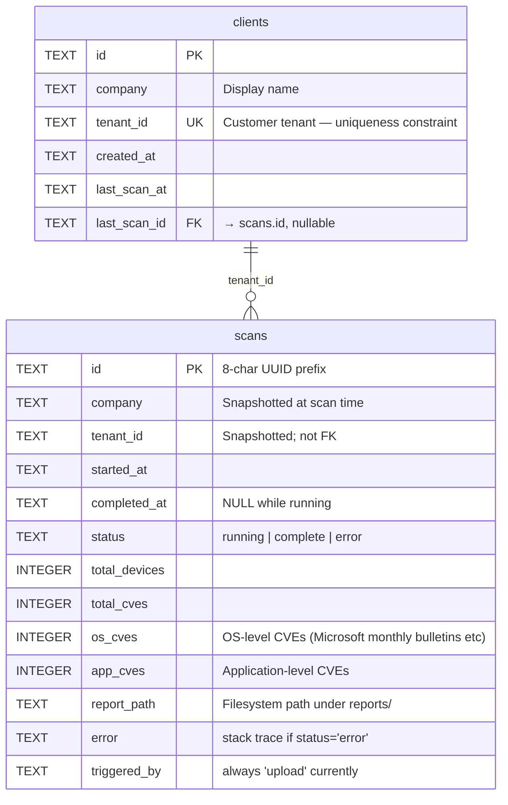

# Database Schema — `dashboard.db`

SQLite file at `/opt/patched-dashboard/dashboard.db` (production) or `<repo>/dashboard.db` (local). Created and migrated by `init_db()` in `main.py` at startup.

> **Known stale (flagged, not fixed, by PAT-802):** this doc documents only `scans` and `clients`. The app has grown well beyond that — the test suite alone touches `report_subscriptions`, `kv`, and others that aren't documented here, and features like Calendly leads, webhooks, ring rollouts, and credentials all imply their own tables. A full schema audit is a bigger job than this docs-refresh ticket scoped for (PAT-802 covered the API/route/screen inventory and testing docs). Treat `init_db()` in `main.py` as the only authoritative table/column list until this doc gets a proper pass — worth a follow-up ticket.
>
> **PAT-852 note:** the local `catalogue_suggestions` table (created by earlier PAT-627 code, never documented here) is retired — `init_db()` no longer creates it. The discovered-app review queue and its state are now derived entirely from patched.im's platform-side `catalogue_products`/`catalogue_platform_targets`/`catalogue_review_audit`/`catalogue_dismissals` tables (PAT-850, Postgres on `example-api-host`), read/written via the `/admin/catalogue/{candidates,products,review,dismiss,revoke}` proxies — not a local SQLite boolean. A pre-PAT-852 box may still have a leftover `catalogue_suggestions` table on disk; it's inert and intentionally left alone rather than dropped.
>
> **PAT-847 note:** the local `catalogue_mirror_approvals` table (created by earlier PAT-500/794 code, never documented here) is retired the same way — `init_db()` no longer creates it, and `PUT /admin/catalogue/{label}/mirror-approval` (the route that wrote to it, plus the Apps-tab "EULA approved" checkbox that called it) is gone too. It was an operator-toggled approval flag that fed nothing else once PAT-852 made the catalogue's "queued" badge platform-state-derived instead — display-vestige only by the time it was removed. A pre-PAT-847 box may still have a leftover table on disk; harmless, intentionally left alone. This is unrelated to the still-live, still-deprecated `catalogue_apps.mirrored` column and its `PUT /admin/catalogue/{label}/mirrored` route, which were untouched by PAT-847 (PAT-2249 later retired both; see below).
>
> **PAT-2249 note — `catalogue_apps` and the `catalogue_hosting_*` tables are dead, not dropped:** the local Software Catalogue (`catalogue_apps`, PAT-500/1349) and its PAT-960 hosting-operations companions (`catalogue_hosting_reviews`, `catalogue_hosting_events`, `catalogue_hosting_messages`) were retired with the catalogue review, hosting and discovery pipeline. `init_db()` no longer creates, alters or seeds them, and nothing reads or writes them, including the admin Logs feed, which no longer offers a catalogue-hosting source. A box that ran earlier code still has the tables and their rows on disk; they are intentionally left alone rather than dropped, the same as `catalogue_suggestions` and `catalogue_mirror_approvals` above, and remain queryable directly if the hosting correspondence history is ever needed.
>
> **PAT-866 note — `public_scans` and `public_uploads` are dead, not dropped:** these two tables backed the anonymous public CVE-scan / Intune-upload funnel (`public_router.py`, PAT-233), removed under PAT-866 because an unauthenticated, internet-facing surface should not share a process with the staff console. The replacement, `scan.patched.im` (portal repo, `scan/`), has its own separate SQLite — it does not write to this database. Both tables remain in `init_db()` here and on disk with their existing rows intact (irreplaceable historical data, deliberately not dropped), but nothing in this process writes new rows to either any more. `_cleanup_old_public_uploads()` / `_public_retention_sweep()` (`shared.py`) still run on the existing schedule and continue purging rows/files past `PUBLIC_RETENTION_DAYS`, so both tables will empty out naturally over time rather than being actively backfilled.
>
> **PAT-1196 note — the staff route that read `public_scans` is gone too:** `GET /admin/monitoring/public-scans` (`main.py`) used to expose historical status counts/errors/abuse signals from this table. PAT-1196 removed the route itself (not the data): confirmed no console tile ever called it and no test covered it, so it was dead code rendering an increasingly stale snapshot rather than a feature anyone used. The table's rows are untouched and still queryable directly (`sqlite3 dashboard.db "SELECT ... FROM public_scans"`) if pre-PAT-866 scan-funnel history is ever needed again.

The two original tables (still accurate as far as they go):



## `scans`

Records of CVE assessment runs. One row per `POST /api/scan/upload` invocation. The `report_path` field points at the generated `.docx` under `reports/` — served by `GET /api/scan/{id}/download`.

| Column | Type | Default | Description |
|---|---|---|---|
| `id` | `TEXT PRIMARY KEY` | — | 8-char prefix of a UUID4 (e.g. `a3f9b2e1`). Surfaced in URLs. |
| `company` | `TEXT NOT NULL` | — | Display name at the time of the scan. Snapshotted — renaming the client later doesn't rewrite history. |
| `tenant_id` | `TEXT` | `''` | Historical — held the Entra ID tenant under the retired Graph pipeline. Always `''` for `'upload'`-triggered scans (no tenant credentials involved). Not a foreign key. |
| `started_at` | `TEXT NOT NULL` | — | ISO-8601 UTC. |
| `completed_at` | `TEXT` | NULL | ISO-8601 UTC. NULL while `status='running'`. |
| `status` | `TEXT` | `'running'` | One of: `running`, `complete`, `error`. |
| `total_devices` | `INTEGER` | `0` | Devices included in the scan (post-filter). |
| `total_cves` | `INTEGER` | `0` | Total unique CVEs found across all devices. |
| `os_cves` | `INTEGER` | `0` | OS-level CVE count. Populated by `scanner.py`. |
| `app_cves` | `INTEGER` | `0` | Application-level CVE count. |
| `report_path` | `TEXT` | NULL | Absolute path to the generated `.docx`. NULL until `status='complete'`. |
| `error` | `TEXT` | NULL | Captured exception message when `status='error'`. |
| `triggered_by` | `TEXT` | `'manual'` | Currently always `'upload'` (`POST /api/scan/upload`). Column kept for scan-history continuity from the retired Graph pipeline's `'manual'`/`'schedule'` values. |

**Writers:** `start_upload_scan` (POST /api/scan/upload) inserts and the background thread later UPDATEs to set completion/error fields.
**Readers:** `get_metrics`, `download_report` (via LEFT JOIN on `last_scan_id` where relevant).
**Retention:** unlimited. Pruning is manual — the table grows roughly one row per upload scan.

## `clients`

Core CRM table — billing tier, onboarding state, contacts, agent config, digest schedules, and (historically) scan bookkeeping. One row per customer tenant, keyed by the UNIQUE `tenant_id`. Rows are created via the onboarding/account routes, not by scanning — the upload-based CVE scan path (`POST /api/scan/upload`) is anonymous and writes no `clients` row.

| Column | Type | Default | Description |
|---|---|---|---|
| `id` | `TEXT PRIMARY KEY` | — | 8-char UUID4 prefix. |
| `company` | `TEXT NOT NULL` | — | Display name. |
| `tenant_id` | `TEXT NOT NULL UNIQUE` | — | Customer tenant ID. UNIQUE — the natural key used throughout the non-scan CRM code (billing, onboarding, agent config, digests). |
| `created_at` | `TEXT NOT NULL` | — | ISO-8601 UTC, set on insert. |
| `last_scan_at` | `TEXT` | NULL | Most recent scan's `completed_at`. Historical — the upload scan path doesn't write a `clients` row, so this no longer updates in the current flow. |
| `last_scan_id` | `TEXT` | NULL | Implicit foreign key into `scans.id`. |

Plus ~35 further columns (not itemised here — see `main.py`'s `init_db()` for the authoritative list) covering cert-digest config, agent config tier/proxy, business/contact fields, stale-endpoint digest config, billing fields, and the bootstrap loader's update channel. This is the core CRM table; treat `main.py` as source of truth over this doc for the full column set.

**Writers:** the onboarding/account admin routes (`admin_account_post` and friends).
**Readers:** the various tenant/account/billing/digest routes and scheduler ticks that key off `tenant_id`.

**PAT-572 (Microsoft Graph scan pipeline removed):** `client_id`, `client_secret`, `secret_expiry`, `schedule_enabled`, and `next_scan_at` — the Entra ID app-registration credentials, secret-expiry tracking, and weekly auto-scan scheduling columns — were dropped via a real `ALTER TABLE ... DROP COLUMN` migration (not just a schema-file edit), specifically to wipe the plaintext `client_secret` values that had been sitting in the production DB. `tenant_id` was kept — it's the CRM natural key, unrelated to Graph.

## `service_engagements`

One current consultancy operating snapshot per customer. `tenant_id` is the primary key. `service_name` is exactly one of `Endpoint Assurance`, `Managed Patching`, or `Full Endpoint Management`; it is deliberately independent of `clients.billing_tier`, agent configuration and entitlement enforcement. The row also stores the accountable specialist, agreed cadence, posture-review status/next date, and an active 90-day plan snapshot. Decisions, owners and accepted exceptions are bounded JSON string arrays. Project and escalation references are bounded JSON arrays of `{label,url}` links only, so delivery work remains in its source system rather than becoming a second task store. Executive outcomes are not stored here; the Account UI derives them from current Needs Attention, report-record and software-metering evidence.

**Writers:** `PUT /admin/tenants/{id}/service-engagement`; confirmed owner-only `DELETE` removes an incorrect or no-longer-applicable snapshot without touching technical tier or entitlement. Only authoritative `DELETE /admin/tenants/{id}/purge` status 200, the platform contract's synchronous terminal success, deletes the dashboard-local snapshot; 202 and every other status preserve it. Reversible offboard/revoke (`DELETE /admin/tenants/{id}`) preserves it for restore; startup and failed/redirected purge never delete it. A successful local purge cleanup audits the full engagement before and JSON `null` after. If post-purge local cleanup fails, the upstream 200 remains authoritative, the response carries `X-Patched-Local-Cleanup: service-engagement-failed`, and the dashboard emits a critical tenant-scoped diagnostic. The owner-only, confirmation-gated `DELETE /admin/tenants/{id}/service-engagement/orphan` repair route retries that cleanup only after the tier-gated tenant-specific allowlist lookup returns exactly its documented `application/json` 404 body `{"error":"tenant not found"}`. Gateway, router, proxy and non-canonical 404 responses fail closed. A 200 or 403 proves the tenant exists; every other status is unprovable. After external absence proof, repair re-reads the snapshot in a write transaction and uses a version-qualified conditional delete; any concurrent replacement or lost-update row count fails closed without deleting or auditing the wrong row. The ordinary service-engagement DELETE retains its client-presence 404 boundary.
**Readers:** `GET /admin/tenants/{id}/service-engagement` and the Account Service engagement view. Owner-only audited `GET /admin/tenants/{id}/service-engagement/orphan` exposes the complete retained snapshot only after the same strict platform-absence proof, including after the local client row has gone, so an operator can inspect it before repair.

## Migrations

`init_db()` runs every time the service starts. The strategy is **idempotent CREATE TABLE IF NOT EXISTS + per-column ALTER TABLE inside try/except**, plus (since PAT-572) guarded `DROP COLUMN` blocks for columns being retired. From `main.py`:

```python
for col, definition in [
    ("triggered_by", "TEXT DEFAULT 'manual'"),
    ("tenant_id", "TEXT DEFAULT ''"),
]:
    try:
        db.execute(f"ALTER TABLE clients ADD COLUMN {col} {definition}")
    except: pass
    try:
        db.execute(f"ALTER TABLE scans ADD COLUMN {col} {definition}")
    except: pass

# PAT-572: drop retired Graph columns from an existing on-disk DB.
_graph_cols = {r[1] for r in db.execute("PRAGMA table_info(clients)").fetchall()}
for col in ("client_id", "client_secret", "secret_expiry", "schedule_enabled", "next_scan_at"):
    if col in _graph_cols:
        try:
            db.execute(f"ALTER TABLE clients DROP COLUMN {col}")
        except Exception as _drop_err:
            print(f"[init_db] Could not drop clients.{col} (SQLite < 3.35?): {_drop_err}")
```

To add a new column: append a tuple to the ADD-COLUMN list and ship. The bare `except: pass` is intentional — SQLite raises `OperationalError` when the column already exists, which is the steady-state case after the first deploy. `DROP COLUMN` needs SQLite 3.35+; each drop is individually try/excepted so an older SQLite fails soft rather than crashing startup. No migration framework, no rollback. If you need a column rename or type change, write a manual SQL migration (table-swap pattern) — SQLite's ALTER TABLE doesn't support those operations directly.

## Removed tables (historical)

The dashboard previously contained a `leads / contracts / recruiters` CRM surface (Jarvis Job Scout overlap). Removed. Tables may still exist on the production DB until manually dropped — see [HARDENING-SUMMARY-.md](../HARDENING-SUMMARY-.md) and the deploy notes for the DROP TABLE commands.

**Don't confuse this with the current `GET /api/leads`** (see `docs/API_REFERENCE.md`) — that's a newer, narrower Calendly-integration feature (`calendly_leads` table) unrelated to the removed CRM surface above. It re-uses the `leads` word but not the removed schema.
