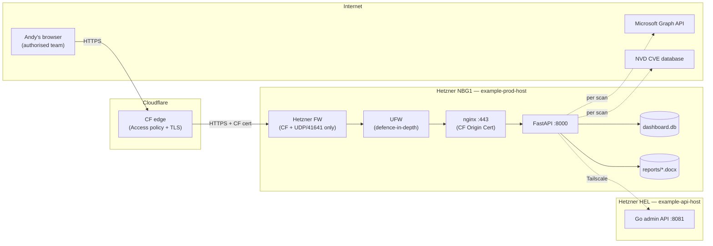

# Dashboard architecture — dashboard.patched.im

**Status:** Final (lifted from Draft after CVE Report downloads verified end-to-end and edge hardening complete)
**Build started:** (approximate — initial scp deploy to `/opt/patched-dashboard`)
**Build complete:** `dashboard.patched.im` live behind Cloudflare Access, three-layer network filtering in place, CVE scan + report download verified end-to-end
**Last enhanced:** Per-OS master switch controls deployed; admin UI restructured into macOS/Windows platform sections with master switch toggles; proxy routes for `tenant-platforms` wired up
**Working notes (source of truth during build):** `github.com/Patched-LTD/dashboard` repo, `HARDENING-SUMMARY-2026-11-14.md` and `CLAUDE.md` in repo root

_Migrated from Notion: https://www.notion.so/360054a7591881c19da5deb43780d3b1_

---

## Current state

> **Single source of volatile state.** This block is the canonical production snapshot for `dashboard.patched.im` — current commit and what is live. Claude Code (and Cowork) rewrites it at the end of every production-changing session. **Update this block on every deploy;** the architecture sections below change only when the architecture changes. The rolling cross-cutting log lives in the Working state Linear Document.

**Verified deploy: 2026-10-05, 10:57:37 UTC (PR #535, PAT-2408; run 37299802897; commit `06f9fdbda5ae71e9d0db0b98f5df68b692943940`)**

- **Live:** `06f9fdbda5ae71e9d0db0b98f5df68b692943940` on `example-prod-host`; `DEPLOYED_SHA` matches. `CONSOLE_BUILD_ID` is unchanged (no template or static change); `patched-dashboard.service` is active with no tracebacks after restart.
- **What changed:** `/docs`, `/redoc` and `/openapi.json` are off unless `DASHBOARD_ENV` is dev or local and `DASHBOARD_ENABLE_API_DOCS=1`. Every route taking a tenant id refuses anything but a canonical lowercase UUID before any upstream call, every caller-influenced upstream path segment is percent-encoded, and the platform client refuses an upstream path holding a dot-segment (PAT-2408).
- **Installed evidence:** `main.py` on the box carries `_require_canonical_tenant_id`; the three docs routes answer 404 on the live service.
- **Not yet proven in production:** the tenant-id refusal has not been exercised with a staff session. Without one the hostile forms answer 401, which does not reach the new check.

**Historical verified deploy: 2026-10-04, 17:43:00 UTC (PR #534, PAT-2404; run 37221538382; commit `5933dadcab62f3805dc5bfe1dc1c571c8ce4556c`)**

- **Live:** `5933dadcab62f3805dc5bfe1dc1c571c8ce4556c` on `example-prod-host`; `DEPLOYED_SHA` matches. `CONSOLE_BUILD_ID` is `2026-10-04-pat2404`; `patched-dashboard.service` is active with no error-level log lines after restart.
- **What changed:** the Software identities screen and its four `/admin/software-catalogue/*` proxies to the platform (PAT-2404). The console stores nothing for it.
- **Installed evidence:** `main.py` on the box carries the new routes, `static/js/console-software-identities.js` is present, and `console.css` carries the screen's rules. The platform routes it proxies are live on `example-api-host` at `1813d524`.
- **Not yet proven in production:** no staff member has opened the screen or reviewed an identity through it. The rendering evidence is from a fake platform at 1280px, 1440px and 390px before deploy.

**Historical verified deploy: 2026-10-04, 03:40:08 UTC (PR #532, PAT-2374; run 37174695682; commit `74a43c5ad8fda748d0f7a7281c3af3b08f145f9a`)**

- **Live:** `74a43c5ad8fda748d0f7a7281c3af3b08f145f9a` on `example-prod-host`; deploy run 37174695682 completed at 03:40:08 UTC and the receipt records deployment at 03:40:02 UTC. `CONSOLE_BUILD_ID` is `2027-04-04-pat2374`; `patched-dashboard.service` is active with zero restarts. The deployed tracked checkout is clean; the pre-existing untracked `shared.py.bak-<timestamp>` is preserved.
- **Installed evidence:** all 12 installed runtime hashes match the reviewed source. The actual versioned console and health endpoint returned 200; the anonymous service endpoint returned 401. All eight byte-verified served assets returned 200 and matched their recorded hashes. The captured overview response contained five rows. The first two account GETs returned 404 with empty bodies, so those accounts remain unavailable and are not prospects. The service-exception response is partial across 11 categories with six exceptions and `Cache-Control: no-store`, not an all-healthy result.
- **PAT-2374 boundary:** the tenant directory preserves source device-reporting counts and unknown findings. Existing server-side authorisation, confirmation and audit controls remain in force. This receipt and offline rendering do not establish a named staff identity, successful live authentication, an account workflow, or lifecycle write proof.
- **Installed rendering:** offline Chromium 148 rendered 32 captures from the actual installed HTML and GET responses at 1440px and 1024px in light and dark themes. The eight served assets were byte-verified; 27 additional local supporting assets are recorded separately and are not claimed as installed hashes. There were no external requests, page errors or overflow. Eight automatic telemetry POSTs were blocked by the offline harness with 405; no live writes occurred. Two harness assertions initially failed on unavailable-state text/title and the Home selector; the harness criteria were corrected to match the installed source. No product code changed for those corrections.
- **Verification:** the frozen parent suite reported 49 checks with 15 failures and 34 controls, plus seven nullable checks with four failures and three controls. The current focused suite is green across 177 checks (49+12+7+109); the full suite has 2,665 unit tests with zero skips. Node 370, E2E 7, parity 22, navigation 6, rollback and Ruff passed. Final NVIDIA review covered all 32 changed files in three chunks and returned no findings; the earlier 31-file review's 16 observations were adjudicated, including one actionable nullable-state defect that was fixed.
- **Adjacent installed scope:** the Support/Feedback frontend is now deployed on portal commit `3166121e741815f0efe65a83c7be5eae0e25485b` by workflow run 37174067792. Its 20-page walk found only the expected local-admin 403. No submissions or customer messages were sent; the original customer-linked PAT-2347 ticket remains unchanged. Certificate functionality is deployed across the API, portal and staff dashboard; the final authorised administrator upload remains owner-blocked. PAT-1967 support-access authority remains unimplemented and disabled, with no impersonation. Integrated real named-staff/two-tenant acceptance PAT-2375 remains on hold. PAT-2380 remains paused with owner holds. Public-scan retirement remains assessment only; no service was turned off.

**Historical verified deploy: 2026-10-04, 02:16:19 UTC (PR #530, PAT-1966; run 37170498692; commit `27042cd1dc8dbcc7d739880a19efb7e8f19e0dfa`)**

- **Live:** `27042cd1dc8dbcc7d739880a19efb7e8f19e0dfa` on `example-prod-host`; the installed receipt matches the commit at 02:16:19 UTC, the tracked checkout is clean, and `patched-dashboard.service` is active with zero restarts. The approved deployment workflow succeeded.
- **What changed:** PAT-1966 adds the Work/Home surface for the installed read-only service-exception feed. Backend PR #723, merge `8c48c03256707bb19a3b15695c7a82ea5c98d416`, was installed by run 37164336269; the dashboard proxy combines its bounded source evidence with recorded local checks. The installed response reports partial coverage across 11 categories and 6 exceptions with `Cache-Control: no-store`; this is not an all-healthy result. No customer messages were sent and no provider activation or write occurred. PAT-2373's Brand v3 operator shell from commit `26e5aa9576f6a55633d5fbc7e9d76f68670a9e47` (run 37166085497, 00:49:19 UTC) remains installed beneath it.
- **Installed hashes:** all nine installed files match the deployed revision. `main.py` `52c95f05f225ca48b1825936c91084fa00cd5dfbb25a17416907d58d65acbdc3`; `shared.py` `e83a08d674d9e72d25883e718fa779f3e4163390e2377848a5704034da4a9fea`; `service_exceptions.py` `690b27bc9424f5f3f339976db5fea9fc1082b95a233598271b8a2989a6a7165e`; `templates/console.html` `b66648305a2e6325c9580477aba4cc2947ff4d7596bdd8ea416e1d380a900975`; `static/css/service-exceptions.css` `70efaaf4f83486719387769bd04a29e6bb318ab9cc4e703a2c8568196c5469c2`; `static/js/console-service-exceptions.js` `1fd9a414727c5884412736ba950324d2221d3fd863d15b893c672a8a6ec92e45`; `static/css/operator-shell.css` `5c7fbb4cd6b78912548ad852db633b8357fd981c301d54808d167f79462af9e2`; `static/js/console-shell.js` `a394ec7aa045ad56ca396b8bbc04a443eaeab58de581443556dbcbb7b08b1311`; `static/vendor/brand/tokens.css` `6c3d97c61a462b1bf65022550bc2e4a90c5ea4fab25ff338c072c28f64d0fba6`. All five served static assets returned 200 and byte-match their installed files.
- **Installed checks:** actual `/console/2026-10-04-pat1966` returned 200; read-only health and service proxy returned 200, and anonymous service access returned 401. Offline Chromium 148 rendered the captured installed HTML, assets and read-only feed in 20 cases across five sections, 1440px/1024px and light/dark themes, with no overflow, page errors, non-GET or external requests. This verifies rendering of captured installed responses; it does not prove a named staff identity or browser authentication.
- **Deferred scope:** tenant directory PAT-2374 is not deployed; short-lived support-access authority PAT-1967 remains unimplemented, and the separate Support/Feedback frontend is not deployed; integrated route acceptance PAT-2375 is deferred. Certificate functionality is installed across the API, portal and staff dashboard, but real administrator upload, replacement, removal and audit proof remain owner-blocked under PAT-2389. PAT-2380 remains paused with owner holds. Public-scan retirement is assessment only; no service was turned off. No private tenant data or identities are recorded here.

**Historical verified deploy: 2026-10-03, 22:45:38 UTC (PR #526, PAT-2389; run 37159489433; merge `29d71c9e2ae3947b29185f216ca02afd2685acb2`)**

- **Live:** `29d71c9e2ae3947b29185f216ca02afd2685acb2` on `example-prod-host`; `DEPLOYED_SHA` and checkout HEAD match. The deploy receipt records all five installed SHA-256 values for `main.py`, `certs.py`, `templates/certs.html`, `templates/cert_digest_email.html` and `templates/cert_digest_email.txt`; each matches this reviewed feature tree. `patched-dashboard.service` is active since 22:45:36 UTC.
- **What changed:** read-only staff certificate inventory at `/certs`, with expiry calculated from current UTC and explicit unknown handling. `CONSOLE_BUILD_ID=2026-09-30` remains unchanged because this feature changed no console template or CSS. Existing digest cadence, preferences, recipients and dry-run behaviour are unchanged; no messages were enabled or sent.
- **Installed checks:** AST-extracted installed expiry helpers passed synthetic uploaded, agent and unknown cases; installed staff HTML and digest HTML/text rendered escaped synthetic labels and explicit unknown states. The installed route's session check precedes its upstream request; unauthenticated `/certs` returned 401 before upstream access. These checks do not establish an authenticated staff view against a real tenant or real message delivery.
- **Scope:** backend `Patched-LTD/patched.im` PR #721 (`de33f825`, migration `0223_manual_certificate_expiry`) was installed by deploy run 37158837260. The customer portal PR #235, merge commit `ba881d33b2ed69da1c40c20f138d5f27925b0b60`, was deployed by run 37162108252 at 23:38 UTC; seven runtime hashes and four read-only walkthrough pages passed. Real administrator upload, replacement, removal and audit proof remain owner-blocked; PAT-2389 remains open and is not complete.

**Verified deploy: 2026-10-03, 21:14:32 UTC (PR #524, PAT-1990; run 37154381567)**

- **Live:** `4f5310879ff3eb84c94f87ed0adc09242ad0b44c` on `example-prod-host`; installed `main.py` matches the checkout, the service is active with zero restarts and the root responds 302.
- **What changed:** the approved welcome body offers help via reply or `support@patched.im`, and explains each colleague needs their own named access. All other wording, confirmation, recipient checks, audit and delivery controls remain intact.
- **Verification:** 81 welcome tests and the full 2,541-test dashboard suite passed; NVIDIA reviewed the complete two-file patch, with its findings adjudicated against the executable renderer. Installed literal/function rendering with synthetic identity passed for both text and HTML. The live process has the configured PIN sender (masked), and its environment file is `root:root 0600`.
- **Bounded route proof:** authenticated read-only `welcome-context` returns 200 and refuses a synthetic invalid recipient. This stops before membership and Cloudflare checks, so it does not prove real recipient authorisation or delivery readiness. No welcome message was sent and no provider setting or credential was changed.

**Verified deploy: 2026-10-03 (PAT-2354 report/digest emails; PR #522, workflow 37152766896)**

- **Live:** `840089d9a315fcce17282a3b3807ebb58241f451` on `example-prod-host`; approved deploy workflow completed successfully. Service active, zero restarts, started at 20:47:21 UTC; localhost `/` returned 302.
- **What changed:** certificate/stale digests, PDF attachments and scheduled XLSX emails share the email-safe brand wrapper and readable estate/report/date subjects. Report data, recipients, authenticated link identities and send controls are retained. Public scan mail is inventoried and excluded pending retirement; no public scan activation or customer sends occurred.
- **Operating evidence:** installed `report_email.py` SHA-256 `0682327231d2e872338eb3ea81487b027423a506a3b0ccdb8e748733013a0ee0` matches reviewed source. Using the installed service Python, a separate process with a minimal allowlisted environment, bytecode disabled and sockets forbidden rendered all four shared template families with synthetic data; readable subjects, current colours and raw-UUID fallback checks passed. No app startup, production database access, provider call or delivery was invoked. This proves installed rendering, not inbox receipt. Parent local checks passed 2530 Python tests, 343 console tests, focused147 and CI all3; NVIDIA review findings were adjudicated against source/tests.
- Existing legacy untracked `shared.py.bak-<timestamp>` was present before deploy and preserved. The workflow deploys merged main, including PAT-2372's local design-contract artefacts; it does not activate that preview as the production console.

**Verified deploy: 2026-09-30, afternoon (PR #520, PAT-2312: the retired patched login removed; runs 36694157449, 36694252822)**

- **Live:** `4c75a8412bb77f21ca7bbadfe1f2fa7d091de30e`, and `DEPLOYED_SHA` matches.
- **What changed:** the manifest removed `/etc/sudoers.d/patched` and the orphan `/var/lib/systemd/linger/openclaw`. `remove_retired_account` removed the `patched` account (uid 1001) and its home, which held a duplicate tunnel credential and an unused cloudflared login cert. The step is guarded: it checks the uid and home, that no process runs as the account, that it owns nothing outside home and tmp, and that each tunnel credential has a copy in `/etc/cloudflared`. **There is no `patched` login on prod-01.** Admin access is `ssh root@example-prod-host` over Tailscale, which the tailnet ACL now allows as `root` only.
- **Operating evidence:**
  - `getent passwd` and `getent group patched` return nothing, `/home/patched` is gone, and `find / -xdev -uid 1001` returns 0.
  - `/etc/sudoers.d` holds only `90-cloud-init-users` and `README`, and `visudo` parses OK.
  - cloudflared, the dashboard and nginx are active, and the app returns 302.

**Verified deploy: 2026-09-30 later (PR #518 PAT-2311, PR #519 PAT-2312; runs 36656938898, 36660066043, 36660130999)**

- **Live:** `245989388304dbf415a23b34582bb60c8d4028d9`, and `DEPLOYED_SHA` matches. The box also carries the patched.im-deployed backup changes (patched.im#695 and #696, PAT-2313/2314), which the push-triggered `deploy-prod01-backup` workflow installs into `/usr/local/libexec/patched-prod-backup`.
- **What changed:**
  - Before the push, `deploy.yml` hash-checks the box's `scripts/deploy.sh` and post-receive hook against GitHub.
  - The manifest removed `/usr/local/bin/patched-deploy.sh`, the legacy in-tree `nvd.db` and `dashboard.db`, the stale sudoers grants (`90-jarvis`, `jarvis-claude`, `patched-deploy`), `/usr/local/bin/jarvis-claude` and the orphan `openclaw` crontab.
  - `sync_box_config` holds `/usr/local/bin/hcloud` at `root:root 0755` and `/etc/ssl/dashboard.patched.im.key` at `root:root 0600`, and installs the prune timer. **A symlink at either path fails the deploy.**
  - The backup now covers the state-dir `reports/`, the nginx site config and the Origin cert and key, and fails on a missing configured path.
- **Operating evidence:**
  - `ls /etc/sudoers.d` shows `90-cloud-init-users patched README`, and `visudo -c` is OK.
  - `hcloud` is `root:root 755`, the key is `root:root 600`, and `nginx -t` is OK.
  - The tree is still 0 non-root. The app returns 302.
  - Backup snapshot `8581c426` contains `/var/lib/patched-dashboard/reports`. Config snapshot `f2d6e05b` holds all five config paths. The restore drill passed.

**Verified deploy: 2026-09-30 (PR #516, PAT-2307 root-owned code tree; also carries #510 PAT-2289, #512, PAT-2249, #513 PAT-2305, #514 PAT-2299 deployed 2026-09-29)**

- **Live:** `d81443566433fdebfc4caee7e8d695ff1c437c1c`. The adopting deploy run `36651815076` (`adopt_code_tree=true`) and the normal deploy run `36651978905` both succeeded, and `DEPLOYED_SHA` on `example-prod-host` matches. `main` has since moved to `4465be6` (PAT-2306, tests only, nothing to deploy).
- **What changed:** `/opt/patched-dashboard` and `/opt/git/dashboard.git` are root-owned with no group or other write. The app writes only to `/var/lib/patched-dashboard` (`StateDirectory`: `dashboard.db`, `nvd.db`, `reports/`). `deploy/code-tree-guard.sh` runs from the runner before the push and before the nginx install, and `scripts/deploy.sh` relocks after every reset. **A normal deploy now fails if anything re-grants www-data;** recover by dispatching `deploy.yml` with `adopt_code_tree=true` (see `deploy/RUNBOOK.md`). The nginx site config is installed only if `nginx -t` passes (PAT-2305).
- **Operating evidence:** after both deploys, `find ! -uid 0` and the group/other-writable count are both 0 across both trees. `runuser -u www-data -- touch` in `scripts/` and in the mirror's `hooks/` is refused. The service is active with `NRestarts=0`, `/` returns 302, and there are no permission errors in the journal. The prune unit carries `REPORTS_DIR=/var/lib/patched-dashboard/reports`.

**Verified deploy: 2026-09-27 (PR #507, PAT-1965 Console product-boundary cleanup)**

- **Live:** `04ab5da4dd255f6fd0a4601dc77bc04e056c8baa`. Deploy run `36309524939` succeeded. On `example-prod-host`, checkout HEAD and `DEPLOYED_SHA` match, the tracked tree is clean, `patched-dashboard` is active with zero restarts, and `CONSOLE_BUILD_ID=2026-09-27a` is live.
- **What changed:** active Console navigation, DOM and routing no longer expose Service engagement, Advisory hours, legacy billing/renewals/charges, leads, deployment catalogue, Patch & Deploy, Application Control, Enforcement Evidence, Runbook or the synthetic Work estate score. Compatibility routes and inert rollback implementations remain. Protected Software and Removal Campaigns now fail closed unless the tenant supplies the explicit boolean capability `removal_capability: true`.
- **Operating evidence:** the versioned `/console/2026-09-27a` route returned `200` and redirected from `/`; its CSS and governance assets carry the same build revision. The live response contains none of the retired selectors, retains the Customers KPI strip, and the service journal has no error or traceback after the deploy.

**Verified deploy: 2026-09-18 (PR #501, PAT-1861 finding dispositions console workflow)**

- **Live:** `a3cd7cf1141f898f70781ecbf5852985cad572e1`. Deploy run `35292938142` succeeded. On `example-prod-host`, `DEPLOYED_SHA` and checkout HEAD match, the tracked tree is clean, `patched-dashboard` is active, and `CONSOLE_BUILD_ID=2026-09-18a` is live.
- **What changed:** the row-level Findings workspace now joins the platform's active disposition records by exact identity, CIS by device plus rule and CVE by tenant-level CVE, and exposes state badges, filters, and owner-only record/supersede actions. The screen performs one disposition list request per load; it does not invent an aggregate disposition for mixed-device CIS control summaries.
- **Operating evidence:** the deployed `console-findings.js` contains the disposition identity helper; a bearer-authenticated request for a real tenant's active dispositions returned `200`; a deliberately invalid disposition POST returned `400` without mutation. The deploy smoke path served `/console/2026-09-18a`, `/api/metrics`, and `/api/smoke/health` successfully.

**Deploy: 2026-09-17 (PR #500, PAT-1830 device-lifecycle/coverage console screen, deployed — 2026-09-17 queue-run batch 4)**

- **Live:** `18301d0d849f40acad2cd0e50f6c0681f00283c0`. Deploy run `35281605973` succeeded. `CONSOLE_BUILD_ID=2026-09-17j` matches the checkout.
- **What changed:** new "Coverage" tab surfaces PAT-1595's six-state device classification and three-bucket reconciliation for a tenant — bucket-count cards from the platform's own tally, read-only thresholds, upload info, filterable/sortable device table. No new proxy route — reuses the `device-lifecycle` route already live since PAT-1595. Wires PAT-1607's "See coverage" link (previously plain text).
- **Operating evidence:** on-box — baseline bogus route returns FastAPI's `{"detail":"Not Found"}`; the real `device-lifecycle` proxy route reaches the platform and gets a genuine validation error (400), confirming the data path. `GET /static/js/console-device-lifecycle.js` → 200, deployed file contains the real function bodies.

**Deploy: 2026-09-17 (PR #499, PAT-1635 unify the five Slack senders behind one formatter, deployed — 2026-09-17 queue-run batch 4)**

- **Live:** `27317b8e57b4699ecd2edd0e453dea78280c3e1e`. Deploy run `35268497305` succeeded. No `templates/console.html`/`static/css/*` changes — no `CONSOLE_BUILD_ID` bump needed.
- **What changed:** all five Slack alert senders (`_send_check_status_alert`, `_run_automation_alerts_tick`'s failure/staleness paths, `_run_automation_digest_tick`, `_send_health_alert`, `_send_portal_auth_alert`) now compose through one shared `_build_alert_blocks`. Fixes a raw `datetime.timedelta` repr reaching rendered text, mid-word truncation in the digest, and three maintenance checks printing an identical body three times in one digest (now deduped). Two-level severity (`critical`/`warning`) keys the icon; `resolved` is orthogonal and always renders a checkmark.
- **Not yet operating evidence:** unlike PAT-1634/PAT-1636 there's no manual trigger for the automation digest tick or a `check_statuses` transition — both fire on their own schedule. Deployed + full local suite green (2132 passed) is evidence the code is correct, not yet evidence it has fired in production. Pending the next real digest or a real check-status transition.

**Verified deploy: 2026-09-17 (PR #498, PAT-1609 disposition queue console screen, deployed — 2026-09-16/17 queue-run batch 4)**

- **Live:** `dc25822482e1195f22bbb0369adb4d2e10c68663`. Deploy run `35261627256` succeeded. `CONSOLE_BUILD_ID=2026-09-17i` matches the checkout; `DEPLOYED_SHA` matches HEAD.
- **What changed:** new console screen — the disposition queue (cohort-aware bucket filters, evidence panel, append-only decision recording via `device-dispositions`), against `05-disposition-queue.html`/panel 4 empty states. Cohorts group only on genuinely-available signals (`state` + calendar-day of `last_seen`), never a fabricated subnet field. Proxies `GET/POST /admin/tenants/{id}/device-dispositions` (PAT-1836/PAT-1825 on the platform side).
- **Operating evidence:** on-box — a bogus route returns FastAPI's own `{"detail":"Not Found"}`; the real route (`GET /admin/tenants/xyz/device-dispositions`) reaches the proxy and gets a genuine upstream validation error (`tenantID must be a UUID`, 400), proving end-to-end wiring rather than a 404 fallthrough.
- **Batch note:** this deploy also brings live PR #497 (PAT-1612, removal campaign console screen — list/dry-run/authorize, proxying PAT-1598's platform endpoints, `CONSOLE_BUILD_ID=2026-09-17h`), which had already reached prod in an intermediate deploy this session but had not yet received its own dated block here. Both are individually verified operating and closed Done in Linear.

**Verified deploy: 2026-09-17 (PR #496, PAT-1820 protected software list console surface, deployed — 2026-09-16/17 queue-run batch 4)**

- **Live:** `08013452f180547aed80fd0d45c6df93184dc24c`. Deploy run `35245135486` succeeded. `CONSOLE_BUILD_ID=2026-09-17g` matches the checkout; `DEPLOYED_SHA` matches HEAD.
- **What changed:** new console tab — the effective per-tenant protected-software set (baseline rows vs tenant additions), add/override-remove forms, and the audit changelog, proxying PAT-1823's platform GET endpoints. Registers the override-remove proxy in the `X-Confirm-Resource` echo-back gate.
- **Operating evidence:** on-box, with a valid bearer token — a bogus route returns FastAPI's own `{"detail":"Not Found"}` (404); the real route (`GET /admin/tenants/xyz/protected-software`) reaches the proxy and gets a genuine upstream validation error (`tenantID must be a UUID`, 400) — proves end-to-end wiring, not a 404 fallthrough.
- **Batch note:** this deploy also brings live everything merged since the last recorded entry below (`4ded844`) that hadn't yet gotten its own dated block here — PAT-1741, PAT-1599, PAT-1809, PAT-1810, PAT-1813, PAT-1811, PAT-1819, PAT-1812, PAT-1607, PAT-1606 — each already individually verified operating on this box and closed Done in Linear (with its own on-box evidence recorded as a Linear comment) at the time it shipped. Recorded here as one consolidated catch-up entry rather than back-dating individual blocks for deploys this doc's rolling log missed during a fast queue-run sequence.

**Verified deploy: 2026-09-16 (PR #485, PAT-1796 Ubuntu Pro attachment availability, deployed)**

- **Live:** `4ded844d2a234dc80f1a9af3808fc9974bd5367a`. Deploy run `35083379717` succeeded. On `example-prod-host`, checkout HEAD and `DEPLOYED_SHA` match, `patched-dashboard.service` is active, and the hardened maintenance facts unit completed successfully with `pro_attached: true` and `esm_updates: 0`.
- **What changed:** the maintenance collector uses the bounded Ubuntu Pro attachment API instead of the full status command. Failed or malformed observations remain `null`; only a confirmed detached response becomes `false`. The dashboard records unavailable evidence as `unconfigured`, never as the false finding “Pro not attached”.
- **Operating evidence:** after all three collectors were deployed and executed, `maintenance_api01`, `maintenance_prod01`, `maintenance_portal01`, `tick_maintenance_drift_check` and `tick_maintenance_prod01_fast` were re-evaluated at `2026-09-16T10:14:14Z`. None contains “Pro not attached” or “Pro attachment status unavailable”; remaining degraded reasons are independent package/config-maintenance findings.

**Verified deploy: 2026-09-13 (PR #482, PAT-1613 correction action + frozen findings, deployed; plus PAT-1712 env fix)**

- **Live:** `55a48a0`. Deploy run `34785810331` (success). On `example-prod-host`: git HEAD `55a48a0`, `CONSOLE_BUILD_ID = "2026-09-13d"`, `patched-dashboard` active, `_evdIssueCorrection` present in the live `templates/console.html` and `findings_total` handling in `static/js/console-evidence.js`. Pre-deploy: box at `e90ade4` (build `2026-09-13c`), which `origin/main` contained.
- **What changed:** the Evidence tab can issue a correction (`supersedes_report_id`, same coverage guard, original content type and period) and renders "Findings then" from the frozen `coverage_snapshot`. Backend was PAT-1685 on api-01.
- **Config change, same session (PAT-1712):** `CLOUDFLARE_ACCESS_APP_ID` in `/etc/patched-dashboard/dashboard.env` now points at the recreated `app.patched.im` Access app (`781413d3-…`); backup at `dashboard.env.bak-pat1712-*`. `check_statuses.portal_auth` = `ok` at 2026-09-13T21:36:42Z.
- **Not yet operating evidence:** no correction has been issued from the live console (needs a signed-in session); tracked on PAT-1613.

**Verified deploy: 2026-09-13 (PR #481, PAT-1716 — nightly uninstall E2E heartbeat receiving side, deployed)**

- **Live:** `e90ade41ae6db0f41dac179b50e8e4d035d7b2bf`. Deploy run `34774460341` (success). `DEPLOYED_SHA` on `example-prod-host` reads that commit, `DEPLOYED_AT=2026-09-13T18:23:38Z`, `patched-dashboard.service` active since 19:23:36 BST, `NRestarts=0`, no `-p err` journal lines. Pre-deploy: box was at `1cb83c6` with a clean tracked tree.
- **What changed at runtime:** new `nightly_job_results` table (created by `init_db()`), `POST /admin/nightly-checks/report` behind the existing session-or-Bearer middleware, and an hourly `nightly-uninstall-checks` scheduler tick. Two new Operational Truth rows, verified on the box via loopback `GET /admin/check-status`: `nightly_uninstall_e2e_macos` and `nightly_uninstall_e2e_windows`, both `unconfigured` ("no nightly result has ever been recorded"), and `tick_nightly_uninstall_checks` `ok`. The route answered an unregistered job with 400 and an unauthenticated POST with 401; no result row was written.
- **Not yet operating evidence:** no nightly job reports yet. The senders (PAT-1714/PAT-1715) are blocked on the missing `UPDATER_CHECKOUT_TOKEN` secret on `Patched-LTD/patched.im`.
- **Open on the box:** `/etc/patched-dashboard/dashboard.env` has a `TURNSTILE_SECRET` value wrapped in literal angle brackets that is not valid shell syntax; the dashboard code does not read that variable (raised with Andy, not changed).

**Verified deploy: 2026-09-13 (PRs #479 + #480 — PAT-1698 pinned requirements + ruff gate, PAT-1701 design PNG removal, deployed)**

- **Live:** `1cb83c6e021b795ecdf101831901bbf9f7cdfdca`. `DEPLOYED_SHA` on `example-prod-host` reads that commit, `DEPLOYED_AT=2026-09-13T16:12:10Z`, `patched-dashboard.service` active, `NRestarts=0`. Deploy run `34767789052`, confirmed by SSH read of `DEPLOYED_SHA` and `git log -1` in `/opt/patched-dashboard`.
- **What changed at runtime:** nothing functional. `requirements.txt` is now pinned to the versions the venv already ran (post-receive `pip install` was a no-op; venv still `fastapi==0.136.1`, `uvicorn==0.46.0`, `cryptography==49.0.0`). `ruff check .` gates CI. `docs/design/pat-1047/*.png` removed from the tree.
- **Unrecorded deploys in between:** `df2b428` (PAT-1615, run `34764992639`) and `08d28de` (PAT-1690, run `34766136254`) deployed on 2026-09-13 without updating this block; both are ancestors of `1cb83c6`.
- **Open on the box:** the portal-auth monitor logs Cloudflare `404 unknown_application` at startup (PAT-1712), pre-dating this deploy.

**Verified deploy: 2026-09-11 (PR #468, PAT-1562 follow-up — Work page empty-state fix, deployed)**

- **Live:** `7fe05925aa6f4873e1206f7ea6a585fbe9f30905`. `DEPLOYED_SHA` on `example-prod-host` reads that commit, `DEPLOYED_AT=2026-09-11T14:04:59Z`, `patched-dashboard.service` active. Deploy run `34607979214`, confirmed on the box by SSH read of `DEPLOYED_SHA` and a grep of `home-verdict-empty` in the live `templates/console.html`.
- **Why:** immediately after PR #467 deployed and this session ran PAT-1562's data step (all 6 known tenants flipped to `tenant_kind='internal'`), Andy reported the Work page "looks worse" — the actual live state (zero real customers) wasn't one the original design accounted for: Customer attention collapsed to "No customers yet." with the only real content hidden in a collapsed `
`, nothing auto-selected into the inspector, and Estate posture showed its header with nothing rendered underneath.
- **What changed:** the internal-tenant section now opens by default and auto-selects its first row into the inspector whenever `customerTenants.length === 0` (unchanged once any real customer exists). Estate posture shows an explicit "No customer data yet." message via a new sibling element (`#home-verdict-empty`) rather than overwriting `#home-verdict`'s static, ID-addressed children — the populate path re-queries those same elements by ID on every call, so clobbering them via `innerHTML` would have silently broken the next real-customer render.
- **`CONSOLE_BUILD_ID` bumped `2026-09-11a` → `2026-09-11b`**; 11 value-pin tests updated.
- **Verification:** full `tests/` suite — 1906 passed; `npm run test:console` — 197 passed. Independent non-author review (NVIDIA/nemotron via opencode) — NO FINDINGS. CI green before merge.

**Prior entry, superseded above for the empty-state handling but still accurate for everything else:**

**Verified deploy: 2026-09-11 (PR #467, PAT-1562 — internal/test tenants de-emphasized on Work page, deployed)**

- **Live:** `6a819dee54ad14deca7d37ee9f5a62824dc245bb`. `DEPLOYED_SHA` on `example-prod-host` reads that commit, `DEPLOYED_AT=2026-09-11T13:23:02Z`, `patched-dashboard.service` active. Deploy run `34603942593` (workflow_dispatch, push-to-mirror + post-receive hook), confirmed on the box by SSH read of `DEPLOYED_SHA` and a direct grep of `home-internal-tenants` in the live `templates/console.html` — not the green Actions run alone.
- **What changed:** `_renderHomeAttention` splits tenants into real customers (unchanged rendering) and internal/test tenants, shown in a collapsed section below with bare-neutral `.badge` styling instead of danger/warning colors. `_renderHomeVerdict` (Estate posture score, Customers/Devices/Need-attention stat strip) excludes internal tenants from its computation. Consumes `tenant_kind` from a parallel `patched.im` API change (PR #436, merged same day, **not yet deployed to api-01** — see that repo's own architecture doc); missing/undefined `tenant_kind` is always treated as `'customer'`, so this is safe live regardless of api-01's deploy state. `CONSOLE_BUILD_ID` bumped `2026-09-10d` → `2026-09-11a`; 11 value-pin tests updated.
- **Not yet operating evidence:** the actual de-emphasis has no visible effect until (a) api-01's `deploy-api-01` workflow ships PR #436 (Andy-gated, not triggered this session — see that repo's note) and (b) the six known internal/test tenant IDs get `tenant_kind='internal'` via the new `PUT /admin/tenants/{tenantID}/kind` endpoint, done by hand post-deploy. Tracked on PAT-1562.
- **Verification:** full `tests/` suite — 1905 passed; `npm run test:console` — 197 passed. Independent non-author review (NVIDIA/nemotron via opencode) — NO FINDINGS. CI (`test`, `e2e`, `gitleaks`) green before merge.

**Prior entry, superseded above for the Work rail but still accurate for everything else:**

**Verified deploy: 2026-09-10 (PR #464, PAT-1545 — Automations row rhythm aligned with Service Health, deployed)**

- **Live:** `e4b7925b52bf928b27a2e80414ff7f6a880bd651`. `DEPLOYED_SHA` on `example-prod-host` reads that commit, `DEPLOYED_AT=2026-09-10T21:10:37Z`, `patched-dashboard.service` active. Deploy run `34530645777` (workflow_dispatch, push-to-mirror + post-receive hook), confirmed on the box by SSH read of `DEPLOYED_SHA` and a direct grep of the fixed CSS rule and bumped `CONSOLE_BUILD_ID` in the live files — not the green Actions run alone.
- **What changed:** `.home-automation-row` given the same `10px minmax(0,1fr) auto` dot-first grid shape as `.home-health-row`; `_renderHomeAutomations()` moved the status dot into its own leading span instead of bundling it with the status text on the right. Fixes the Work page rail's Service Health/Automations panels having different internal left-to-right rhythm.
- **`CONSOLE_BUILD_ID` bumped `2026-09-10a` → `2026-09-10b`** (console.html + console.css both changed). 11 value-pin tests updated in the same commit.
- **Verification:** full `tests/` suite — 1899 passed; `npm run test:console` — 197 passed. Independent non-author review (NVIDIA/nemotron via opencode) — NO FINDINGS. CI (`test`, `e2e`, `gitleaks`) green before merge.

**Prior entry, superseded above for the Automations rail but still accurate for everything else:**

**Verified deploy: 2026-09-10 (PR #463, PAT-1539 — quarantined automations filtered out of Work rail, deployed)**

- **Live:** `184748d646c4db93fe862296b8bc56a3cf840635`. `DEPLOYED_SHA` on `example-prod-host` reads that commit, `DEPLOYED_AT=2026-09-10T18:43:53Z`, `patched-dashboard.service` active. Deploy run `34516074307` (workflow_dispatch, push-to-mirror + post-receive hook), confirmed on the box by SSH read of `DEPLOYED_SHA`, `git log -1`, and a direct grep of the fixed line in the live `templates/console.html` — not the green Actions run alone.
- **What changed:** `_renderHomeAutomations()` in `templates/console.html` now filters `quarantined`/`retired` state jobs (installomator, mirror pipeline) out of the Work landing page's compact Automations rail before sort/render, matching the exclusion `main.py`'s `/admin/health/proxy` already applies to `automation_alerts`. They remain visible on the dedicated Automations page by design. No `CONSOLE_BUILD_ID` bump needed — JS logic only, no markup/CSS change.
- **Also investigated, not changed:** a claimed mobile-ordering bug on the Work page didn't hold up — `static/css/console.css:986-1004` (PAT-1140) already orders the primary column ahead of the context rail at narrow widths. A claimed "decommissioned test tenant pollutes worst-ingest-lag ranking" issue is real but isn't a code bug — `go-service`'s `queryIngestionFreshness` already excludes revoked tenants, and there's no `is_test`/synthetic-tenant flag in the `tenants` schema to filter on instead; flagged to Andy as a data-hygiene call, not fixed here.
- **Verification:** full `tests/` suite — 1899 passed; `npm run test:console` — 197 passed. Independent non-author review (NVIDIA/nemotron via opencode) — NO FINDINGS, logged in `reviews/non-author-review/log.ndjson`. CI (`test`, `e2e`, `gitleaks`) green before merge.

**Prior entry, superseded above for the Work rail but still accurate for everything else:**

**Verified deploy: 2026-09-10 (PR #462, PAT-1537 — favicon-specific composition for 16px legibility, deployed)**

- **Live:** `0ecd5b7ba30a6344bc9d51c2ed797358baefdb05`. `DEPLOYED_SHA` on `example-prod-host` reads that commit, `DEPLOYED_AT=2026-09-10T16:11:47Z`, `patched-dashboard.service` active. Deploy run `34500491583` (workflow_dispatch, push-to-mirror + post-receive hook), confirmed on the box by SSH read of `DEPLOYED_SHA` and `git log -1`, not the green Actions run alone.
- **What changed:** `static/vendor/brand/*` synced to branding kit v2.1.0. This repo's own bespoke light/dark-adaptive `static/favicon.svg` (an intentional divergence from the kit's static SVG, not drift — see "Brand tokens" below) got the equivalent legibility fix applied by hand: dropped the thin ring outline at favicon scale, kept a bold "P" + the signal-orange corner arc. Read back from the box directly (`cat static/favicon.svg` over SSH) and confirmed correct — CF Access blocks an unauthenticated external curl check for this domain by design, so on-box verification is the only way to confirm content here.
- **`CONSOLE_BUILD_ID` bumped `2026-09-09o` → `2026-09-10a`** (favicon `<link>` gained a `?v=` cache-buster it didn't have before, which is itself a `console.html` change requiring the bump). 11 value-pin tests updated in the same commit (AGENTS.md's own list of "the two tests that pin this" was stale — fixed that note too).
- **Verification:** full `tests/` suite (excluding `e2e/`, which needs playwright not installed on this machine) — 1899 passed.
- **Sibling repos:** `branding` tagged `brand-v2.1.0` (PR #16); `website` deployed same session (PR #115); `portal` sync tracked as remaining scope on PAT-1537 as of this snapshot.

**Verified deploy: 2026-09-03 (PR #450, PAT-1346 — outbound email switched on, deployed)**

- **Live:** `91362a6bb444705ec35e05e41e15648427a56878`. `DEPLOYED_SHA` and `git rev-parse HEAD` on `example-prod-host` both read that commit; `DEPLOYED_AT=2026-09-03T12:23:00Z`; `patched-dashboard.service` active, restarted 13:22:57 BST. Deploy run `33754848385` (workflow_dispatch, push-to-mirror + PAT-909 post-receive hook).
- **Outbound email is LIVE.** `EMAIL_DRY_RUN` is removed from `/etc/patched-dashboard/dashboard.env` (backup `dashboard.env.bak-pat1346-20260903T120846Z`) and absent from the running process environment. `/api/smoke/health` reports `{"email_dry_run": false, "email_delivery": "live"}`. The `check_statuses.email_delivery` row has moved **degraded → ok** with reason "OAuth token acquired successfully", which is a real Graph token acquisition rather than a config-presence check.
- **The deploy gate is now inverted.** `scripts/smoke/email_delivery.py` (renamed from `email_dry_run.py`) FAILS THE DEPLOY unless `email_delivery == "live"`, so suppression can no longer be reinstated unnoticed. Reinstating it deliberately means inverting that module in the same commit as the env change and rewriting `truth_manifest.yaml`'s `prod01-email-delivery` entry.
- **Operating evidence, not just configuration:** one second after restart the scheduler's startup tick sent a real stale-endpoint digest to `andy@patched.im` for tenant `5c048e12` through the live Graph transport, and `last_stale_digest_sent_at` moved from `never` to `2026-09-03T12:22:58`. The cert-digest path correctly skipped both tenants ("no recipient", and a 404 from go-service). A deliberate confirmation send also arrived, message-id `PAXPR04MB964172ED0FD3BCF99D861ECBCCB62`.
- **Verification:** 1,793 Python tests pass with zero failures; `e2e` and `gitleaks` green in CI. Non-author review exited 0 after raising a P1 on `EMAIL_DRY_RUN` truthiness parsing, which was fixed and re-reviewed clean. A pre-existing month-dependent test failure that reddened every PR in this repo was fixed first as PAT-1513 (PR #451).

**Provenance reconciliation: 2026-08-15 (PAT-1215)**

- **Exact current live SHA:** not asserted until the checkout, `DEPLOYED_SHA` and running process are read back together on `example-prod-host`. The latest exact SHA documented in this architecture block is the independently verified `e1472353e8d74fde58bbec46f0e9a70f2c42313b` snapshot below; local `origin/main` has advanced beyond it and is not deployment evidence.
- **PAT-1215 evidence:** PR #410 commit `ca87a8c3154fdc06d3e8d0599e8e5eb4e760d58a` is an ancestor of that verified snapshot. The issue records it deployed at 2026-08-14 11:32 UTC, and records `tick_public_uploads_cleanup` and `tick_trial_expiry` as current `ok` rows on 2026-08-15.

**Independently verified snapshot: 2026-08-14 (PR #418, PAT-1372 Operational Truth evidence workspace, deployed)**

- **Live:** `e1472353e8d74fde58bbec46f0e9a70f2c42313b` replaces the 7,673 px raw Operational Truth prose table with one compact, problem-first evidence workspace. Console build `2026-08-14i` is live; GitHub Actions deploy run `31808972794` completed successfully.
- **Truth boundary:** all 40 manifest-declared checks remain visible and searchable. Raw red, amber and green states are presented as Action required, Evidence missing and Verified; an unknown state fails closed to Evidence missing. Filtering and empty states cannot imply a healthy estate, long proof and manifest text remain available through explicit details, and the page remains read-only.
- **Live acceptance:** production reports 40 declared checks: seven Action required, 26 Evidence missing and seven Verified. Worst evidence leads; search, state and eight-scope filtering compose; visible result counts stay truthful; detail expansion exposes full proof and evidence. At the 1,556 px signed-in viewport the 1,066 px table has matching client and scroll width, the document has zero horizontal overflow, and height fell from 7,673 px to 3,230 px. Operational Truth has `aria-current=page`, the helper is served at build `2026-08-14i`, and the browser console has no errors.
- **Verification:** 1,468 Python tests, 106 Node behavioural tests, repository CI, browser E2E and gitleaks passed. Independent non-author review verified fail-closed evidence semantics, complete declared inventory, escaping, refresh race protection, read-only behaviour and accessibility before returning no findings. On-box verification confirmed exact checkout and `DEPLOYED_SHA` `e1472353e8d74fde58bbec46f0e9a70f2c42313b`, active `patched-dashboard.service`, build `2026-08-14i` and HTTP 200 from the versioned console.

Previous snapshot — 2026-08-14 (PR #416 — PAT-1371 Automations evidence workspace, deployed)

**Snapshot — 2026-08-14 (PR #416 — PAT-1371 Automations evidence workspace, deployed)**

- **Live:** `7d3c1992e874987ecfe2b3599e603927e011c546` replaces seven large automation cards with one compact, problem-first evidence table and a six-cell summary for registered, failed, overdue, missing, running and current jobs. Console build `2026-08-14h` is live; GitHub Actions deploy run `31807063594` completed successfully.
- **Control and truth boundary:** the page derives overdue state from the same expected-cadence times 1.5 contract as automation alerting, treats unknown and missing run records as `No run evidence`, recognises warning evidence without making it disappear, and moves stale running rows to overdue. Manual execution is exposed only for `installomator_sync`, the one upstream trigger that performs real work; the Dashboard rejects every other key before upstream, and the supported action is owner-only, audited and explicit-confirmation gated.
- **Live acceptance:** production reports seven registered jobs, four current, three with no run evidence, none failed, overdue or running. Missing-evidence rows lead; readable names retain immutable job keys. Exactly one Run now control is present, all seven History controls work read-only, the table has an accessible caption and current navigation semantics, and the 1,556 px viewport has zero horizontal overflow.
- **Verification:** 1,464 Python tests, 100 Node behavioural tests, repository CI and browser E2E passed. Independent non-author review found and closed persisted-status XSS, warning-evidence classification and problem-ordering defects before returning no findings. On-box verification confirmed exact checkout and `DEPLOYED_SHA` `7d3c1992e874987ecfe2b3599e603927e011c546`, active `patched-dashboard.service` and build `2026-08-14h`.

Previous snapshot — 2026-08-14 (PRs #412-#413 — PAT-1358 Infrastructure decision workspace, deployed)

**Snapshot — 2026-08-14 (PRs #412-#413 — PAT-1358 Infrastructure decision workspace, deployed)**

- **Live:** `980087b6abba1b73d6c85a39495d0fbca9c91b03` replaces the raw Infrastructure card wall with five compact outcomes, one severity-ordered and deduplicated action queue, a three-host service table, secondary supporting evidence and a separate owner-only guarded-actions region. Console build `2026-08-14g` is live; final GitHub Actions deploy run `31805164891` completed successfully.
- **Truth boundary:** live service observations, stored scheduler evidence and deployment provenance are explicitly separated. Missing or stale API, database, certificate, firewall, maintenance or backup evidence fails closed; wrapper checks cannot duplicate their underlying incident; and tenant navigation from stale-ingest evidence is read-only. Deployment status requires an exact full-SHA match between the configured checkout and `DEPLOYED_SHA`.
- **Live acceptance:** production renders Availability, Ingest, Protection, Backups and Server maintenance summaries, seven unique action rows and three host rows. The current Infrastructure navigation item exposes `aria-current=page`; owner-only firewall controls remain guarded. Supporting SHA/proof values wrap safely, and the 1,556 px production viewport has matching 1,556 px document width with no horizontal overflow.
- **Verification:** 1,458 Python tests, 94 Node behavioural tests and repository CI passed. Independent non-author review fixed thirteen correctness, authorisation, freshness and provenance findings before returning no findings; a live-only overflow defect was then corrected and independently reviewed with no findings. On-box verification confirmed exact checkout and `DEPLOYED_SHA` `980087b6abba1b73d6c85a39495d0fbca9c91b03`, active `patched-dashboard.service` and build `2026-08-14g`.

Previous snapshot — 2026-08-14 (PR #408 — PAT-1356 compact Customer Account workspace, deployed)

**Snapshot — 2026-08-14 (PR #408 — PAT-1356 compact Customer Account workspace, deployed)**

- **Live:** `1ce8da89d4e5d43ba0cd2a0b6b6bc64fa1843d29` replaces the 3,300 px linear Customer setup / Account form with four focused views: Profile, Commercial, Notifications and Agent lifecycle. The account summary keeps plan, lifecycle, renewal, App Control and contact completeness visible. Console build `2026-08-14e` is live; GitHub Actions deploy run `31794970271` completed successfully.
- **Control and truth boundary:** routine Profile and Commercial saves are independent from the confirmed and audited plan-tier action. A successful tier change synchronises canonical App Control state across Account, tenant navigation, Enforcement Evidence and Browser Extensions. One-off charge entry is closed by default and has its own form boundary. Agent lifecycle shows directive and aggregate progress only; individual machine rows remain in Devices, and a tenant with no directive reads `No removal scheduled` rather than presenting registered devices as pending.
- **Live acceptance:** the signed-in Patched.im tenant reports Report, Deploy & Patch, active lifecycle, App Control off and all three contacts complete. Profile, Commercial, Notifications and Agent lifecycle each expose one complete accessible tabpanel. The Account workspace reduced from roughly 3,106 px to 971 px on the default Profile view; the 1,331 by 1,085 px viewport had zero horizontal overflow and document height 1,188 px. Commercial exposes an independent save and closed-by-default charge action; live form ownership confirms Profile, Commercial and charge inputs submit only to their respective forms. Agent lifecycle reports three registered devices with no current directive, contains no duplicated machine table and links to Devices. Browser console errors and warnings were empty.
- **Verification:** 1,444 Python tests, 79 Node behavioural tests and repository CI passed. Independent non-author review ran across three correction rounds; six integration findings were fixed and the final review returned no findings. On-box verification confirmed exact checkout and `DEPLOYED_SHA` `1ce8da89d4e5d43ba0cd2a0b6b6bc64fa1843d29`, active `patched-dashboard.service`, build `2026-08-14e`, HTTP 200 from the versioned console and no recent service errors.

Previous snapshot — 2026-08-14 (PRs #404-#406 — PAT-1354 truthful Shadow IT workspace, deployed)

**Snapshot — 2026-08-14 (PRs #404-#406 — PAT-1354 truthful Shadow IT workspace, deployed)**

- **Live:** `778dd15c6665bfe7d6597a8776913d8f9011b55d` replaces the Shadow IT card wall with one compact evidence table and shared command surface. Needs review and Exceptions are distinct views; search, category/source filters, refresh and same-filter CSV operate over the displayed result set. Console build `2026-08-14c` is live; final GitHub Actions deploy run `31787568328` completed successfully.
- **Truth boundary:** unapproved app-policy drift and the separate risk catalogue are labelled as distinct evidence sources and merged without double-counting a machine/application pair. Exceptions remain visible and reversible, require a reason for new decisions, and never claim an application was blocked, removed or pushed to an endpoint.
- **Live acceptance:** the signed-in Patched.im tenant reports 20 app policies, zero current needs-review findings and one ChatGPT exception on MacBook-Pro. Inline detail exposes the immutable device ID, `com.openai.codex` and first/last observation. Filtering Exceptions to Gaming correctly reports `No results match these filters`; Clear filters restores the exception. At 1280 by 720 px, the 780 px table has 780 px scroll/client width, the document has zero horizontal overflow and the corrected helper loads as `console-shadow-it.js?v=2026-08-14c`.
- **Verification:** 1,427 Python tests, 63 Node behavioural tests and repository CI passed. Signed-in rendered acceptance caught and corrected the filtered-empty-state wording, then the console build was advanced so the immutable asset cache could not retain the first helper. On-box verification confirmed exact checkout and `DEPLOYED_SHA` `778dd15c6665bfe7d6597a8776913d8f9011b55d`, active `patched-dashboard.service`, build `2026-08-14c` and HTTP 200 from the versioned console. Supporting API PR #384 is deployed at SHA `21be15eb01f3766c2f4dbe356d939cd83d416870` with migration 0104.

Previous snapshot — 2026-08-14 (PR #402 — PAT-1352 Enforcement Evidence workspace, deployed)

**Snapshot — 2026-08-14 (PR #402 — PAT-1352 Enforcement Evidence workspace, deployed)**

- **Live:** `20905165415b6d27c693d3197f8ba5715874e91f` replaces the raw Enforcement Audit log with a compact operator workspace. Machine search, action and outcome filters, refresh and same-filter CSV export share one command bar; the table presents Machine, Action, Target, Outcome, Occurred and Details. Console build `2026-08-14a` is live; GitHub Actions deploy run `31784677520` completed successfully.
- **Truth boundary:** the status strip reads Application Control state separately from observed endpoint evidence and links to Customer setup when control is off. Hostnames lead while immutable device IDs remain visible. Six backend event types have readable labels and metadata, details expand inline, and impossible action/outcome combinations resolve locally without a misleading request.
- **Live acceptance:** the signed-in Patched.im tenant correctly reports Application Control off and zero endpoint enforcement events. At the 1567 by 1324 px production viewport, the 1,069 px workspace and 780 px table have no horizontal overflow; the command bar is 54 px high and the versioned helper loads from `console-enforcement.js?v=2026-08-14a`. Browser Extensions plus Skipped produced the expected filtered empty state, and Clear filters restored the unfiltered view.
- **Verification:** 1,423 Python tests, 58 Node behavioural tests and repository CI passed. On-box verification confirmed exact checkout and `DEPLOYED_SHA` `20905165415b6d27c693d3197f8ba5715874e91f`, active `patched-dashboard.service`, build `2026-08-14a` and HTTP 200 from the versioned console. The supporting API PR #382 is deployed and reports exact binary SHA `9a4cccb6f502bdd8f0a086768271ee13c0cb21f7`.

Previous snapshot — 2026-08-13 (PR #392 — PAT-1337 truth-first Software Metering workspace, deployed)

**Snapshot — 2026-08-13 (PR #392 — PAT-1337 truth-first Software Metering workspace, deployed)**

- **Live:** `906df0d` replaces Software Metering's unqualified 30-day list with a compact reclaim workspace. Reclaim candidates, Evidence gaps and All software are distinct views with shared search, platform and age controls. Per-device usage expands within the selected row and retains the Manage Updates cross-link. Console build `2026-08-13h` is live; GitHub Actions deploy run `31748475349` completed successfully.
- **Truth boundary:** null launch evidence is unavailable, not unused. Zero launches becomes Never launched only when the endpoint supplied a metering aggregate, and Windows-pending rows remain in Evidence gaps. The current production estate reports 95 installed app/platform records: 10 confirmed unused for 30 days or more, 0 confirmed never launched and 49 with unavailable evidence.
- **Rendered acceptance:** at the signed-in 1567 by 1324 px production viewport, the default view contains 10 reclaim candidates, 18 visible buttons and no horizontal overflow. Page height reduced from 2,671 px to 1,327 px. Evidence gaps exposes 49 records, including 10 Windows-pending records; the Windows filter returns exactly those 10. Changing the threshold to 90 days returns 5 candidates, search for Firefox returns one row, and inline detail shows the device, platform, collected evidence, last use, launches and Manage Updates without leaving the list.
- **Verification:** 1,364 Python tests and 54 Node console tests passed locally. GitHub CI passed on clean rerun after the known PAT-572 asynchronous scan timing race affected the first run. Focused coverage verifies fail-closed classification, future measured-Windows support, composed filters, accessible sorting, inline drilldown and cache-build advance. On-box verification confirmed exact checkout and `DEPLOYED_SHA` `906df0d9d5c9187fcbf8e2332ce7dd5c3651809c`, active `patched-dashboard.service`, build `2026-08-13h` and HTTP 200 from the versioned console.

Previous snapshot — 2026-08-13 (PR #390 — PAT-1330 compact Evidence Reports workspace, deployed)

**Snapshot — 2026-08-13 (PR #390 — PAT-1330 compact Evidence Reports workspace, deployed)**

- **Live:** `d845160` replaces the stacked Evidence Reports page with three focused views: Report types, Delivery and History. The primary action generates a full evidence pack; each compact report-type row keeps Generate visible while Configure and recipient-confirmed Send now sit under More. Console build `2026-08-13g` is live; GitHub Actions deploy run `31722660294` completed successfully.
- **Truth and safety boundary:** History presents generated artifacts and delivery outcomes as separate states, so a downloadable record is Ready without claiming it was sent. PDF/XLSX actions remain explicit, recurring report configuration remains editable one row at a time, and the existing recipient-category lookup and external-recipient confirmation are unchanged. The unrelated Blocked Software list is removed from Evidence.
- **Rendered acceptance:** at the signed-in 1567 by 1324 px production viewport, the default Report types view contains all 13 report types with no horizontal overflow and reduces the page from 2,927 px to 1,364 px. Delivery exposes the two retained contact and named-schedule workspaces. History shows 20 records in one compact timeline with distinct Artifact and Delivery columns; current downloadable records render Ready and Not sent with working PDF/XLSX links.
- **Verification:** 1,358 Python tests, 48 Node console tests and GitHub CI passed. Focused coverage verifies the three-view structure, compact edit-on-demand rows, truthful artifact/delivery state, retained recipient safeguards and cache-build advance. On-box verification confirmed exact checkout and `DEPLOYED_SHA` `d845160b7c92db6db8d4d0e6a9716164c5757a0b`, active `patched-dashboard.service`, build `2026-08-13g` and HTTP 200 from the versioned console.

Previous snapshot — 2026-08-13 (PR #386 — PAT-1326 compact Software Catalogue table, deployed)

**Snapshot — 2026-08-13 (PR #386 — PAT-1326 compact Software Catalogue table, deployed)**

- **Live:** `b0d30e8` reduces the Software Catalogue table header and body padding, moves application identity and Details onto the same supporting line, and applies smaller table-scoped badges and policy actions. Application name, identity, platform, device count, state, policy and actions remain visible. Console build `2026-08-13f` is live; GitHub Actions deploy run `31703848118` completed successfully.
- **Layout boundary:** the four catalogue workflows, filters, sorting, installed-app grouping, device drilldown, details treatment, bulk review and policy writes are unchanged. Density overrides are scoped to `#as-table`, so other console surfaces retain their existing scale.
- **Rendered acceptance:** at the signed-in 1567 px production viewport, representative Available rows reduced from 75 px to 47.7 px. Identity and Details align on the same second line, all seven columns and Set policy remain visible, badges retain the shared 4 px radius, and both the table and document report zero horizontal overflow.
- **Verification:** 1,341 Python tests, 44 Node console tests and GitHub CI passed. Focused coverage checks compact padding, retained identity/Details, table-scoped badge/action density and the cache-build advance. On-box verification confirmed exact checkout and `DEPLOYED_SHA` `b0d30e835f2f6a517c038f978b430822eaaab598`, active `patched-dashboard.service`, build `2026-08-13f` and HTTP 200 from the versioned console.

Previous snapshot — 2026-08-13 (PR #384 — PAT-1324 full-width Customers table, deployed)

**Snapshot — 2026-08-13 (PR #384 — PAT-1324 full-width Customers table, deployed)**

- **Live:** `0166f0e` replaces the Customers page's fixed list/inspector split with the console's full-width compact data-table pattern. Search, lifecycle filter, at-risk filter, create and refresh now share one command bar; agent-version drift is a compact context strip. Customer names are explicit workspace links and support view remains a separate row action. Console build `2026-08-13e` is live; GitHub Actions deploy run `31702739018` completed successfully.
- **Layout boundary:** all existing customer facts, sorting, health accents, new-app drill, offboarded handling and support-view behaviour remain available. The page no longer reserves 340 px for an empty inspector before selection.
- **Rendered acceptance:** at the signed-in 1556 px production viewport the table shell measured 1256 px and the table 1254 px, with zero table or document overflow. All ten columns and four support-view actions were visible; customer names occupied one or two lines rather than the previous four-line wrapping. The browser console reported no errors or warnings.
- **Verification:** 1,337 Python tests, 44 Node console tests and GitHub CI passed. Focused coverage checks the command bar, full-width table, explicit actions and absence of the legacy inspector. On-box verification confirmed exact checkout and `DEPLOYED_SHA` `0166f0e40bfe533cc8a41b11af835b51dbee1476`, active `patched-dashboard.service`, build `2026-08-13e` and HTTP 200 from the versioned console.

Previous snapshot — 2026-08-13 (PR #382 — PAT-1323 rectangular semantic badges, deployed)

**Snapshot — 2026-08-13 (PR #382 — PAT-1323 rectangular semantic badges, deployed)**

- **Live:** `7032a51` standardises semantic status, category, platform, policy, role, report, billing and automation labels on one compact 4 px rectangular radius. Text, colour and meaning are unchanged. Console build `2026-08-13d` is live; GitHub Actions deploy run `31701401797` completed successfully.
- **Shape boundary:** numeric tab and notification counters, toggles, progress tracks, status dots, scrollbars, avatars and score rings remain round where shape carries meaning. The shared radius token is deliberately separate from those controls.
- **Rendered acceptance:** signed-in production checks on Software Catalogue measured platform, review and policy badges at 4 px, while the catalogue count remained 999 px. Browser Extensions removal states measured 4 px while its four numeric view counts remained 9 px. Both routes had zero document overflow and the browser console reported no errors or warnings.
- **Verification:** 1,333 Python tests, 44 Node console tests and GitHub CI passed. Focused CSS contract coverage checks the shared badge treatment and its circular exclusions. On-box verification confirmed exact checkout and `DEPLOYED_SHA` `7032a51721339a898dc16b3fb266a1a55702c9a2`, active `patched-dashboard.service`, build `2026-08-13d` and HTTP 200 from the versioned console.

Previous snapshot — 2026-08-13 (PRs #378 to #380 — PAT-1317 compact Browser Extensions removal jobs, deployed)

**Snapshot — 2026-08-13 (PRs #378 to #380 — PAT-1317 compact Browser Extensions removal jobs, deployed)**

- **Live:** `bf04ec6` replaces the Browser Extensions Removal jobs card stack with the same compact table language as Needs review. Extension, browser, scope, endpoint-confirmation progress, requested time, truthful state and the existing cancellation action remain visible in aligned rows. Console build `2026-08-13c` is live; GitHub Actions deploy run `31700078727` completed successfully.
- **Safety boundary:** this is presentation-only. Extension control remains off, every current removal job remains Blocked with zero endpoint confirmations and the page continues to state that requests have not been sent to endpoints. Policy decisions, removal lifecycle, confirmation handling and endpoint behaviour are unchanged.
- **Rendered acceptance:** the Patched.im tenant shows 8 Needs review extensions and 4 separate removal jobs. At a 1280 px viewport the 780 px table has no document overflow, every 80 px Cancel job button remains within its cell, compact headers stay separated and the full date token stays intact. At 700 px rows switch to labelled cards with no page overflow. The browser console reported no errors or warnings.
- **Verification:** 1,330 Python tests, 44 Node console tests and GitHub CI passed. Independent full-diff review found invalid empty/error table markup and a cramped mobile colspan state; both were fixed, and each rendered follow-up received a no-findings re-review. On-box verification confirmed exact checkout and `DEPLOYED_SHA` `bf04ec6e6958e44503639e28a535ae329167f573`, active `patched-dashboard.service`, build `2026-08-13c` and HTTP 200 from the versioned console.

Previous snapshot — 2026-08-10 (PR #372 — PAT-1111 agent decommission lifecycle, deployed)

**Snapshot — 2026-08-10 (PR #372 — PAT-1111 agent decommission lifecycle, deployed)**

- **Live:** `1a8aabc` adds audited assessment-expiry controls, a separately confirmed immediate agent-removal flow and persistent per-device progress to the tenant Account view. Offboarding remains independent and explicitly warns that it never removes agents. Console build `2026-08-10a` is live; GitHub Actions deploy run `31392612356` completed successfully.
- **Safety boundary:** immediate removal refreshes the affected device count, requires a server-validated human tenant name and leaves local credentials, queued uploads and cached artefacts intact unless purge is explicitly selected. The Console reads state back before reporting success, distinguishes a committed write from failed read-back and keeps unavailable inventory enrichment separate from a device that has never reported.
- **Verification:** 1,167 Python tests, 11 Node behavioural tests and GitHub CI passed. Independent full-diff review findings covering branch staleness, tenant-name drift, bounded inventory pagination, audit/write context, stale read-back state, internal URL quoting and unavailable enrichment were fixed. The proposed special ceremony for shortening an assessment expiry was dismissed against PAT-1111's explicit normal-action requirement; past timestamps still fail closed. On-box verification confirmed exact checkout and `DEPLOYED_SHA` `1a8aabcd8f1396fb3d4cb6476cc8d02a73fd1e7c`, active `patched-dashboard.service`, build `2026-08-10a`, HTTP 200 for the deployed helper and versioned console, and the expected Cloudflare Access 302 at the public boundary.

Previous snapshot — 2026-08-08 (PR #369 — PAT-1131 executable console behaviour tests, deployed)

**Snapshot — 2026-08-08 (PR #369 — PAT-1131 executable console behaviour tests, deployed)**

- **Live:** `f1ccd34` extracts Work-page tenant selection and service-health classification into the browser-loaded `static/js/console-work.js` helper. The Console still renders the same Work surface, but CI now executes those behaviours against explicit DOM fakes instead of relying only on source-string assertions. Console build `2026-08-08a` is live; GitHub Actions deploy run `31267116571` completed successfully.
- **Test contract:** interactive console changes now require behavioural JavaScript coverage through the dependency-free Node harness. Existing Python source-string checks remain cheap deletion guards, not behavioural proof.
- **Verification:** 1,133 Python tests and 2 Node behavioural tests passed locally and in CI. Independent OpenCode review with NVIDIA Nemotron 3 Super reported no findings. On-box verification confirmed exact checkout and `DEPLOYED_SHA` `f1ccd34ba78b540da14cd47bf8525944d5792ecc`, active `patched-dashboard.service`, build `2026-08-08a`, and HTTP 200 for the deployed helper and versioned console.

Previous snapshot — 2026-08-04 (PRs #354 and #355 — PAT-1160 customer Updates workflow, deployed)

**Snapshot — 2026-08-04 (PRs #354 and #355 — PAT-1160 customer Updates workflow, deployed)**

- **Live:** `3f6da4a` replaces the misleading **Patch & Deploy** destination with **Updates** and four coherent internal views: Updates, Rollouts, Policy and Activity. Updates shows explicit verified/current/unavailable counts, search and filters, installed/target versions, affected devices, policy and evidence age. Rollouts shows only real rollout records; Policy owns the correct 2–5 band mapping and device assignments; Activity shows direct agent provenance. Console build `2026-08-04f` is live; final GitHub Actions deploy run `30932243318` completed successfully.
- **Truth boundary:** the page trusts only the API's explicit `evidence_state`; a legacy `update_available` boolean cannot upgrade missing evidence. Live API acceptance resolves the 100 visible parent applications to 1 verified update, 19 current and 80 evidence unavailable. The sole verified row is Microsoft Teams classic on MacBook-Pro; Rollouts explicitly reports none active, Policy shows 10/30/60 across Internal/Canary/GA with all 3 devices in GA, and Activity explicitly reports no agent provenance yet.
- **Rendered acceptance:** final desktop rendering keeps all six update columns inside the customer content width without clipping or a desktop horizontal scrollbar. Decorative version bars are removed only from this compact table; the installed version/count remains readable. At 732 px and below, the table uses its own 720 px internal scroller. All four tabs, empty states and device assignments were exercised against the live API.
- **Verification:** 1,097 local tests and GitHub CI passed. Independent non-author review identified the incorrect 2/5-band mapping; it was fixed for every selectable count and final review reported no findings. A second rendered review found the desktop table overflow; PR #355 corrected it and received a no-findings re-review. On-box verification confirmed exact commit and `DEPLOYED_SHA` `3f6da4a9a1154a41a961576c4a27f1ef9983e5be`, active `patched-dashboard.service`, console build `2026-08-04f`, and HTTP 302 at the Cloudflare Access boundary.

Previous snapshot — 2026-08-04 (PR #353 — PAT-1159 compact device navigation, deployed)

**Snapshot — 2026-08-04 (PR #353 — PAT-1159 compact device navigation, deployed)**

- **Live:** `c5b129c` changes only the device workspace navigation from the body type token to the established compact navigation token and reduces vertical button padding from 9 px to 7 px. Active states, count badges, navigation behavior and device content typography are unchanged. Console build `2026-08-04e` is live; GitHub Actions deploy run `30904077428` completed successfully.
- **Rendered acceptance:** the signed-in MacBook-Pro production page exposes Summary, Hardware, Security, Software, Patching, Compliance and Activity at the compact scale. Computed styles confirm the compact token, 7 px top/bottom padding, retained active weight, unchanged device-content body size, build-pinned `theme.css`/`console.css`, and zero document overflow.
- **Verification:** the full suite passed 1,083 tests. Independent non-author review reported no findings after 75 focused tests, and GitHub CI passed. The PAT-66 status failed only at the known PAT-491 external scanner credential/execution gate and produced no finding count. On-box verification confirmed exact commit and `DEPLOYED_SHA` `c5b129cf9fc1fc773779d04a752d8123158a199b`, active `patched-dashboard.service`, console build `2026-08-04e`, and HTTP 200 from the versioned origin route.

Previous snapshot — 2026-08-04 (PRs #350 and #351 — PAT-1157 standalone Hardware inventory, deployed)

**Snapshot — 2026-08-04 (PRs #350 and #351 — PAT-1157 standalone Hardware inventory, deployed)**

- **Live:** `70aba13` — PR #350 adds a separate per-device **Hardware** destination before **Security**; PR #351 narrows low-storage attention to the canonical primary disk/root volume after live macOS data exposed small read-only system mounts. Security retains its historical internal `hardware` key, while Hardware uses `inventory`. Console build `2026-08-04d` is live; final GitHub Actions deploy run `30902107448` completed successfully.
- **Inventory model:** Identification shows model, serial, hardware UUID and architecture. Compute shows processor, core count and memory. Storage shows reported capacity/free space plus every API-supplied volume; Physical disks shows location, media and conservative SMART interpretation; Battery distinguishes present, absent, not applicable and not reported. Evidence age uses the last inventory check-in. All fields and rows are visible without disclosures, and missing data remains explicit.
- **Health contract:** inventory facts lead and Hardware attention is secondary. Battery below 70%, primary storage below 10 GB and explicit SMART failures create attention. Unknown, unavailable, unsupported or unfamiliar SMART states remain neutral; malformed, boolean, negative or empty numeric telemetry renders Not reported and cannot generate a fault. Small non-primary macOS system mounts remain visible but do not produce false low-storage warnings. There is no synthetic hardware score.
- **Live acceptance:** the signed-in production shell exposes Summary, Hardware, Security, Software, Patching, Compliance and Activity in that order, with distinct Hardware/Security panel labels, all six Hardware sections and build-pinned `theme.css`/`console.css`. On-box API readback reconciled all three devices: MacBook-Pro reports Apple M4/10 cores/24 GB, nine volumes and a 100% Normal battery; mac-staging reports virtual M4/4 cores/8 GB, eleven volumes, no battery and neutral SMART Not Supported; WIN-STAGING reports QEMU/4 cores/8 GB, one C: volume, no battery and explicit SMART Verified.
- **Verification:** the full suite passed (1,081 tests; 12 pre-existing warnings). Independent non-author review found three partial-telemetry classification defects across two rounds; all were corrected and final review reported no findings after 246 focused tests. The live-data system-mount correction received an additional no-findings review across POSIX/macOS and Windows root forms. On-box verification confirmed exact commit and `DEPLOYED_SHA` `70aba1316f482136565dd08797918a22fa62200b`, active `patched-dashboard.service`, console build `2026-08-04d`, and HTTP 200 from the versioned origin route.

Previous snapshot — 2026-08-04 (PR #348 — PAT-1156 device Security workspace, deployed)

**Snapshot — 2026-08-04 (PR #348 — PAT-1156 device Security workspace, deployed)**

- **Live:** `c7742f8` — PR #348 replaces the misleading visible **Hardware** tab with a machine-actionable **Security** workspace while retaining the internal `hardware` route key for compatibility. Console build `2026-08-04c` is live; GitHub Actions deploy run `30899069592` completed successfully.
- **Security model:** six summary cards now report AV / EDR, Firewall, Encryption, Secure Boot, SIP / UAC and Automatic Updates from the endpoint's actual signals. Confirmed risks are counted separately from unknown or unfamiliar data, unknowns never render green, and an overview card is healthy only when all applicable evidence is explicitly healthy.
- **Operator workflow:** the tab badge and default view show confirmed risks only, with separate **Unknown** and **All** views plus search. Signal rows lead with readable labels while preserving the raw key, explicit interpreted state, raw value and observation age. Endpoint protection, system extensions and background items remain available below the signal table.
- **Rendered acceptance:** signed-in production verification on WIN-STAGING showed 11 confirmed risks, 16 unknowns and 67 total signals. The six cards reported AV / EDR at risk, Firewall at risk, Encryption at risk, Secure Boot healthy, SIP / UAC at risk and Automatic Updates unknown. Each view returned the matching 11, 16 and 67 rows; searching `firewall` returned the three firewall signals. The former Hardware label is absent and the signal table is height-capped with internal scrolling.
- **Verification:** the full suite passed (1,072 tests; 12 pre-existing warnings). Independent non-author review first identified two P1 classification defects—mixed healthy/unknown aggregate evidence and disabled automatic security updates—both were corrected; the final review found no remaining issues and reran 237 focused tests. On-box verification confirmed exact commit `c7742f8a93fa97b479df0f94feda478f3f55fc09`, matching `DEPLOYED_SHA`, active `patched-dashboard.service`, console build `2026-08-04c`, and HTTP 200 from the versioned origin route.

Previous snapshot — 2026-08-04 (PR #346 — PAT-1153 machine-first Device Summary, deployed)

**Snapshot — 2026-08-04 (PR #346 — PAT-1153 machine-first Device Summary, deployed)**

- **Live:** `20e626a` — Device Summary now leads with a complete, always-visible **Machine information** definition grid. The fixed 13-field order is Hostname, Model, Serial, OS/build, CPU, RAM, Disk/free space, Primary user, Agent version, Last check-in, Last login, Backup and MDM. Missing values remain visible as **Not reported** rather than disappearing. The compact four-signal **Device status** surface is secondary; **Needs review** and **Recent activity** follow as supporting work. Console build `2026-08-04b` is live.
- **Data and isolation contract:** Backup reuses the canonical tenant-inventory bucket and tooltip semantics without blocking the device-detail response. The inventory cache is trusted only when its recorded tenant matches the current tenant; otherwise the page fetches the current tenant's inventory and stale device responses are discarded. MDM is always one of Enrolled, Not enrolled or Not reported. The PAT-1152 verified-only Healthy verdict contract is unchanged.
- **Verification:** 1,061 local tests and GitHub CI passed. Independent non-author review found and verified the cross-tenant Backup-cache guard, then reported no findings after 226 focused tests. GitHub Actions deploy run `30896910793` completed successfully. On-box verification confirmed exact commit and `DEPLOYED_SHA` `20e626af8e06cafeba40bcebd45e107f3922cb67`, active `patched-dashboard.service`, running Uvicorn, HTTP 200 from the versioned console and build `2026-08-04b`. Signed-in production verification on WIN-STAGING confirmed all 13 ordered machine facts, explicit Primary user/Last login/MDM placeholders, live Backup **None**, machine information before status, and the unchanged truthful Action required / 9 compliance findings / 3 degraded-agent state. The source and reviewer-rendered 732 px shell check confirmed the four-column grid wraps without fixed-width overflow.
- **Review note:** the PAT66 automated reviewer again failed at its scanner execution/credential gate with no findings count (PAT-491). The independent review and corrective re-review are recorded on PR #346.

Previous snapshot — 2026-08-04 (PR #344 — PAT-1152 truthful Device Summary, deployed)

**Snapshot — 2026-08-04 (PR #344 — PAT-1152 truthful Device Summary, deployed)**

- **Live:** `53137a6` — Device Summary now opens with one compact **Device status** surface rather than the disconnected `Issue tiles` and immediate-issues panels. Four real, navigable signals cover Patching, Compliance, Agent and Check-in; ranked issue rows link directly to the relevant device page. Identity and recent activity remain secondary context. Console build `2026-08-04a` is live.
- **Verdict contract:** known pending/failed patch work, stale reporting or compliance failures produce **Action required**. Verified degraded agent capabilities produce **Attention needed**. Agent health remains **Checking** while its supplemental response is pending and **Unavailable** when verification fails; only an explicit successful `degraded: []` response can show **Reporting normally** and permit an otherwise all-clear device to be labelled **Healthy**. This prevents missing evidence from becoming a positive assertion.
- **Verification:** 1,049 local tests and GitHub CI passed. Independent non-author review found and verified the unknown-agent-health correction, then reported no findings after 177 focused tests. GitHub Actions deploy run `30895125195` completed successfully. On-box verification confirmed exact commit and `DEPLOYED_SHA` `53137a6b12cdb6a8248d2d7a289b0db7ae1ca097`, active `patched-dashboard.service`, running Uvicorn and build `2026-08-04a`. Signed-in production verification on WIN-STAGING confirmed **Action required**, 9 compliance findings, 3 degraded agent signals, all four status controls, working Compliance and Activity navigation, a 732 px status/secondary workspace and no desktop document overflow.
- **Review note:** the PAT66 automated reviewer failed at its scanner execution/credential gate with no findings count (tracked by PAT-491). The independent non-author review and its corrective follow-up are recorded on PR #344.

Previous snapshot — 2026-08-03 (PR #342 — PAT-1148 Needs Attention retirement, deployed)

**Snapshot — 2026-08-03 (PR #342 — PAT-1148 Needs Attention retirement, deployed)**

- **Live:** `7e8fd39` — the standalone customer **Devices > Needs Attention** screen is retired. It was a PAT-275 Tier 2 upsell which became an inert duplicate for patch-tier customers: current rows had no device identity and every action read `Managed by agent`. Devices now opens Device Inventory directly with no redundant one-item submenu. The page-specific panel, loader/rendering JavaScript, mock fixture and CSS are removed. Console build `2026-08-03o` is live.
- **Compatibility and retained data:** stale `#tenant/{id}/needs-attention` bookmarks and the existing Priorities vulnerability triage action normalise to `device-health` and replace the hash. The shared `/admin/tenants/{id}/needs-attention` aggregation remains live because Priorities and Home still consume its counts. Historical `conversion_events`, its API and unified audit-log projection are preserved unchanged.
- **Verification:** 1,037 local tests and GitHub CI passed; the focused retirement/navigation/regression suite passed 194 tests and independent non-author review reported no findings after 192 focused tests. GitHub Actions deploy run `30821008899` completed successfully. On-box verification confirmed exact commit and `DEPLOYED_SHA` `7e8fd393029c35d0b678d57816418879efe22da1`, active `patched-dashboard.service`, a running Uvicorn process and build `2026-08-03o`. Signed-in browser verification proved a stale Needs Attention URL canonicalises to Device Inventory, the customer workflow contains no Needs Attention destination or redundant Devices submenu, Priorities still displays the live `3 apps with known vulnerabilities` signal, and its Triage action lands on the At risk Device Inventory.
- **Review note:** the PAT66 required check remains blocked by the repository's missing `CODEX_AUTH_JSON` secret (PAT-491), rather than a finding in this change.

Previous snapshot — 2026-08-03 (PR #340 — PAT-1145 customer Devices inventory, deployed)

**Snapshot — 2026-08-03 (PR #340 — PAT-1145 customer Devices inventory, deployed)**

- **Live:** `8cbfd89` — the customer Device Inventory now starts with one compact estate summary and one controls surface for the At risk/Stale/All lens, search, State, OS, Backup, result count and CSV export. Sort controls are restored to table headers only. Compliance percentage and the reason for concern are consolidated into a readable Attention column, removing the duplicate Compliance column while preserving its sort. Review/Enforce, device detail and owner Delete actions are unchanged. Console build `2026-08-03n` is live.
- **Responsive behaviour:** the seven-column inventory fits its 780 px signed-in desktop workspace without internal or document scrolling. The controls wrap before the fixed navigation rails make the workspace narrow at 1050 px; at 390 px the document remains exactly viewport-width while the 760 px inventory is contained in its own horizontal scroller. All three live rows retain both primary and owner actions.
- **Verification:** 1,045 local tests and GitHub CI passed; a first CI attempt exposed the unrelated intermittent PAT-572 upload-scan timing failure and the clean retry passed. Independent non-author review found and verified the 901 px filter-wrap correction, then reported no findings after 162 focused tests. GitHub Actions deploy run `30819206479` completed successfully. On-box verification confirmed exact commit and `DEPLOYED_SHA` `8cbfd8980e3f7ca5282521b055c550025a0066d9`, active `patched-dashboard.service`, listening Uvicorn process and build `2026-08-03n`. Final signed-in browser verification confirmed five live counts, three explicitly labelled filters, seven columns, three rows, both actions per row, a 780/780 px desktop table, zero document overflow at 1280/901/390 px and contained 356/760 px inventory scrolling at 390 px.
- **Review note:** the PAT66 required check remains blocked by the repository's missing `CODEX_AUTH_JSON` secret (PAT-491), rather than a finding in this change.

Previous snapshot — 2026-08-03 (PRs #335–#338 — PAT-1144 customer Priorities composition, deployed)

**Snapshot — 2026-08-03 (PRs #335–#338 — PAT-1144 customer Priorities composition, deployed)**

- **Live:** `6eb5acc` — the customer Priorities page now uses one compact 84 px status summary across the workspace, followed by a stable `minmax(0, 1fr) + 300px` work/context composition. What needs attention is the primary work column; Estate at a glance and Recent activity form the context rail. The five estate metrics resolve as a deliberate two-column grid with the fifth card full-width, and the freshness stamp has its own readable line. Existing counts, routes and drill-down handlers are unchanged. Console build `2026-08-03m` is live.
- **Responsive behaviour:** below 1100 px the page becomes one ordered column: status, attention, estate, activity. At 390 px and 320 px all three actions and all five estate cards remain present, and the actual grid items are constrained with `min-width: 0; max-width: 100%` so their content cannot expand the document.
- **Verification:** 1,039 local tests and GitHub CI passed; independent non-author review reported no findings after 178 focused tests. The live-render loop caught and corrected a shared flex-rule cascade conflict, an over-compressed estate heading and a 9 px 320 px overflow before sign-off. GitHub Actions deploy run `30813413493` completed successfully. On-box verification confirmed exact commit and `DEPLOYED_SHA` `6eb5acc71a7496ad0bce7eefa793e6601f084216`, active `patched-dashboard.service`, and build `2026-08-03m`. Final signed-in browser verification confirmed the 84 px summary, 466/300 desktop columns, two-column estate grid, ordered 900/390/320 layouts, all 3 actions and 5 estate metrics, and zero document overflow at 1280, 900, 390 and 320 px.
- **Review note:** the PAT66 required check remains blocked by the repository's missing `CODEX_AUTH_JSON` secret (PAT-491), rather than a finding in this change.

Previous snapshot — 2026-08-03 (PR #333 — PAT-1143 compact menu typography, deployed)

**Snapshot — 2026-08-03 (PR #333 — PAT-1143 compact menu typography, deployed)**

- **Live:** `0a46b33` — global navigation labels and the six customer workflow menu rows now share the same `--fs-sm` system-font token, computed as 12.855 px in the live browser. Customer sub-navigation remains on the same compact scale, while customer identity, tier/evidence metadata and page content retain their intended hierarchy. Console build `2026-08-03i` is live.
- **Verification:** 1,035 local tests and GitHub CI passed; the focused guard was mutation-tested and independent non-author review reported no findings after 184 focused tests. GitHub Actions deploy run `30810860283` completed successfully. On-box verification confirmed exact commit and `DEPLOYED_SHA` `0a46b33edd7eb2ea5bef751587230c78444e700e`, active `patched-dashboard.service`, no tracked checkout drift, build `2026-08-03i`, and HTTP 200 from the versioned console route. Live browser verification confirmed identical 12.855 px global, customer-primary and customer-submenu sizing, unchanged identity hierarchy, versioned assets and no document overflow at 1280 and 390 px; release-candidate acceptance also passed at 320 px.
- **Review note:** the PAT66 required check remains blocked by the repository's missing `CODEX_AUTH_JSON` secret (PAT-491), rather than a finding in this change.

Previous snapshot — 2026-08-03 (PR #331 — PAT-1142 compact global rail, deployed)

**Snapshot — 2026-08-03 (PR #331 — PAT-1142 compact global rail, deployed)**

- **Live:** `b1352ae` — the global navigation rail is reduced from 168 px to 144 px and its four 54 px stacked icon tiles are replaced by 40 px horizontal rows. Work, Customers, Operations and Administration retain their full labels and routes. The navigation now uses a dedicated 18 px rounded-stroke icon family: dashboard, people, activity and shield. Console build `2026-08-03h` is live.
- **Responsive behaviour:** the global mobile drawer remains 144 px wide; the customer context drawer uses the remaining viewport width. At 320 px the two drawers resolve to exactly 144 px + 176 px, and the closed shell contributes no document-level overflow.
- **Verification:** 1,033 local tests and GitHub CI passed; independent non-author review reported no findings and ran 182 focused regression tests. GitHub Actions deploy run `30809831378` completed successfully. On-box verification confirmed exact commit and `DEPLOYED_SHA` `b1352ae1f9201d3dfb8a001f48fb8ac378ad2dcd`, active `patched-dashboard.service`, no tracked checkout drift, build `2026-08-03h`, and HTTP 200 from the versioned console route. Live browser verification confirmed the 144 px rail, 131 x 40 px rows, 18 px icons, full-label clearance, versioned assets and no document overflow at 1280, 390 and 320 px.
- **Review note:** the PAT66 required check remains blocked by the repository's missing `CODEX_AUTH_JSON` secret (PAT-491), rather than a finding in this change.

Previous snapshot — 2026-08-03 (PRs #328 and #329 — PAT-1139/PAT-1140 Sidebar and Work coherence, deployed)

**Snapshot — 2026-08-03 (PRs #328 and #329 — PAT-1139/PAT-1140 Sidebar and Work coherence, deployed)**

- **Live:** `835e14a` — PR #328 gives every operating context the same 168 px labelled global rail, system typography and readable customer tier/evidence details; PR #329 rebuilds Work as one operator flow with customer attention and estate posture in the primary column, and selected-customer context, service health and automations in a stable 340 px context rail. Console build `2026-08-03g` is live.
- **Responsive behaviour:** below 1100 px the Work content becomes a deliberate single-column sequence; phone layouts keep the identity and navigation controls usable, constrain panels to the viewport and place wide tables in their own horizontal scroller. The closed navigation drawers no longer contribute hidden page width.
- **Verification:** 1,030 local tests and the GitHub CI suite passed. GitHub Actions deploy run `30807737542` completed successfully. On-box verification confirmed exact commit and `DEPLOYED_SHA` `835e14a49165e263cdc8aa7d81dba5b7d93aa08b`, active `patched-dashboard.service`, no tracked checkout drift, build `2026-08-03g`, and HTTP 200 from the versioned console route. Live browser verification confirmed the versioned assets, 168 px labelled rail, system font, no document overflow and the 680/340 Work grid at 1280 px. Release-candidate rendered checks also passed at 1050, 390 and 320 px.
- **Review note:** the required PAT66 workflow remains blocked by the repository's missing `CODEX_AUTH_JSON` secret (PAT-491), rather than a code failure. PAT-1140's independent reviewer also noted that responsive acceptance is a DOM/CSS contract plus rendered QA rather than computed-layout browser CI; the four rendered widths are the release evidence until a browser runtime is added to CI.

Previous snapshot — 2026-07-29 (PR #319 — PAT-1047 Portal palette alignment, deployed)

**Snapshot — 2026-07-29 (PR #319 — PAT-1047 Portal palette alignment, deployed)**

- **Live:** `304a7b6` — PR #319 aligned the rewritten dashboard with the customer Portal's paper, snow, slate, graphite, rule and signal-orange palette. GitHub Actions deploy run `30466491935` pushed the merge through the standard `example-prod-host` mirror, post-receive hook and rollback guard. Console build `2026-07-29c` is live.
- **Visual system:** information architecture, density and workflows remain unchanged from the v2 redesign. Light mode now uses the shared Portal and brand tokens, semantic success/warning/danger colours match the Portal, and dedicated accessible solid-action tokens preserve WCAG contrast in both light and dark themes.
- **Deployment verification:** the deploy smoke suite passed; on-box verification confirmed exact commit `304a7b6a71a773ee2f95019b94ba8bdc4e19b5f7`, active `patched-dashboard.service`, no tracked checkout drift, the versioned console returning HTTP 200 at the origin, the expected palette tokens in deployed CSS, and the public route redirecting to Cloudflare Access.
- **Acceptance note:** Andy approved this palette pass with an explicit `go`. Rendered screenshot capture remains unavailable from the coding session because no in-app browser is connected.

Previous snapshot — 2026-07-29 (PR #318 — PAT-1047 workflow-first dashboard redesign, deployed)

**Snapshot — 2026-07-29 (PR #318 — PAT-1047 workflow-first dashboard redesign, deployed)**

- **Live:** `2831588` — PR #318 merged the complete PAT-1047 rewrite and GitHub Actions deploy run `30462946376` pushed it through the standard `example-prod-host` mirror, post-receive hook, rollback guard and smoke suite. On-box verification confirmed the exact commit, `patched-dashboard.service` active, no tracked checkout drift and console build `2026-07-29b`.
- **Console architecture:** the rejected horizontal-tab reskin has been replaced by the workflow-first v2 shell: a compact global rail, scope-sensitive context navigator, Work and Customers list-detail views, vertical customer workflows (Priorities, Devices, Patching, Assurance, Evidence, Customer setup) and a diagnostic device workspace (Summary, Hardware, Software, Patching, Compliance, Activity). All 11 global, 19 customer and 6 device destinations remain reachable; the synthetic device posture score is removed.
- **Deployment verification:** all four production smoke modules passed (`dashboard_core`, `scheduler`, `email_dry_run`, `public_scan`); origin `GET /` returns the expected HTTP 302; the deployed template contains the v2 global rail, customer workflow and device-workspace markers; and the public hostname returns the expected Cloudflare Access login redirect.
- **Acceptance note:** deployment was performed on Andy's explicit instruction after code, test, CI and security review. A post-v2 rendered screenshot set remains outstanding because the coding session had no connected browser; do not treat the rejected v1 captures as v2 evidence.

Previous snapshot — 2026-07-28 (queue-run batch — PAT-1010 + PAT-681, deployed)

**Snapshot — 2026-07-28 (queue-run batch — PAT-1010 + PAT-681, deployed)**

- **Live:** `9b493ef` — deployed via the standard push-to-mirror path (`git push` to `/opt/git/dashboard.git`, post-receive hook, smoke suite passed). This doc had drifted stale since the 2026-07-27 PAT-931 entry below — several other sessions deployed in the interim (visible in `git log`: PAT-988, PAT-1000, PAT-1004 through PAT-1020 and others) without updating this block. Not reconstructing that full history here; this entry only covers what this session deployed and verified.
- **PAT-1010 — EMAIL_DRY_RUN no longer masquerades as delivery.** New hourly `email_delivery` scheduler check (`shared.email_delivery_check()`, validates a real Graph OAuth token when Graph is the active path, not just config presence). Every real call site that wrote durable "delivered" state under dry-run now gated: catalogue-hosting vendor outreach, trial-expiry notifications, report delivery (on-demand + scheduled), Calendly follow-ups, and the public scan funnel's OTP/report-copy claims. Verified live: `GET /admin/check-status` returns `email_delivery: degraded` with an honest reason, evaluated seconds after this deploy — `EMAIL_DRY_RUN=1` was still set on this box at the time. **Superseded 2026-09-03 (PAT-1346):** dry-run has since been lifted, `email_delivery` now reports `ok`, and the deploy gate was inverted to fail unless delivery is live.
- **PAT-681 — backup status column, tooltip, and estate rollup tiles.** Backend data (`report.BackupBucket`) has existed since PAT-679/680/948; this shipped the frontend. Verified live: the estate currently has zero backup telemetry (`backup_status_counts` all-zero for the only tenant), and the code correctly renders that as a neutral/muted "no data" state rather than a false green — confirming the round-2/3 coverage-caveat fix works as intended, not just that it compiles. Report-PDF section is a separate ticket (PAT-1025) against the `patched.im` repo — that rendering isn't in this codebase.
- **Note:** git history between snapshots is not itemised here — that's what `git log` is for. Treat this block as "what's live now", not a changelog.

Previous snapshot — 2026-07-27 (PR #269 — PAT-931 — deployed)

**Snapshot — 2026-07-27 (PR #269 — PAT-931 — deployed)**

- **Live:** `de2b3ba` — the Ops firewall-apply trigger no longer shells `sudo`. `POST /api/ops/firewall-apply` now runs a plain `systemctl start <unit>`, authorised over D-Bus by a polkit rule (`deploy/49-patched-ops-fw.rules`) scoped to exactly the `start` verb, exactly the two `hetzner-firewall-apply(-api)` units, exactly the `www-data` user. With no setuid transition in the path, `patched-dashboard.service` now runs with `NoNewPrivileges=true` and an empty `CapabilityBoundingSet=`; `/etc/sudoers.d/patched-ops-fw` is deleted.
- **Deployment verification:** on-box on `example-prod-host` — `HEAD=de2b3ba`, `systemctl show patched-dashboard` reports `NoNewPrivileges=yes` and `CapabilityBoundingSet=` **on the running process** (not merely present in the unit file), service `active`, sudoers file absent. Authorisation was proven under the app's exact constraints via a transient unit (`systemd-run --uid=www-data -p NoNewPrivileges=true -p CapabilityBoundingSet= /usr/bin/systemctl start hetzner-firewall-apply.service` → exit 0). Negative controls: `ssh.service` and the `stop` verb both return `Interactive authentication required`. `systemd-analyze security patched-dashboard` → **3.2 OK** (only `UMask=` outstanding).
- **Box config is NOT installed by the deploy.** `scripts/deploy.sh` deploys code and restarts, but never installs the systemd unit or polkit rules — those three steps were done manually here, deliberately ordered polkit-rule-first because shipping the sudo-less code without the rule breaks firewall-apply *silently*. Tracked as PAT-986; until it lands, every unit-file or polkit change carries the same hazard.
- **Note:** git history between snapshots is not itemised here — that's what `git log` is for. Treat this block as "what's live now", not a changelog.

Previous snapshot — 2026-07-25 (PRs #277–#284 — PAT-960 + PAT-961/964–969)

**Snapshot — 2026-07-25 (PRs #277–#284 — PAT-960 + PAT-961/964–969 — deployed)**

- **Live:** `53002bc` — Console has been rebuilt around the tenant-attention redesign (PAT-961: Overview/Devices/Home verdict heroes, ranked actions, Patch & Deploy sub-tabs, Compliance & CVEs merge) with a mobile sidebar drawer and full responsive pass (PAT-964/965), and the cache-bust machinery is now driven from `CONSOLE_BUILD_ID` after a stale `theme.js` key caused a mobile redirect loop (PAT-966/967/968). PAT-969 exempts the guarded post-deploy smoke HMAC from the public-scan rate limit. This live tree also carries **PAT-960 catalogue hosting operations** — a per-app hosting-review workflow (evidence, licence/SPDX classification, approval-gated vendor permission email via Microsoft Graph, reply sync/triage, and a legal+technical promotion gate) surfaced as the **Hosting operations** tab on the Catalogue console — and the public `/public/supported-apps.json` feed backing the website's Supported Apps page. Console route and shell assets are aligned on revision `2026-07-24i`.
- **Deployment verification:** on-box verification on `example-prod-host` (`/opt/patched-dashboard`) confirmed `HEAD=53002bc31f5630e4cb73c355b5c45c8e009ec66b` and `CONSOLE_BUILD_ID = "2026-07-24i"`; the public feed `GET https://dashboard.patched.im/public/supported-apps.json` returns HTTP 200 with 148 apps in the internal-field-free projection (`label, name, platform, homepage, description, delivery`), confirming the PAT-960 backend is live.
- **PAT-960 reply ingestion — live (resolved 2026-07-25, PAT-970).** The "Patched.im Mailer" app (`c79373cc-df83-44b9-b2b1-f52b905103f9`) now holds **Mail.Read** in addition to Mail.Send; the existing Exchange ApplicationAccessPolicy keeps it scoped to `noreply@patched.im`. Verified end-to-end: `POST /admin/catalogue/hosting-replies/sync` returns HTTP 200, and the scheduler correlates `[PAT-CAT-…]` replies hourly.
- **Note:** git history between snapshots is not itemised here — that's what `git log` is for. Treat this block as "what's live now", not a changelog.

Previous snapshot — 2026-07-24 (PR #270 — PAT-847)

**Snapshot — 2026-07-24 (PR #270 — PAT-847 — deployed)**

- **Live:** `bdb1775` — Catalogue Apps now uses one delivery-state mapping for both row badges and summary counts: Hosted by Patched, Vendor-pinned, Queued, Vendor-direct, and Not hosted. `mirror_state=none` is no longer mislabelled Vendor-direct, the summary reconciles to all 174 rows, and the vestigial Dashboard-local EULA approval store and controls are retired. Approvals retains its platform-backed review and filtering workflow. The console route and shell assets are aligned on revision `2026-07-24d`.
- **Deployment verification:** GitHub Actions deploy run `30105891678` pushed `bdb1775` to the `example-prod-host` mirror; the deploy completed successfully. On-box verification confirmed the exact SHA, active service state, the revised console copy at `/console/2026-07-24d`, and live catalogue counts of 174 total: 3 hosted, 5 pinned, 0 queued, 9 vendor-direct, and 157 not hosted.
- **Note:** git history between snapshots is not itemised here — that's what `git log` is for. Treat this block as "what's live now", not a changelog.

Previous snapshot — 2026-07-24 (PRs #274 and #276 — PAT-955/PAT-956)

**Snapshot — 2026-07-24 (PRs #274 and #276 — PAT-955/PAT-956 — deployed)**

- **Live:** `7f4f425` — Home is now tenant-first: the global item queue is removed, tenants needing attention are ranked for direct drill-down, and compact Service Health and Automations summaries share the landing screen. Service Health and Admin Tools destinations remain expanded in the global sidebar. PR #276 removes the Home Service Health link to the empty Infrastructure screen. The console route and shell assets are aligned on revision `2026-07-24c`.
- **Deployment verification:** GitHub Actions deploy run `30103115560` pushed `7f4f425` to the `example-prod-host` mirror; the hook reported the service active, the full smoke suite passed, and the deploy completed without rollback. On-box verification confirmed the exact SHA, active service state, HTTP 200 from `/console/2026-07-24c`, the new Home/sidebar markup, and no Infrastructure link within the Home section.
- **Note:** git history between snapshots is not itemised here — that's what `git log` is for. Treat this block as "what's live now", not a changelog.

Previous snapshot — 2026-07-23 (PRs #271, #265, and #272 — PAT-951/PAT-936 — deployed)

**Snapshot — 2026-07-23 (PRs #271, #265, and #272 — PAT-951/PAT-936 — deployed)**

- **Live release commits:** `4b00cb7` (PAT-951), `367e3db` (PAT-936), and `8c2fdfd` (PAT-951 cache revision). PAT-951 applies the console design-audit remediation across the shared shell and customer workspace, including navigation, density, typography, controls, tables, responsive behaviour, and accessible focus states; PR #272 advances the versioned console route and shell asset keys so Cloudflare and browsers cannot retain the pre-remediation UI. PAT-936 keeps Turnstile enabled for public traffic while allowing the guarded post-deploy `public_scan` smoke test to use a dedicated, short-lived HMAC credential; it never accepts the owner-level dashboard API key on the public route.
- **Note:** git history between snapshots is not itemised here — that's what `git log` is for. Treat this block as "what's live now", not a changelog.

Previous snapshot — 2026-07-11 (PR #242 — PAT-799 — deployed)

**Snapshot — 2026-07-11 (PR #242 — PAT-799 — deployed)**

- **Live:** `ffd0cb7` — PAT-799: standardized confirmation/audit UX for high-risk writes. Extended the shared `dangerConfirm()` modal (PAT-696) with a `diffRows` before/after table and an optional `reason` field; added `admin_audit_log.resource_name`/`reason`/`before_value`/`after_value` (additive migration). Applied to tenant purge/offboard (reason field), firewall apply, webhook enable/disable/test/delete, billing rates, plan-tier change, patch ring config + per-device override, and App Control admins/allowlist. The auth middleware now writes the destructive-write audit row *before* dispatch (crash/cancellation-safe) and enriches it afterward with a status-code-aware outcome (`allowed` vs `rejected_<code>`) plus any before/after the handler computed.

Previous snapshot — 2026-07-05 (PR #188 — PAT-712 — deployed)

**Snapshot — 2026-07-05 (PR #188 — PAT-712 — deployed)**

- **Live:** `ce411d8` — PAT-712: collapsed the per-tenant Reports tab's duplicate "Generate Reports" card grid into the Scheduled Reports table (added a Download button per row); fixed a shadowed `POST /admin/tenants/{id}/reports/email` handler so ad-hoc email now works for all 13 catalog report types instead of just 2.
- **Docs reconciled 2026-07-10 (PAT-802):** the "Built reality", routes/features, and auth model sections below were rewritten against `origin/main` as of PR #229 (PAT-805) — they were badly stale (describing a `dashboard.html`/`GET /admin` page model retired well before this). See those sections for the current picture; this snapshot line itself is a deploy record and untouched.
- **Note:** git history between snapshots (PRs #69–#188+) is not itemised here — that's what `git log` is for. Treat this block as "what's live now", not a changelog.

Previous snapshot — (PRs #69–#71 — PAT-462/474/479)

**Snapshot — (PRs #69–#71 — PAT-462/474/479 — deploy pending Andy)**

- **Live:** `dashboard.patched.im` — `GET /` ops dashboard + `GET /console` Customers console (includes Billing section). `GET /admin` removed (was legacy compliance admin UI; JSON proxy routes at `/admin/*` remain, used by the console).
- **Last deploy:** `530bee9` — PAT-456 (PR #68): `/public/scan` path-traversal fix; Bearer middleware extended to `/admin/*`; `adminFetch` attaches Bearer; PDF downloads use fetch+blob.
- **Pending deploy (PRs #69–#71, main HEAD `daaed6d`):** PAT-462 per-device app removal UI + proxy routes (`GET/POST/DELETE /admin/devices/{id}/removals`, `GET /admin/devices/{id}/apps`); PAT-474 D1 App Policy panel on Approved Software tab (policy CRUD via `GET/PUT /admin/tenants/{id}/app-policies`, `DELETE …/{entryID}`); PAT-479 D2 App Policy Drift panel (summary chips + findings table via `GET /admin/tenants/{id}/app-policy-drift`).
- **`/admin` proxy:** `/admin/tenants` (GET + POST), `/admin/tenant-rules/*`, `/admin/tenant-platforms/*`, `/admin/metrics/proxy`, lifecycle routes (`DELETE /admin/tenants/{id}`, `GET /admin/tenants/revoked`, `POST …/restore`, `DELETE …/purge`), agent-decommission routes (`GET/PUT /admin/tenants/{id}/decommission`, `GET …/decommission/devices`), `/admin/tenants/{id}/account` (GET + POST), `/admin/reports/executive-summary/{id}` (PDF), `/admin/reports/cve/{id}` (PDF), `/admin/tenants/{id}/reports/email` (POST), `/admin/reports` (GET delivery log), `/admin/tenants/{id}/stale-alert-config` (GET + PATCH), `/admin/billing` (GET), `/admin/billing/rates` (POST) → `example-api-host:8443` admin API over Tailscale.
- **`/console` proxy:** `/admin/tenants/overview`, `/admin/tenants/{id}/devices`, `/admin/devices/{id}`, `/admin/tenants/{id}/findings`, `/admin/tenants/{id}/allowlist` (GET + POST), `/admin/tenants/{id}/allowlist/{entryId}` (PUT + DELETE), `/admin/tenants/{id}/allowlist/scan` (GET), `/admin/devices/{id}/apps` (GET), `/admin/devices/{id}/removals` (GET + POST + DELETE), `/admin/tenants/{id}/app-policies` (GET + PUT + DELETE), `/admin/tenants/{id}/app-policy-drift` (GET) → `example-api-host:8443` admin API over Tailscale.
- **Auth:** CF Access (email OTP) at edge + Bearer middleware on `/api/*` **and `/admin/*`** (PAT-456 defence-in-depth). Public `/public/*` routes are open (no CF Access, no Bearer) — protected by Turnstile + per-email/per-IP rate limits + 10 MB CSV cap. `TURNSTILE_SECRET` **still needs to be added to `dashboard.env`** before `PUBLIC_REQUIRE_TURNSTILE=1` can be activated.
- **Templates:** `dashboard.html` (ops), `console.html` (Customers console — sections + hash router; includes Billing section). `console.html` loads `console.css` for its local styles. `stale_digest_email.{html,txt}` for the weekly stale-endpoint digest. No compliance admin template — that UI is gone.
- **`clients` table columns added (PAT-432 migration):** `primary_contact_name`, `primary_contact_email`, `onboarding_state` (default `prospect`), `contract_notes`, `account_notes`. Added idempotently via `ALTER TABLE … ADD COLUMN IF NOT EXISTS` at startup.
- **`clients` table columns added (PAT-445 migration):** `billing_tier` (report|patch|full), `pam_enabled` (bool), `billing_frequency` (annual|monthly). Bills off these commercial fields, not the agent tier (`report_deploy`/`patch`). Added idempotently at startup.
- **`report_deliveries` table (PAT-433/PAT-1847):** `id`, legacy tenant grouping (`tenant_id`, `tenant_name`), `report_type`, exact subject (`subject_scope`, `subject_id`), `recipient`, `generated_at`, `sent_at`, `status`. Created and forward-migrated at startup. Tracks every PDF download and email send without inventing a tenant for device-scoped reports.
- **Rate-config (PAT-445):** tier rates, PAM add-on, monthly floor, and frequency uplift stored in the DB as editable key-value config; staff can edit via the Billing screen settings.

---

## Built reality (current as of 2026-07-10 — PAT-802 doc reconciliation)

| Item | Value |
|---|---|
| Public URL | `https://dashboard.patched.im` (orange-cloud, Cloudflare-proxied) |
| Hosting | `example-prod-host` — Hetzner CAX21, Nuremberg (NBG1), public IPv4 `203.0.113.10` |
| App stack | FastAPI + Uvicorn (Python 3.12), bound `127.0.0.1:8000` |
| App file | Single-file `main.py` (well over 6,000 lines at this point) — routes, middleware, DB |
| Scanner engine | `scanner.py` — CVE-upload-only pipeline (local NVD SQLite match; Microsoft Graph credentials removed under PAT-572) |
| Frontend | Vanilla JS + one Jinja2 template, `templates/console.html` — a single-page app with a hash router (top-level sections + per-tenant tab bar). No build step. `templates/dashboard.html` no longer exists — retired in the console rebuild. |
| Database | SQLite at `/var/lib/patched-dashboard/dashboard.db` (`DASHBOARD_DB_PATH`, PAT-994; gitignored, irreplaceable). Far more than the original `scans`/`clients` pair at this point — see `docs/SCHEMA.md`'s staleness note; `init_db()` in `main.py` is the authoritative table list. |
| Reports | Generated `.docx`/PDF via `python-docx`/report renderer, stored under `/var/lib/patched-dashboard/reports/` (PAT-2307; reports from before that stay in `/opt/patched-dashboard/reports/`) |
| Service unit | systemd `patched-dashboard.service`, runs as `www-data`, writes only to its `StateDirectory=` `/var/lib/patched-dashboard`. The code tree `/opt/patched-dashboard` and the bare mirror are `root:root` with no group or other write, checked by `deploy/code-tree-guard.sh` on every deploy (PAT-2307) |
| Origin TLS | nginx terminates with Cloudflare Origin Certificate at `/etc/ssl/dashboard.patched.im.{pem,key}` (15-year validity, CF-trusted only) |
| Edge firewall | Hetzner Cloud Firewall `example-prod-host-edge` — TCP 80/443 from CF v4+v6 ranges only, UDP 41641 from anywhere (Tailscale), ICMP. No public SSH at edge. |
| Host firewall | UFW — CF + tailnet on 80/443, tailnet CGNAT (`100.64.0.0/10`) on 22 only |
| Edge auth | Cloudflare Access (email OTP) — authorised team emails only |
| Access login page | Custom branding (set in the CF Access app, not the repo). **Logo:** `https://patched.im/patched-wordmark-onslate.svg` — slate-panel wordmark served by the `website` repo (`brand-v1.4.0`); the transparent variant renders as a bare orange dot on CF's white login card. **Disclaimer:** *"This is a private system operated by Patched. Access is restricted to authorised users only. Activity may be monitored and logged. If you are not an authorised user, disconnect now."* |
| App auth | Session cookie (minted from the CF Access identity on `/console/{rev}`) OR shared Bearer token, on `/api/*` and `/admin/*`, plus owner/consultant RBAC (PAT-695/696). `GET` requests ending `/download` are exempt — see below. |
| Self-maintenance | `hetzner-firewall-apply.timer` (daily 04:17 UTC) refreshes CF ranges on the edge FW idempotently |
| Repo | `github.com/Patched-LTD/dashboard` |

## Purpose

Internal operations dashboard for the Patched.im team. Single-tenant tool for Patched's own ops work — NOT a customer-facing surface (customers receive emailed CVE reports and, for higher tiers, live device/agent management via the endpoint agent itself).

**Pages** — there is one rendered page. See `docs/API_REFERENCE.md` for the full route/screen inventory; summary:
- `GET /` and `GET /console` — redirect to `GET /console/{rev}`.
- `GET /console/{rev}` — the entire authenticated UI: Home, Customers (→ per-tenant workspace with a dozen-plus tabs), Service Health, Admin Tools. **There is no separate `GET /admin` page** — the old standalone "Compliance Admin" screen was retired in the console rebuild; its functionality (T2 CIS rule toggling, cert digest config, etc.) now lives inside the relevant per-tenant tab or an Admin Tools sub-screen within `/console`. Anything referring to `/admin` as a page (rather than the `/admin/*` JSON proxy route family) is describing a screen that no longer exists.
- `GET /certs?tenant_id=…` — read-only, server-rendered certificate inventory, requiring a valid staff session cookie. A missing estate selector or unavailable upstream produces a safe message; no API key is embedded in the page.
- `GET /public/supported-apps.json` — retired by PAT-2249 (the app answers `404`; PAT-2299 removed its nginx block, so at the edge it falls into the `/public/` redirect to scan.patched.im). It was the one residual public route after PAT-866, a projection of the local Catalogue for the website's Supported Apps page (PAT-960), kept here by PAT-1196's explicit decision. The website retired that page (it redirects to `/`), and PAT-2249 removed the local Catalogue it read, so the route went with it.

**Features (current):**
- **CVE Scanner** — upload-based (PAT-572): Intune "All devices" CSV export (+ optional detected-apps export) matched against a local NVD SQLite dataset. No Microsoft Graph credentials or live tenant connection required for this path.
- **Customers console** — per-tenant workspace covering devices, CVE findings, compliance status/CIS controls, software policy, software metering, application control, browser extensions, shadow IT, enforcement audit, reports, webhooks, account/billing, needs-attention, and the staff-only PAT-1108 agent-decommission lifecycle. Software policy records approved/unapproved decisions, new-app review and drift evidence without endpoint actuation. Browser-extension policy and exact-artifact extension-removal requests are retained assurance controls. Package catalogue, self-service, patch-and-deploy and rollout execution are quarantined; direct app-removal creation is unavailable while historical reads and cancellation remain. The software execution path is retired (PAT-2299); Patched records policy only. Customer offboarding and endpoint agent removal remain separate actions.
- **Support impersonation** (PAT-137) — read-only (optionally write-enabled) session viewing a tenant's data as that tenant, for support work.
- **Certificate View** (PAT-2389 source implementation; deployment evidence is recorded separately in Current state) — `/certs?tenant_id=…` and `GET /api/tenant/{id}/certs` read the go-service's existing admin inventory union. Agent fields remain intact; uploaded public certificate metadata retains its administrator label, fingerprint and `uploaded` source without invented device provenance. Shared enrichment calculates current UTC whole days from `not_after`, never collection-time days: negative is expired, 0–7 critical, 8–30 warning, over 30 healthy. Missing, malformed, non-string and timezone-naive dates remain unknown. The JSON API retains its type/device/expiry filters. The staff page is read-only; tenant-admin upload/replacement/removal and audit are owned by the customer portal and Go service, not the dashboard.
- **Cert Digest Emails** — the same inventory union and enrichment feed existing per-tenant scheduler emails through the shared report-email branding. Uploaded labels and source are explicit, HTML is escaped and plaintext is literal. Severity-limited bands exclude unknown expiry; `all_categorised` lists it and counts it separately from healthy. The four existing bands, daily/weekly/monthly cadence, tenant selection, recipient fallback, enabled preferences, dry-run handling and successful-send timestamps are unchanged. Reading certificates does not enable delivery. No customer sends or deployment are implied by this source implementation.
- **Estate-wide (Home) rollups** (PAT-673–678/708) — aggregate stats and per-tenant health rows for daily triage, backed by `/api/admin/fleet-summary` and `/api/admin/fleet-tenants`. (Those route names still say `fleet` in code — see the copy note in `docs/API_REFERENCE.md`. On-screen copy and this doc say "estate".)
- **Legacy Catalogue history** — retired by PAT-2249. The catalogue had no Console destination since PAT-1481; PAT-2249 removed its routes, the hosting-operations workflow and the local `catalogue_apps` code as well. See `docs/API_REFERENCE.md`, "Catalogue review, hosting and discovery pipeline (retired, PAT-2249)".

**PAT-1481 coordinated retirement order:** the updater change must land first.
Updater commit `efc910994cdd05c60f946eb0836955f109d2a8fb` deletes the broad
`installomator-upstream-review.yml` workflow; Dashboard may describe that job
as retired only after GitHub confirms that commit is an ancestor of updater
`main`. `truth_manifest.yaml` carries this prerequisite and `truth.py` evaluates
it on every Operational Truth collection. Missing GitHub credentials leave the
row amber and a branch without the commit makes it red, so a dashboard-first
release cannot silently turn an active upstream workflow into retired history.

## Topology

Solid lines are request paths; dotted lines are scan-time outbound calls. The `/admin/*` proxy routes forward to `example-api-host` port 8081 over Tailscale. The Tailscale mesh handles transport security; the connection uses the MagicDNS FQDN `example-api-host.example-tailnet.ts.net:8443` directly (no static host pin).

## Auth model — the bit that bites

Cloudflare Access at the edge, plus an app-level layer that now accepts two different credentials (PAT-695 added the second):

1. **Cloudflare Access** at the edge — email-OTP, authorised team list. Sets a `CF_Authorization` cookie that rides every subsequent request.
2. **App-level middleware** in `main.py` (`api_bearer_auth`) — protects `/api/*` and `/admin/*` routes. Accepts **either**:
   - a `patched_session` cookie, minted server-side when `/console/{rev}` renders from the CF Access identity — this is how the browser UI authenticates now; there is no client-side token to manage, and
   - the shared `Authorization: Bearer ${DASHBOARD_API_KEY}` token — for scripts and the rollback path. Carries no email, so it always resolves to the `owner` role.

   On top of authentication, every request also resolves an **RBAC role** (`owner`/`consultant`) and consultants are blocked from writes outside an explicit allow-list; destructive `/admin/*` proxies additionally require an echoed `X-Confirm-Resource` header; every destructive write is recorded to an audit log. See `docs/API_REFERENCE.md` for the full model — this doc covers the network/edge picture, that one covers the request-auth detail.

### The /download exemption — don't remove it

`GET` requests whose paths end in `/download` skip the Bearer middleware. **Why:** file-download endpoints are reached via plain `<a href>` navigations, and browsers don't attach arbitrary headers to anchor clicks. Mutating verbs are never exempt merely because their path ends in `/download`. The CF Access cookie still authenticates legitimate downloads (it rides every request from the same browser session).

The Bearer model is correct for AJAX endpoints; CF Access is correct for navigations. Trying to use Bearer for browser downloads will silently 401 every download — that was the root cause of the bug session.

If you want defence-in-depth back on download paths in future, switch to signed short-lived URLs — don't re-enable Bearer auth on `/download`.

## Network posture

Three layers of filtering, outside-in:

1. **Hetzner Cloud Firewall `example-prod-host-edge`** (primary edge filter) — TCP 80/443 from Cloudflare's published ranges only, UDP 41641 from anywhere (Tailscale direct-connect), ICMP. No public SSH at edge. Managed by `deploy/hetzner-firewall-apply.sh` (idempotent — live-fetches CF ranges from `cloudflare.com/ips-v[46]`, applies via `hcloud firewall replace-rules`). Daily timer auto-refresh.
2. **UFW (host)** — defence-in-depth. CF + Tailscale CGNAT on 80/443, Tailscale CGNAT on 22. No `Anywhere` rules.
3. **nginx** — TLS termination via the Cloudflare Origin Cert. **No IP allowlist at this layer** — `real_ip_header CF-Connecting-IP` rewrites `$remote_addr` to the browser's real IP before nginx's `allow`/`deny` directives evaluate, which breaks the pattern. The two outer layers handle filtering correctly. `set_real_ip_from` + `real_ip_header` are kept purely for accurate client IPs in logs and FastAPI.

## Admin access

- **Primary:** Tailscale — `ssh root@example-prod-host`. WireGuard tunnel arrives as UDP 41641, decapsulates onto `tailscale0`, bypasses both Hetzner FW and UFW's `eth0` INPUT path. Tailscale ACLs are the device-level access control.
- **Emergency:** Hetzner Cloud Console → Server → Console — browser TTY independent of network. Use this if Tailscale ever breaks.
- **No home-IP SSH rule by design.** Andy moved off the DDNS-pinned-home-IP pattern. Tailscale + Console cover admin needs without the maintenance overhead and without exposing port 22 to the public internet.
- **Root is the only login.** The local `patched` account (uid 1001, passwordless sudo) was retired on 2026-09-30 (PAT-2312). The deploy deletes its sudoers grant and then, once its guards hold, the account and its home. See `deploy/RUNBOOK.md`.

## Deployment model

**Superseded — see `AGENTS.md`'s "Deployment model" section for the current, accurate procedure.** Summary: `/opt/patched-dashboard` is a git checkout fed by an on-box bare mirror (`/opt/git/dashboard.git`) with a **post-receive hook** that delegates to `scripts/deploy.sh` (PAT-909) — reset to the pushed commit, reinstall requirements, `systemctl restart`, run the smoke suite, and auto-roll back to the previous commit on any failure. The primary path is `gh workflow run deploy.yml -R Patched-LTD/dashboard` (GitHub Actions pushes `main` to the box's bare mirror over Tailscale; PAT-617 disabled org-wide deploy keys, so the box cannot `git fetch` from GitHub — it's push-only, in that direction). Manual scp is a documented fallback for one-file hotfixes. There is no manual `git pull` step on the box in the current model — the earlier "push then SSH in and `git pull`" flow described in older revisions of this doc is gone. **A merge to `main` does not deploy anything by itself** — `deploy.yml` is `workflow_dispatch` only.

**Provenance (PAT-992/PAT-1378):** `scripts/deploy.sh` writes `/opt/patched-dashboard/DEPLOYED_SHA` (full commit SHA + UTC timestamp, atomic temp-file-then-`mv`, content-verified before the `mv`) as the last step of any confirmed-healthy path: smoke-passed forward deploy or completed rollback (recording what the box rolled back to, never the failed attempt). The no-op path deliberately does not write it, since it confirms nothing. The `deploy_drift` scheduler check in `main.py` requires both a match against the box's own checkout HEAD and a clean tracked working tree, so a tracked scp/manual hotfix is degraded even when two stale SHAs agree; untracked runtime files are ignored. Git status is bounded and fails closed on error or timeout. The check surfaces via `GET /admin/check-status` and never reaches GitHub, so it reports against the box's own last-confirmed deploy, not `origin/main`. A SHA mismatch within a bounded grace window of this process's own start is `unconfigured` ("deploy may still be finishing") rather than a false `degraded`, since the write lands after the restart. See `deploy/RUNBOOK.md` for the exact verification commands.

### Smoke-tested deploys + auto-rollback (PAT-228, wired in by PAT-909)

`scripts/smoke/run_all.py` and its modules (`dashboard_core`, `scheduler`, `email_dry_run`, `public_scan`) run on every push to `main`, invoked by `deploy/post-receive` → `scripts/deploy.sh`. A failing module rolls the checkout, its requirements, and the running service back to the pre-deploy commit and exits non-zero (see exit codes documented at the top of `scripts/deploy.sh`). `scripts/smoke/dashboard_core.py` was fixed under PAT-909 to check `GET /` (which redirects to `/console/{CONSOLE_BUILD_ID}`) instead of the retired `GET /admin` page, plus a bounded wait for the service to actually answer after restart before running the rest of the suite. See `deploy/RUNBOOK.md` for the box-side install procedure (this only takes effect once the new hook is installed over the old raw one — until then the box still runs the old no-smoke hook even though this script is in the repo).

## Things that have bitten us — and how to avoid

- **`<a href>` navigations don't attach custom headers.** Any auth scheme depending on `Authorization: Bearer` will silently fail on browser downloads. Use cookie auth (CF Access) for navigation paths, or signed URLs.
- **nginx `allow`/`deny` evaluates `$remote_addr` AFTER `real_ip_header` rewrites it.** Combining a CF-IP allowlist with `real_ip_header CF-Connecting-IP` rejects every real user. Filter at Hetzner FW + UFW layers instead, or use `geo $realip_remote_addr ...` + `if`.
- **nginx `http2 on;` is 1.25+.** Ubuntu 24.04 ships 1.24 — use `listen 443 ssl http2;` on both `listen` lines instead.
- **The default nginx site can win SNI matching on a fallback `default_server`.** If `dashboard.patched.im` ever serves the wrong cert (CF Error 526), check whether an explicit `listen 443 ssl;` block with `server_name dashboard.patched.im;` exists — without it, requests fall through to the default site, which serves the apex `patched.im` Let's Encrypt cert.
- **The original UFW `Anywhere` rules came from manual `ufw allow OpenSSH/80/tcp/443/tcp` at initial VPS setup**, not from any script. Once removed they don't drift back. If you see them reappear, suspect a human typing those commands, not a scheduled script.

## Adjacent components on the same box

`example-prod-host` hosts two unrelated workloads:

- **This dashboard** at `/opt/patched-dashboard` (code root-owned since PAT-2307, runs as www-data, FastAPI on `:8000`, nginx on `:443`).
- **Jarvis** (separate concern; `/etc/jarvis/jarvis.env` holds its Slack credentials). It holds no dashboard credential on this box: there is no `/etc/jarvis/job-scout.env`, and its env file has no `DASHBOARD_API_KEY` (checked 2026-09-30, PAT-2311).
- **`openclaw`** automation user at `/home/openclaw/.openclaw/workspace/` — also runs Claude-based scripts; its `HARDENING-SUMMARY-2026-11-10.md` doc is superseded by `HARDENING-SUMMARY-2026-11-14.md` in the dashboard repo.

All three coexist; the dashboard service is the only public-facing one.

## Public CVE-scan funnel — moved out (PAT-866)

The anonymous `/public/*` CVE-scan + Intune-upload funnel (`public_router.py`, PAT-233) that used to be co-hosted in this process was removed under PAT-866. It is no longer part of this repo or this process — the P1 rationale was that an anonymous, unauthenticated upload/scan surface should not share a process with the staff console. The replacement, `scan.patched.im`, is a standalone service in the `portal` repo (`scan/`) with its own SQLite, its own Turnstile/OTP/rate-limit stack, and its own deploy — see that repo's `deploy/RUNBOOK-scan.md` and `AGENTS.md`.

The old `public_scans` / `public_uploads` SQLite tables remain in this dashboard's `dashboard.db` (irreplaceable historical data, not dropped) but are no longer written to by this process — see `docs/SCHEMA.md`. The staff `GET /admin/monitoring/public-scans` route that used to read `public_scans` for historical visibility was itself removed under PAT-1196 (dead code — no console caller, no test coverage; the underlying table is untouched).

## Open items

- **Alertmanager is already live and routes to Slack `#alerts`** — backup failure + API/extractor alerts. Superseded the "Teams webhook" framing this line used to carry; see `patched.im/api-vps-artefacts/alerting/MESSAGE-GRAMMAR.md` for the outbound message contract (PAT-1632).
- **Decide `deploy/firewall-setup.sh`** — abandoned UFW host firewall script in the repo. Either codify as the second layer's source of truth or remove.
- **Cosmetic nginx warning** — the `default` site has `listen [::]:443 ssl` alongside ours, producing a `protocol options redefined` warning on reload. Not breaking; move `http2` from one block or set `default_server` flag deliberately when next touching that area.
- **PAT-187 launch checklist** — Turnstile keys, CF Access public-bypass rule, website link, `robots.txt` indexability. Do not flip these until PAT-187 is confirmed ready.

## Related architecture docs

- `go-service/docs/architecture.md` in the `patched.im` repo — the API box, ingestion service, and Postgres
