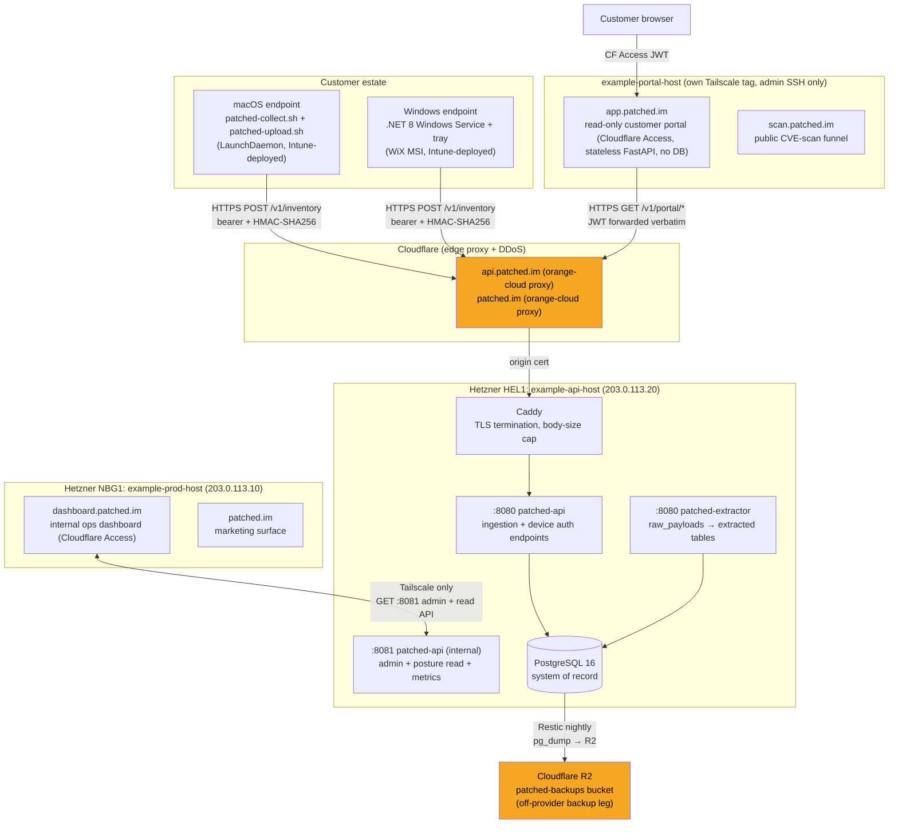
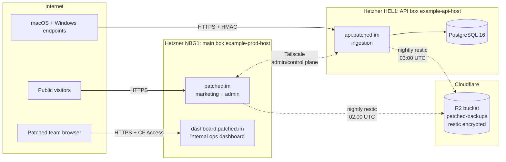

# Patched Platform: Architectural Overview

**Audience:** external auditor (security review, Cyber Essentials assessment, customer due-diligence, incorporation/diligence)
**Scope:** the whole Patched platform, covering the server-side platform (`Patched-LTD/patched.im`) and the endpoint agents (`Patched-LTD/updater`)
**This document:** the canonical System Overview and index/overview layer. Reference, do not duplicate, the component docs listed in [Component documentation](#component-documentation). `go-service/docs/architecture.md` is no longer the architecture document; it is the running deploy and current-state log (see that table entry below).

---

## 1. System context

Patched runs three dedicated VPSes. `example-api-host` hosts `api.patched.im`: the ingestion endpoint for device telemetry from macOS and Windows endpoints. The main box, `example-prod-host` (Hetzner CAX21, Nuremberg), stays as the marketing surface and also hosts the internal operations dashboard at `dashboard.patched.im`, a Patched-team-only tool. `example-portal-host` hosts the customer-facing surface: `app.patched.im`, a read-only, CF-Access-JWT-authenticated, customer-scoped portal (PAT-331/PAT-693) that reads the API box's `/v1/portal/*` endpoints, and `scan.patched.im`, the public CVE-scan funnel. It is a separate trust boundary from the other two boxes - its own Tailscale tag, admin SSH only, zero data-plane grants.

Data flows left to right: endpoint agents collect and POST telemetry; Cloudflare proxies and scrubs; Caddy terminates TLS and applies a 5 MB body cap; `patched-api` authenticates and writes raw payloads; `patched-extractor` asynchronously derives the query tables; admin tools reach `example-api-host` over Tailscale only. The customer portal reaches `example-api-host` the same way a browser does - a public HTTPS call to `/v1/portal/*`, forwarding the caller's Cloudflare Access JWT - not over Tailscale; `example-portal-host`'s Tailscale tag grants admin SSH only, zero data-plane access.

**Why three boxes:**

- **Blast-radius separation:** a flood of inventory POSTs cannot knock the marketing surface over, and neither can knock the customer portal over.
- **Independent attestation surface:** the data plane is separately documented for SOC2-lite / Cyber Essentials Plus narratives.
- **Different scaling axis:** the API box needs disk I/O and Postgres headroom; the web and portal boxes do not.
- **Separate trust boundary for the portal:** it is the only box a customer's own credentials ever authenticate against directly, so it carries no database, no write path, and no Tailscale grant into the data plane - a compromise there cannot reach `example-api-host`'s Postgres instance or the internal dashboard.

---

## 2. Components and responsibilities

| Component | Process / binary | Listener | Host | Role |
|---|---|---|---|---|
| `patched-api` | Go static binary, systemd unit | `:8080` (public via Cloudflare + Caddy) | `example-api-host` | Ingests `/v1/inventory` and `/v1/provenance`; issues `GET /v1/agent-config` (Ed25519-signed); exposes `GET /v1/posture` (device-authenticated); rate-limits and replay-guards all public endpoints |
| `patched-api` (admin) | same binary, second listener | `:8081` (Tailscale-only) | `example-api-host` | Tenant lifecycle, credential management, compliance-rule toggling, platform read-API, app-policy CRUD, PDF reports, Prometheus `/metrics`. No application-layer auth (network-layer enforcement via Tailscale ACL + Caddy site block) |
| `patched-extractor` | Go static binary, systemd unit | none (poll loop) | `example-api-host` | Consumes `raw_payloads` rows; populates `devices`, `device_apps`, `compliance_signals`, `compliance_evaluations`, `device_browser_extensions`, `seen_nonces`; runs CIS L1 evaluator |
| Caddy (api-01) | systemd unit | `:80`, `:443`, `:8443` (Tailscale-only) | `example-api-host` | TLS termination (CF Origin Cert `*.patched.im`, expires 2041); HTTP→HTTPS redirect; 5 MB body cap; routes public traffic to `:8080`, routes Tailscale admin traffic to `:8081` via `example-api-host.example-tailnet.ts.net:8443 tls internal` |
| PostgreSQL 16 | system service | `127.0.0.1` + Tailscale `100.64.0.0/10` | `example-api-host` | System of record for all device, inventory, compliance, and tenancy data |
| macOS endpoint agent | `patched-collect.sh` + `patched-upload.sh`, LaunchDaemon | n/a | Managed endpoint | Collects hardware identity, OS posture, app inventory, full CIS L1 surface; queues locally; uploads via HMAC+bearer POST |
| Windows endpoint agent | .NET 8 Windows Service + tray | n/a | Managed endpoint | Collects CIS Windows L1 signals and app inventory; same `/v1/inventory` wire format; WiX MSI deployment; tray for user-visible update status |
| Ops dashboard | web app + SQLite | `:443` (Cloudflare Access) | `example-prod-host` | Internal tool for the Patched team: tenant management, device overview, compliance findings; queries `example-api-host:8081` over Tailscale |
| Marketing surface | web app | `:443` (public) | `example-prod-host` | Public `patched.im`; no access to customer data |

### Stack

| Layer | Choice | Notes |
|---|---|---|
| TLS / reverse proxy | Caddy | Auto-TLS, HTTP/3, two site blocks per box (public + Tailscale-bound internal) |
| Application | Go (single static binary) | systemd-managed, ~30 MB idle memory floor |
| Database | PostgreSQL 16 (same host) | JSONB raw payloads + extracted indexable columns, `pg_partman` for time-partitioning. Tuning sized for 4 GB RAM: `shared_buffers=768MB`, `effective_cache_size=2GB`. |
| Off-provider backup | Restic to Cloudflare R2 | **Two independent legs into bucket `patched-backups`** (see §7 for the reconciled backup table). (1) api-01 → R2 (Postgres): live, `patched-backup.timer` at 03:00 UTC, `pg_dump -Fc` → `restic backup --stdin`; first snapshot `e8b2b2c4` verified clean. (2) prod-01 → R2 (dashboard.db + reports/): scripts deployed (PAT-84), `patched-prod-backup.timer` at 02:00 UTC, `sqlite3 .backup` snapshot → restic; pending Andy filling `/etc/patched-dashboard/backup.env` and running `restic init`. Both repos: 7 daily / 4 weekly / 3 monthly retention; each ships a heartbeat to api-01 surfaced on the dashboard Service Health strip (PAT-387). `pat-backup-01` (on-prem) retired (PAT-401 canceled). See `api-vps-artefacts/BACKUP_DR.md`. |
| Inter-box link | Tailscale (SaaS coordination plane) | WireGuard mesh, MagicDNS, ACLs as versioned JSON in workspace. Device names match Hetzner hostnames. |
| Public DNS | Cloudflare | Orange-cloud proxied (migrated). CF Origin Cert (`*.patched.im`, expires 2041) on example-api-host; Hetzner FW `example-api-host-edge` tightened to CF ranges only. |
| Private DNS | Tailscale MagicDNS | Admin hostnames have no public record |

### Observability

Prometheus metrics live. `patched-api` exposes `GET /metrics` on the internal `:8081` listener (Tailscale-only): `patched_http_requests_total{route,status}`, `patched_http_request_duration_seconds{route,status}`. chi route patterns are used as the `route` label so per-tenant UUIDs never become a cardinality problem. `patched-extractor` exposes its own `GET /metrics` on a separate loopback-only `:8083` listener (PAT-1377): `patched_extractor_rows_processed_total{result}`, `patched_extractor_batch_size`. These two used to be registered (but never incremented) on patched-api's `:8081` instead, since they're only ever observed inside patched-extractor's own process, so that wiring produced a permanently-zero series and let `ExtractorStalled`/`DeadLetterRows` ship matching nothing in production. Prometheus v2.45.3 runs on `example-api-host` itself, scraping both `localhost:8081` and `localhost:8083` every 30s. Alertmanager routes to Slack `#alerts` (`api-vps-artefacts/alerting/`); Grafana dashboards remain open (see also Open items).

A second, narrower PAT-1377 gap surfaced after that fix deployed: `DeadLetterRows` still matched zero series in production even though `patched_extractor_rows_processed_total{result}` was now registered and served from the right process. The reason is a `client_golang` `CounterVec` quirk, not a registration bug: a `CounterVec` doesn't materialize a label child (a concrete time series) until `.WithLabelValues(...)` has been called at least once for that exact label combination, and `result="dead_letter"` is only ever incremented when a row exhausts its retry attempts (`internal/extractor/extractor.go`, `recordProcessError`), which had not happened yet on the box. Until it did, the `dead_letter` series simply didn't exist for the alert's selector to match, however healthy the underlying code path was. `metrics.RegisterExtractor` now pre-touches all three `result` values (`success`, `error`, `dead_letter`) with `.Add(0)` immediately after registration, so every series exists at zero from process start and `DeadLetterRows` can match a real series immediately rather than waiting on the first dead-letter event.

### Endpoint collection

**macOS.** The agent is two scripts plus a LaunchDaemon:

- **`patched-collect.sh`**: zsh collector, run as root via Intune. Captures hardware identity (serial, hw UUID), OS version, FileVault, SIP, Gatekeeper, XProtect/MRT, pending updates, and the full CIS L1 compliance signal surface. Refactored into a thin orchestrator + 11 `lib/` modules; `build-bundle.sh` inlines them into a single `dist/patched-collect.sh` for deployment.
- **`patched-upload.sh`**: drains the queue and POSTs to `api.patched.im` with HMAC + bearer, exponential backoff, 7-day retention.
- **`com.patched.upload.plist`**: LaunchDaemon that runs the uploader every 900 s.

v1 (current): unsigned shell scripts plus the LaunchDaemon plist, deployed via Intune Platform Scripts as root. v2 (roadmap): signed `.pkg` for unmanaged onboarding, gated on Patched.im Ltd. incorporation completing, then DUNS, then Apple Developer ID enrolment, then notarisation credentials.

**Windows.** See ADR-0006 (`go-service/docs/adr/0006-windows-native-agent.md`), which supersedes the original PowerShell-script plan in ADR-0002. The Windows endpoint is a native C# .NET 8 Windows Service plus a system-tray app, packaged as a WiX MSI (`windows/` in the `updater` repo), not a script deployed via Intune Platform Scripts. The compliance collector converged with the Patched Updater (winget/choco patching, tray UI, provenance reporting) once a persistent background process was needed for update delivery, not just point-in-time collection; a script model can't hold that responsibility. The MSI is currently unsigned for pilot; still no Microsoft Graph dependency in the data path.

The service collects installed-app inventory (registry Uninstall keys across HKLM / WOW6432Node / HKCU, `Get-AppxPackage`, `winget list`) and the full CIS Windows L1 control-signal surface (the T1 set originates in migration `0019`; T2 expansion is tracked in `go-service/docs/WINDOWS_T2_GAPMAP.md` per ADR-0007). It POSTs schema-compatible JSON to `/v1/inventory` with the same bearer + HMAC auth as macOS; no server-side changes were needed for the native rewrite. See `updater` repo, `windows/` for the client-side source and build.

---

## 3. Trust and authentication model

### 3.1 Endpoint → API (data plane)

All public ingestion endpoints enforce a **two-layer auth chain** before any JSON parse or database write:

1. **Bearer token.** `Authorization: Bearer <token>` resolved against `tenant_credentials` table. Multiple concurrently-valid credentials per tenant allow zero-downtime rotation.
2. **HMAC-SHA256 body signature.** `X-Patched-Signature` header: HMAC of canonical JSON body with per-tenant HMAC key.
3. **Timestamp freshness.** `X-Patched-Timestamp` must be within ±300 s of server time.
4. **Replay rejection.** `X-Patched-Nonce` checked against `seen_nonces` table; re-use returns 409.

Device-specific credentials (table `device_credentials`, migration `0029`) gate `GET /v1/posture`, using a device-level bearer from provisioning over the same HMAC chain.

### 3.2 Admin surface (control plane)

The `:8081` admin API carries no application-layer auth. Protection is **network-layer only**: Caddy binds the site block to the Tailscale interface (`example-api-host.example-tailnet.ts.net:8443`); the `pg_hba.conf` similarly restricts Postgres to `127.0.0.1` and `100.64.0.0/10`. An operator must be a member of the `patched` Tailscale tailnet to reach it. Caddy's admin site block is a second, distinct site block from the public one; the internal listener also carries Prometheus `/metrics`.

### 3.3 Agent config signing

`GET /v1/agent-config` returns a payload signed with an Ed25519 key loaded at service startup (`key_id ecd47f2c5b3d5705`). Agents verify the signature before acting on config. The public key is pinned in the agent build.

### 3.4 Dashboard → API

The ops dashboard calls the `:8081` read-API over the Tailscale link. The dashboard itself is gated behind Cloudflare Access (team SSO) at `dashboard.patched.im`.

See `go-service/docs/API.md` for per-route auth requirements.

### 3.5 Per-device authentication: roadmap and what shipped

**MVP (live):** pre-shared per-tenant bearer token, deployed via Intune Configuration Profile (Windows + macOS). HMAC-SHA256 over canonical JSON body, signature in `X-Patched-Signature` header. Token rotates via Intune push. Both the bearer lookup and the HMAC verify run before any JSON parse or DB write.

**V2 (originally deferred):** bootstrap exchange: pre-shared token becomes single-use, exchanged on first contact for a per-device JWT + device-bound key, enabling per-device revocation.

**Reconciled:** device-level authentication already shipped, via a simpler mechanism than the V2 roadmap above envisioned. `device_credentials` (migration 0029, §3.1) issues a device-scoped bearer token that gates `GET /v1/posture` today, and device revocation (PAT-549) already works against it. The JWT bootstrap-exchange design in the V2 paragraph has not shipped as described; treat it as superseded in intent rather than as a live roadmap item.

### 3.6 Security posture: external ingestion endpoint

The `/v1/inventory` endpoint is public on the internet by design: Intune-managed endpoints POST telemetry to it from anywhere. It was assumed discoverable within hours of going live (DNS + Certificate Transparency), and that has held.

**Layers in place at build complete:**

- **TLS termination at Caddy.** CF Origin Cert (`*.patched.im`, 15-year, installed), TLS 1.2/1.3 only, HTTP/3 supported.
- **Request body size cap.** `request_body { max_size 5MB }` in the Caddyfile bounds the abuse blast radius before auth runs.

**Layers live in the Go service:**

- **Per-tenant bearer token + HMAC-SHA256 over canonical JSON body.** Each request must carry `Authorization: Bearer <token>` (matching a tenant) and `X-Patched-Signature` (HMAC of body using the per-tenant key). Without both, the service returns 401 before parsing the body.

**Layers deferred until paying-customer scale** (kept verbatim from the original build-complete assessment; see the reconciliation note below):

- **Cloudflare WAF + DDoS scrubbing at the edge.** Done `api.patched.im` is now orange-cloud proxied.
- **Rate limiting via the `caddy-ratelimit` module.** Per-tenant-token bucket (target 60 req/min, 10/sec burst). Not yet in the Caddyfile at build-complete; leans on the Cloudflare proxy edge and the 5 MB request-body cap. Add before the first paying tenant.
- **Replay protection.** `X-Patched-Timestamp` + `X-Patched-Nonce` headers were accepted by the collector but not yet validated by the service at build-complete; deferred to v1.1.
- **Structured audit logging of every rejected request.** Lands in the audit store (backlog item 6). Not yet built.

> **Reconciled (contradiction):** the bullets above describe the system as it stood at build-complete and last-enhanced. §3.1 above, and current-state snapshots onward, describe `X-Patched-Timestamp` freshness, `X-Patched-Nonce` replay rejection and per-tenant rate limiting (60 rpm, burst 10) as enforced in production. The newer, more specific claim (§3.1, corroborated by the `seen_nonces` table existing and by repeated current-state entries) is treated as authoritative: replay protection and rate limiting have shipped. The "deferred" bullets are retained unedited above because they are the honest historical record of what was true at build-complete, not because they still describe current status. Structured audit logging of rejected requests remains genuinely open (see Open items); that part of the "deferred" framing still holds.

**Explicitly NOT defended against today:**

- A compromised managed endpoint replaying its own validly-signed data. Per-device credentials (§3.5) make revocation feasible at device granularity, but do not prevent a still-valid device from replaying its own data.
- Volumetric DDoS exceeding the box's bandwidth. Cloudflare proxy is the answer when it matters.
- Data-shaped attacks. Mitigated by Go's stdlib `encoding/json` plus strict decoding into typed structs only; formal pen-test sweep deferred until pre-customer.

**Threat model in one line:** the endpoint is public, discoverable within hours. Cost of an unauthenticated POST to an attacker is zero; cost to us is one HMAC verification (~microseconds). Bypassing auth requires stealing a tenant's pre-shared token, which lives on managed endpoints under Intune's control.

---

## 4. Data model and retention

The system of record is PostgreSQL 16 on `example-api-host`. Application tables group into three functional areas. The authoritative list is the migration set in `go-service/migrations/`; the table below names what matters for orientation rather than enumerating the schema, deliberately, so it does not go stale each time a migration lands:

| Area | Key tables | Notes |
|---|---|---|
| Tenancy | `tenants`, `tenant_credentials`, `tenant_rules`, `tenant_rule_changes`, `tenant_platform_changes` | Per-tenant isolation; audit logs are append-only |
| Device inventory | `devices`, `device_apps`, `device_browser_extensions`, `raw_payloads`, `patches`, `provenance_records` | `raw_payloads` is immutable and partitioned monthly for cheap pruning; `provenance_records` is plain BIGSERIAL |
| Compliance & policy | `compliance_rules`, `compliance_evaluations`, `compliance_signals`, `tenant_app_policies`, `app_catalog_entries`, `device_report_digests` | Rule inventory is migration-managed and [queried live](../contracts/portal-api.md#rule-count-source-of-truth) by platform, benchmark, version, and tier; `compliance_evaluations` is append-only |
| Auth & access | `tenant_credentials`, `device_credentials`, `seen_nonces` | `seen_nonces` trimmed by age; `device_credentials` added migration 0029 |

`raw_payloads` holds the verbatim JSONB payload from every inventory POST, and are the authoritative audit trail from which all derived tables are (re)computed. Derived tables (`device_apps`, `compliance_signals`, etc.) are overwritten on each extraction cycle; `raw_payloads` itself is never mutated.

The established ingestion-path tables, sketched for orientation:

- `tenants(id, name, intune_tenant_id, macos_enabled, windows_enabled, ...)`
- `devices(id, tenant_id, serial, hw_uuid, hostname, os, os_version, last_seen)`
- `device_apps(device_id, name, version, identifier, sha256, signer, team_id, first_seen, last_seen)`
- `compliance_signals(device_id, key, value, severity, observed_at)`: backs auditor-ready reporting
- `patches(device_id, identifier, installed_at)`
- `raw_payloads(id, device_id, body jsonb, received_at)`: partitioned monthly for cheap pruning
- `provenance_records(id, tenant_id, received_at, source_ip, user_agent, body jsonb)`: Patched Updater audit trail; plain BIGSERIAL (not partitioned)

Plus the compliance + policy tables: `compliance_rules` (the rule pack), `compliance_evaluations` (append-only per-device per-rule outcomes), `tenant_rules` (per-tenant T2 enable/disable, severity overrides, suppression), `tenant_rule_changes` (append-only audit log), `tenant_platform_changes` (append-only audit log of per-OS master-switch flips).

### Read-only software observation seam

PAT-1461 adds a second extraction projection for Endpoint Assurance and Software Governance. `software_inventory_runs` and immutable `software_observations` preserve evidence, reviewed aliases resolve evidence to `software_products`, and `software_installations` maintains device presence. The domain is documented in `go-service/docs/SOFTWARE_DOMAIN.md`.

The seam deliberately has no foreign key or behaviour dependency on catalogue packages, installers, signed package metadata, deployment rings, self-service or remediation. `device_apps` remains in service for existing consumers.

The former server-side Installomator manifest synchroniser is retired rather
than disabled. The service has no upstream manifest-fetch or parsing path, and
historical `installomator_sync` automation runs remain audit-only. Persisted
`app_group_rules.source='installomator_sync'` rows remain readable identity
evidence for extraction, so canonical naming and downstream joins do not change
without a measured rematch migration. `installomator_sync` cannot be recorded
or triggered. The legacy mirror jobs are quarantined and unscheduled, but their
record endpoint remains compatible while the external manual workflows still
contain reporters. Non-active jobs expose history without operational last-run
fields, avoiding stale alerts in lifecycle-unaware consumers.

macOS payloads may close missing installations because their supported `apps` contract is a full snapshot. Windows closes only missing Winget identities and only after the existing versioned complete-Winget capability assertion. Other Windows absence remains unknown. The internal comparison endpoint exposes projection counts for operator validation and cannot mutate identity or policy.

This section describes source architecture. Migrations 0111 (schema) and 0112 (idempotent `device_apps` backfill, split out so schema creation holds no extended lock; PAT-1461 review) and the new extractor path are not production state until `go-service/docs/architecture.md`'s Current state block records a verified deployment.

See `go-service/docs/SCHEMA.md` for the full erDiagram and per-table column/index breakdown, and `go-service/docs/PAYLOAD_SCHEMA.md` for the inventory payload wire format.

---

## 5. Network and infrastructure

| Host | Public IPv4 | Tailscale IPv4 | Public ports | Notes |
|---|---|---|---|---|
| `example-api-host` (HEL1) | 203.0.113.20 | 100.64.10.1 | 80, 443 via Cloudflare only | Hetzner FW `example-api-host-edge` allows only CF CIDRs on 80/443; TCP 22 closed |
| `example-prod-host` (NBG1) | 203.0.113.10 | 100.64.10.2 | 80, 443 via Cloudflare | Same firewall posture |

All admin access (SSH, admin API, Postgres) is Tailscale-only. The `patched` tailnet uses MagicDNS (suffix `.example-tailnet.ts.net`); admin hostnames have no public DNS record and no Certificate Transparency exposure.

**Provider and location.** Hetzner, same provider for both boxes. `example-api-host` sits in Helsinki (HEL1); `example-prod-host` sits in Nuremberg (NBG1), distinct from HEL1 for physical separation between the public surface and the telemetry surface. `example-api-host` spec is CPX22 (3 vCPU x86, 4 GB RAM, 80 GB NVMe) at provisioning; the vertical-scale path is CPX31 → CPX41, to revisit when thresholds are hit per backlog item 4. See §6 for data-residency implications and §7 for the relocation playbook if UK residency is ever required.

**Topology**, complementing the data-flow diagram in §1 with the control-plane and backup view:

Solid lines are bulk traffic; dotted lines are control plane. Both production boxes back up independently to the same Cloudflare R2 bucket (`patched-backups`) at separate restic repository paths (see §7).

**Network posture detail.** Caddy on `example-api-host` serves a second site block bound only to the Tailscale interface for admin endpoints (`example-api-host.example-tailnet.ts.net:8443`, `tls internal`), reached via MagicDNS; the earlier `api-internal.patched.im` hostname and `/etc/hosts` alias were retired in favour of MagicDNS. The Go service's internal listener (`:8081`) carries the admin API and Prometheus `/metrics`, all Tailscale-only with no application-layer auth beyond network placement (see §3.2). Postgres listens on `127.0.0.1` and the Tailscale interface only; UFW closes the public side, and `pg_hba.conf` restricts to localhost and the tailnet CIDR (`100.64.0.0/10`).

See `api-vps-artefacts/OPERATIONS.md` for firewall and Tailscale ACL runbooks.

---

## 6. Hosting and data residency

| Resource | Provider | Location | Notes |
|---|---|---|---|
| `example-api-host` (system of record) | Hetzner | Helsinki, Finland (EU) | CPX22, 3 vCPU / 4 GB RAM / 80 GB NVMe |
| `example-prod-host` (marketing + dashboard) | Hetzner | Nuremberg, Germany (EU) | Distinct from HEL1 for physical separation |
| Off-provider backup | Cloudflare R2 | EU (zero-egress) | `patched-backups` bucket; Backblaze B2 named fallback |
| DNS + CDN | Cloudflare | Global edge | Orange-cloud proxy for both public hostnames |

All customer device data is held in the EU. Relocation is triggered by the first IoM-regulated FS customer requiring UK data residency in their DPA, or evidence that Hetzner sovereignty perception is blocking commercial conversations; Mythic Beasts is the named UK fallback provider. The relocation playbook (target: one working day) is documented in §7.

---

## 7. Backup and DR

The platform runs a **3-2-1 backup strategy** across two independent legs into the same Cloudflare R2 bucket (`patched-backups`):

| Leg | Mechanism | Schedule | Retention | Status |
|---|---|---|---|---|
| api-01 → R2 (Postgres, primary system of record) | Restic `pg_dump -Fc` → Cloudflare R2 | Nightly 03:00 UTC (`patched-backup.timer`) | 7 daily / 4 weekly / 3 monthly | Live; first snapshot `e8b2b2c4` verified clean |
| prod-01 → R2 (dashboard.db + reports/) | `sqlite3 .backup` snapshot → Restic (`patched-prod-backup.timer`, PAT-84) | Nightly 02:00 UTC | Same 7/4/3 retention | Scripts deployed; pending Andy filling `/etc/patched-dashboard/backup.env` and running `restic init` as of that date, needs verification that this has since completed |

> **Reconciled (contradiction):** the original overview snapshot listed only the api-01 leg, since the prod-01 leg (PAT-84) deployed a week later,. Both legs are now listed above; the second leg's completion (`restic init` run, `backup.env` filled) has not been independently re-verified for this merge and should be checked against the dashboard Service Health strip before being treated as fully live.

Each backup leg ships a heartbeat to `patched-api` on completion; heartbeat state is surfaced on the dashboard Service Health strip (PAT-387).

Restore path: `restic restore latest → pg_restore` to a fresh Postgres instance, then DNS swap at Cloudflare. Target RTO: one working day (see relocation playbook below). See `api-vps-artefacts/OPERATIONS.md` for full restore runbook.

### Relocation playbook (when triggered)

**Trigger:** first IoM-regulated FS customer requiring UK data residency in their DPA, or evidence that Hetzner sovereignty perception is blocking commercial conversations.

**Steps (target one working day):**

1. Stand up new box at named UK provider (Mythic Beasts preferred).
2. Restic-restore Postgres dump.
3. Reinstall Tailscale (tailnet membership replaces VPC config; no networking redesign needed).
4. DNS swap at Cloudflare (60-second change with low TTL).
5. Decommission Hetzner box.

---

## 8. Deployment and change control

| Stage | Detail |
|---|---|
| Branch model | Feature branch per Linear ticket; one worktree per ticket. Direct commits to `main` only for doc-only and close-out work. |
| CI gates | `go test ./...`, `go vet ./...`, `go build ./...` on every PR. Tailscale ACL validation for ACL changes. |
| Review gate | GitHub-Non-Author-Review required on all PRs before merge. |
| Merge strategy | Squash merge to `main`. |
| Deploy | Manual binary deploy via systemd on `example-api-host`. Procedure in `api-vps-artefacts/OPERATIONS.md` §Binary deploy. No automated CD to production. |
| Migration apply | `psql` against live Postgres; migrations are in `go-service/migrations/`; applied manually before or with binary swap. |
| Rollback | Stop systemd unit; `pg_restore` from last Restic snapshot; swap binary to previous build artifact. |

---

## 9. Secrets management

| Secret class | Where stored at rest | How deployed |
|---|---|---|
| Per-tenant bearer tokens + HMAC keys | `/etc/patched-api/` on `example-api-host` | Manual provisioning; never committed |
| Ed25519 signing key (`key_id ecd47f2c5b3d5705`) | `/etc/patched-api/` on `example-api-host` | Manual provisioning |
| Postgres credentials | `/etc/patched-api/` env file, loaded by systemd unit | Manual provisioning |
| Restic + R2 credentials | `/etc/patched-api/` on `example-api-host` | Manual provisioning |
| Endpoint agent credentials (bearer + HMAC) | Intune Configuration Profile (macOS keychain / Windows DPAPI) | Pushed via Intune MDM; rotatable per-tenant |
| Cloudflare Origin Certificate private key | Caddy on `example-api-host` | Manual provisioning |

Secrets are never committed to either repository. `.gitignore` covers rendered in-tree forms (`*.ready`, `*-secret`, `*-creds`). `gitleaks protect --staged --redact` runs as a pre-commit hook in both repos (see `README.md` §Conventions). CI uses throwaway credentials scoped to test databases only.

---

## 10. Tenancy model

Patched is a **multi-tenant SaaS**. All data is isolated at the tenant level:

- Every `devices` row carries a `tenant_id` foreign key; all queries are scoped by tenant.
- `tenant_credentials` binds bearer tokens and HMAC keys to a specific tenant; one set of credentials cannot authenticate as another tenant.
- `tenant_rules` enables/disables individual CIS rules per tenant (T2 rules). `tenant_rule_changes` and `tenant_platform_changes` are append-only audit logs of every toggle.
- `macos_enabled` and `windows_enabled` columns on `tenants` are per-tenant master switches for each platform; the evaluator skips payloads for disabled platforms.
- `tenant_app_policies` stores per-tenant, per-app enforcement policy (mandatory / approved / unapproved / unmanaged); matched by team_id > bundle_id > name.
- The ops dashboard reads via the `:8081` admin API, which is tenant-scoped at the handler layer.

There is no shared schema, no cross-tenant query path in the application code, and no shared database user between tenants.

### Data ownership boundary

The API box is the system of record for all device, inventory, and compliance data. The main box does not read the API DB directly. Inter-box calls are administrative only:

- **Main → API (provisioning):** when a customer signs up, main box calls `POST /admin/tenants` on the internal Tailscale endpoint. Returns the enrollment token.
- **API → Main (webhooks):** significant events (new device, compliance signal red, monthly report ready) POSTed back to main box.

The internal operations dashboard at `dashboard.patched.im` runs on the main box (`example-prod-host`), not the API box. It is a Patched-team-only tool behind Cloudflare Access. The customer-facing surface (§1, PAT-331/PAT-693) runs as a separate service on its own box, `example-portal-host`: a stateless FastAPI app with no database of its own, reading the API box's `/v1/portal/*` endpoints over the network rather than querying Postgres locally. See `dashboard/docs/architecture.md` and `portal/AGENTS.md`.

---

## Open items

- **Grafana dashboards** remain open (not deployed/configured); needed before first revenue customer. Alertmanager itself is already live and routes to Slack `#alerts` (§2 Observability), reconciled against this item's older framing of a still-to-build "Teams webhook" alert path, which is superseded.
- **Audit store**: append-only event log for rejected requests and admin actions. Architecture backlog item 6. Genuinely still open (§3.6).
- **Apple Developer ID / notarisation**: deferred to v2 roadmap, gated on Patched.im Ltd. incorporation.
- **`pg_partman` automation**: partition management cron. Currently manual (see ADR-0001 action item 6).

---

## Component documentation

This document is the index layer. For implementation detail, refer to:

| Doc | What it covers |
|---|---|
| `go-service/docs/architecture.md` | Deploy and current-state log: live production snapshot, deploy history, production binary deployment contract, built-reality baseline. Architecture itself now lives in this document. |
| `go-service/docs/API.md` | Every HTTP route (6 total): method, path, listener (public vs Tailscale-internal), auth requirements (bearer + HMAC), request/response shapes, error codes, gotchas |
| `go-service/docs/PAYLOAD_SCHEMA.md` | Canonical JSON shape for `POST /v1/inventory`. Inventory payload wire format (schema_v2 / v3), every field, type, required/optional, macOS + Windows (projected) examples. Cross-referenced to extractor and migrations. |
| `go-service/docs/payload.schema.json` | JSON Schema 2020-12 for programmatic validation of inventory payloads |
| `go-service/docs/SCHEMA.md` | Postgres schema: Mermaid erDiagram + per-table column/index breakdown, including `compliance_rules` and `compliance_evaluations`. The table/migration count last stated here (8 tables across 4 migrations) is stale given the migration set has grown well past 0100 since; needs a re-count, not corrected here. |
| `go-service/docs/CIS_RULES.md` | CIS L1 catalogue and live inventory method; T1/T2 tier model; per-tenant activation; comparator reference; treat-unknown-as policy; `LoadRulesForTenant`; add-a-rule process; framework mappings |
| `go-service/docs/FULL_ENDPOINT_MANAGEMENT_DELIVERY.md` | Attended customer-one delivery runbook for Full Endpoint Management: tenant readiness, before-state capture, pilot and broad rings, exception handling, rollback, and reconciliation of Intune assignment state with fresh Patched endpoint evidence |
| `go-service/docs/SETUP.md` | Clone-to-running-locally for the Go service: prerequisites, Postgres + migrations, env vars, bootstrap tenant, test payload recipe, what needs the tailnet |
| `go-service/docs/SECURITY_POSTURE.md` | Consolidated security-posture and audit-evidence pack (PAT-411): the single doc shown to a prospect's security reviewer, insurer or auditor. Network layers, auth model, data handling, encryption, secrets, backup/DR posture, observability, framework mapping (Cyber Essentials / ISO 27001 / IoM FSA / GDPR Art.32), and honest open gaps. Cites the source docs rather than re-deriving. |
| `go-service/docs/adr/` | Architecture decision records, ADR-0001 through ADR-0011 (table below) |
| `go-service/docs/TESTING.md` | Test coverage table for all packages; philosophy: pure functions get table-driven unit tests, DB integration is out-of-band; how to run |
| `api-vps-artefacts/OPERATIONS.md` | Runbooks: API/extractor service down, extractor lag, partition management, auth failure diagnosis, tenant onboarding, key rotation, binary deploy, Caddy/CF cert state, Postgres health |
| `api-vps-artefacts/DR_PLAN.md` | Disaster-recovery plan (PAT-139): scope, RTO/RPO targets, layered 3-2-1 model, per-failure-mode restore runbooks, and the quarterly restore-test checklist. Complements `BACKUP_DR.md` (mechanics). |
| `CLAUDE.md` (repo root) | One-page repo orientation for Claude Code (and any new developer): stack, binaries, key file map, auth model, deployment model, build commands, 7 conventions, 7 known traps |
| `Patched-LTD/updater` → `macos/README.md` | macOS collector: what it collects, Intune deployment, local testing, credential config, debugging. Moved out of this repo into `Patched-LTD/updater` under PAT-384 (this repo is server-only). |
| `Patched-LTD/updater` → `windows/` | Windows agent: native C# .NET 8 Windows Service + tray + WiX MSI source and build (ADR-0006). Client-side only; this repo owns the `/v1/inventory` contract both platforms POST to. |
| `dashboard/docs/architecture.md` | The main box, dashboard, and Jarvis Job Scout |
| `updater/docs/architecture.md` | The macOS + Windows endpoint agents and the Patched Updater (client side of the `/v1/inventory` contract this repo owns); see also `updater/docs/adr/ADR-001-vendor-direct-delivery.md` (vendor-direct delivery is the default, the R2 mirror is dormant) |

**Not wired in:** the `updater` repo's own ADR set is cross-referenced above by link only; there is no build step in either repo that pulls or renders another repo's docs (confirmed: no `.gitmodules`, no CI copy step, no shared mkdocs). Folding `updater`'s architecture/ADR content into a single browsable index is a genuine cross-repo structural question, not a link-list fix; out of scope here, flagged as a fast-follow.

### Decision records (ADRs)

| ADR | Status | Summary |
|---|---|---|
| `0001-cis-collection-scope.md` | Accepted; proposed all six action items delivered | **macOS agent expands to the full CIS L1 collection surface, with per-tenant rule activation.** Three-tier model: T1 = 17 controls already implemented; T2 = rest of CIS macOS Sonoma 14 L1 (~80-100 more controls: collect always, evaluate per-tenant policy via `tenant_rules`); T3 = CIS L2 + user-elective (out of scope). Triggers `schema_v3`, a collector refactor, and a new dashboard surface for managing tenant policy. |
| `0002-windows-client-approach.md` | **Superseded by 0006**; accepted | **Windows endpoint client is a single self-contained PowerShell collection script via Intune, no native agent.** Superseded once the collector converged with the Updater into a native service. Reasoning still valid for a compliance-only collector and the macOS model. |
| `0003-tier3-graph-access.md` | **Superseded by 0010** (2026-08-14); implementation deleted 2026-07-14 (PAT-911). Originally accepted (PAT-350 spike, PAT-351 authoring layer). | **Tier 3 Graph access: one multi-tenant Entra app, app-only client credentials, customer-tenant authority.** The `internal/tier3/` implementation this ADR describes (`graph`, `mapping`, `policy`, `reconcile`, `renderer`) was complete and tested but never wired into a route or `cmd/` binary; deleted in PAT-911 rather than left as a landmine that could be silently wired back in without a review trigger. Full details in `go-service/docs/adr/0012-tier3-graph-access-full.md` (moved here when the `spikes/tier3-graph-access/` spike was deleted; renumbered from `0003-tier3-graph-access-full.md` 2026-09-13, PAT-1700, to stop two files claiming ADR-0003). Deleting the implementation was not the same decision as dropping Tier 3's use of Graph; see 0010. |
| `0004-non-intune-delivery-rail.md` | Proposed; spike PAT-67; Andy's v2 call per ADR-0002 | **Investigation into a delivery rail for endpoints not enrolled in Intune.** Feeds the deferred v2 decision from ADR-0002 (which it does not supersede). Andy-owned planning. |
| `0005-software-metering-source.md` | Accepted | **macOS software metering reads usage from the Spotlight metadata store (`mdls`): `kMDItemLastUsedDate` + `kMDItemUseCount`.** Reads run in console-user context (`launchctl asuser`) to dodge the per-user-store/root-context null trap; guarded on `mdutil -s`. New nullable `device_apps.last_used_at`/`launch_count` (migration `0020`), collector v0.10.0. `NULL` = no recorded usage (unknown, not zero). `launch_count` is lifetime-cumulative. v1 captures only; no report/UI consumer yet. |
| `0006-windows-native-agent.md` | Accepted; supersedes 0002 | **Windows endpoint is a native C# .NET 8 Windows Service + WiX MSI + tray (`windows-agent/`), not a script.** The compliance collector converged with the Patched Updater (winget/choco patching, tray, provenance), which needs a persistent process. Same `/v1/inventory` contract + 13 CIS rules (migration 0019); no server changes. Clean-room (distinct from quarantined legacy PowerShell, PAT-175). MSI unsigned for pilot. |
| `0007-macos-windows-parity-principle.md` | Accepted for assurance parity; actuation parity superseded by 0011 (2026-09-07) | **macOS and Windows retain parity for inventory, identity, evidence, findings and governance.** ADR-0011 replaces deploy/patch parity with platform-specific actuation: bounded macOS execution is a Patched capability, while Windows application deployment remains external. |
| `0008-dashboard-as-primary-product-surface.md` | Accepted | **The dashboard (`dashboard.patched.im`) is the primary product surface; PDF reports become toggleable outputs, not the primary deliverable; the public CVE scan is the free top-of-funnel tier.** CVE scoring moves off the one-shot Graph-only path onto the continuous agent pipeline. |
| `0009-agent-home-and-per-tenant-deployment.md` | Accepted; one open sub-question (§7) | **One repo for agent code (`updater`), one generic signed artifact per platform, per-tenant behaviour delivered as signed runtime config, not a bespoke build.** No per-customer agent repo or per-customer binary. Open: whether the enrolment token travels embedded in the bootstrap or is entered at install (PAT-19). |
| `0010-microsoft-graph-scope-reconciliation.md` | Accepted (2026-08-14) | **Reconciles two rulings that read as contradictory.** Microsoft Graph is dead as an inventory/scanning source (the agent + `/v1/inventory` pipeline replaced it, per 0008) but alive as the Tier 3 orchestration mechanism (Intune is the customer's MDM; Graph is the only API surface for writing into it, per PAT-168/PAT-301). Supersedes 0003 (both variants); keeps `tenants.intune_tenant_id` and the `admin.go` Tier 3 warning, correcting how each is described rather than removing them. |
| `0011-global-macos-execution-catalogue.md` | Accepted (2026-09-07) | **Reinstates optional macOS-only third-party patching without restoring the broad packaging platform.** One signed global catalogue holds operation-specific verified capability; explicit tenant policy automatically enrols missing software as pending but never grants trust; bounded demand-driven verification replaces full-manifest GitHub Actions sweeps. Windows application deployment remains external. |
