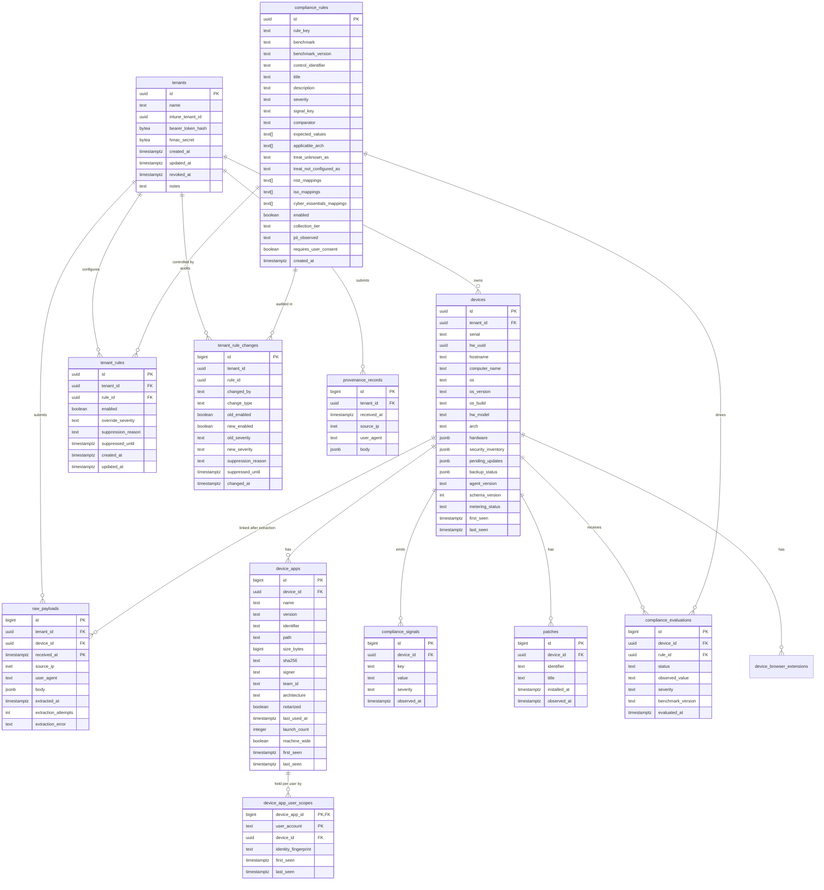

# Database schema

Postgres 16 on `example-api-host`. The migration directory is the canonical
schema history. Migration `0111` adds the read-only software observation and
normalised identity seam documented in [SOFTWARE_DOMAIN.md](SOFTWARE_DOMAIN.md);
migration `0112` runs its idempotent `device_apps` backfill as a separate,
lock-light step. Together they run beside the legacy `device_apps`, catalogue,
policy and deployment tables. No vNext core table depends on a package or
installer record. Migrations `0113` and `0114` record the latest quarantine
generation plus every contained API process activation. Each process advances
a tenant once, so rollback and redeploy remain monotonic without changing the
version on every config read.

Forward migrations are applied in filename order. Production uses the
manifest-verified `deploy-api-01.yml` path documented in `architecture.md`;
local integration tests apply every non-rollback SQL file to a fresh Postgres
database.

Migration `0205_agent_update_channel_observations` stores additive
tenant/device-bound channel observations separately from release soak-health
evidence. They never affect release-gate completeness.

---

## Entity relationship



---

## Tables

### `tenants`

One row per customer organisation. Created by `POST /admin/tenants` (`internal/handlers/admin.go`).

| Column | Type | Notes |
|---|---|---|
| `id` | UUID | PK, `gen_random_uuid()` |
| `name` | text NOT NULL | Human-readable name, e.g. `"Acme Ltd"` |
| `intune_tenant_id` | UUID | Customer's Entra/Azure tenant ID; set at onboarding or later |
| `bearer_token_hash` | bytea NOT NULL | SHA-256 of the bearer token — plaintext never stored |
| `hmac_secret` | bytea NOT NULL | Raw HMAC secret bytes; needed for verification so cannot be hashed |
| `created_at` | timestamptz | |
| `updated_at` | timestamptz | |
| `revoked_at` | timestamptz | Non-null = tenant disabled; bearer lookups filter `WHERE revoked_at IS NULL` |
| `notes` | text | Free-text operator notes |
| `macos_enabled` | boolean NOT NULL DEFAULT true | Per-OS master switch. When `false`, macOS devices for this tenant are not evaluated (no `compliance_evaluations` rows written) and are excluded from exec-summary reports. Overrides T1 always-on rules. Added in `0010`. |
| `windows_enabled` | boolean NOT NULL DEFAULT true | Per-OS master switch for Windows. Same semantics as `macos_enabled`. Added in `0010`. |

**Written by:** `POST /admin/tenants` handler; `PUT /admin/tenant-platforms/{tenantID}` for the master switches.
**Read by:** `auth.LookupTenantByBearer` on every `POST /v1/inventory`; extractor (checks `macos_enabled`/`windows_enabled` before evaluating); exec-summary report queries.

**Indexes:** `idx_tenants_bearer_token_hash` (hot path — every ingest does this lookup).

**Security note:** `hmac_secret` is envelope-encrypted at rest (AES-256-GCM, PAT-687). A per-value data key encrypts the secret and is itself wrapped by the `PATCHED_KEK` key-encryption key sourced from `/etc/patched-api/env`; only the wrapped key and ciphertext are stored, so a Postgres-only compromise yields ciphertext, not usable secrets. `auth.LookupTenantByBearer` decrypts on every bearer lookup (`internal/auth/bearer.go` via `internal/envelope/envelope.go`); unmarked legacy rows are read as plaintext through the decrypt-with-fallback path, and `cmd/patched-kek-backfill` encrypts any historical plaintext rows in place. Bearer token is stored as SHA-256 hash only; the plaintext is returned once at tenant creation and is unrecoverable afterward.

---

### `devices`

Per-tenant inventory of managed endpoints. One row per device, upserted on every extraction.

| Column | Type | Notes |
|---|---|---|
| `id` | UUID | PK |
| `tenant_id` | UUID FK | References `tenants.id` ON DELETE CASCADE |
| `serial` | text | IOPlatformSerialNumber (macOS) / BIOS serial (Windows). NULL when unreadable. |
| `hw_uuid` | UUID | IOPlatformUUID (macOS) / SMBIOS UUID (Windows). Primary upsert key when present. |
| `hostname` | text | `LocalHostName` / NetBIOS |
| `computer_name` | text | `ComputerName` — human-friendly display name |
| `os` | text NOT NULL | `"macOS"` or `"Windows"` |
| `os_version` | text | `"15.4.1"` |
| `os_build` | text | `"24E263"` |
| `hw_model` | text | `"Mac14,2"` |
| `arch` | text | `"arm64"` / `"x86_64"` |
| `hardware` | JSONB | Latest `hardware` sub-object from payload (cpu, ram, disk). Added in `0002`. |
| `security_inventory` | JSONB | Snapshot: `{security_tools, system_extensions, background_items, icloud}`. Added in `0002`. |
| `pending_updates` | JSONB | Latest `pending_updates` array from `softwareupdate -l`. Added in `0004`. Replaced on each ingest. |
| `backup_status` | JSONB | Latest `backup_status` object (PAT-679 macOS Time Machine / PAT-680 Windows File History, plus OneDrive/iCloud sync and third-party tool detection). Added in `0087` (PAT-948). Replaced on each ingest; NULL when the reporting agent predates PAT-679/680 or the section failed to parse (`extractor.parseBackupStatus` — non-fatal, existing value preserved). |
| `collection_status` | JSONB | Latest per-section collection status the agent reported (PAT-1732). Added in `0128`. **Merged**, not replaced, on each ingest — unlike every other snapshot column above: a payload reporting only `certificates` leaves a previously stored `hardware_health` status intact, and vice versa (`extractor.upsertCollectionStatus`). Shape: `{"certificates": "complete"\|"partial"\|"unavailable", "apps": "complete"\|"partial"\|"unavailable" (PAT-2063), "safari_extensions": "complete"\|"partial"\|"unavailable" (PAT-2067), "hardware_health": {"battery": ..., "storage": ..., "disks": ...}}`. Every key at both levels is independently optional; a key absent from the object means that section has never been reported and must not be read as "complete". NULL when the agent has never reported any `collection_status` section at all. Values are always normalised (an unrecognised wire value is stored as `"unavailable"`, never `"complete"` — see `normaliseCollectionStatus`). See [PAYLOAD_SCHEMA.md § Collection status object](PAYLOAD_SCHEMA.md#collection-status-object). |
| `agent_version` | text | Collector version from the most recent payload. Added in `0002`. |
| `schema_version` | integer | Payload `schema_version` from most recent ingest. Added in `0002`. |
| `metering_status` | text | Software-metering provenance (macOS, agent v0.10.0+): `ok` / `spotlight_disabled` / `no_user_session`. Tells whether a NULL `device_apps.last_used_at` means "never launched" (`ok`) or "no data". NULL on older/non-macOS agents. Added in `0020`. |
| `first_seen` | timestamptz | Set on INSERT, never updated. |
| `last_seen` | timestamptz | Updated to `now()` on every upsert. |
| `device_class` | text NOT NULL DEFAULT `'unknown'` | `workstation` \| `server` \| `domain_controller` \| `unknown`. Added in `0158` (PAT-1960). Drives which `compliance_rules` apply — see that table's `device_class` column. `'unknown'` means no agent has reported a real value yet (every device until PAT-1959 ships); scored exactly like a workstation, never silently upgraded to a guess. Sourced from the payload's top-level `device_class` field (sibling to `platform`, not nested under `os` — see PAYLOAD_SCHEMA.md § Device class fields). Only overwritten on ingest when the payload carries one of the three real classes — an older/degraded agent that omits the field, or a current agent that reports the literal `"unknown"` this run, never downgrades an already-known classification. |
| `installation_type` | text | Verbatim Windows registry `InstallationType` (`Client` \| `Server` \| `Server Core`). Added in `0158`. Informational only — `device_class`, not this column, drives rule matching. |
| `os_caption` | text | Verbatim WMI `Win32_OperatingSystem.Caption` (e.g. `"Microsoft Windows Server 2022 Standard"`). Added in `0158`. Informational only. |

**Written by:** `extractor.upsertDevice` (one upsert per extraction, `ON CONFLICT (tenant_id, hw_uuid)` preferred, falls back to `ON CONFLICT (tenant_id, serial)`) for every column above `collection_status`; `extractor.upsertCollectionStatus` writes `collection_status` separately, in the same transaction, as a read-then-merge-then-write (not part of the `upsertDevice` upsert statement, because it merges at the JSON key level rather than replacing the column wholesale).
**Read by:** report handlers (`internal/report`), compliance evaluations, dashboard queries.

**Unique constraints:** `(tenant_id, hw_uuid)`, `(tenant_id, serial)` — allows multiple NULL serials per tenant.

**Indexes:** `idx_devices_tenant_id`, `idx_devices_last_seen`.

---

### `raw_payloads`

Immutable archive of every `POST /v1/inventory` body. Partitioned monthly by `received_at` — see partitioning note below.

| Column | Type | Notes |
|---|---|---|
| `id` | bigserial | Part of composite PK with `received_at` |
| `tenant_id` | UUID FK | References `tenants.id` |
| `device_id` | UUID FK | NULL until the extractor links it after successful extraction |
| `received_at` | timestamptz | Part of composite PK; partition key |
| `source_ip` | inet | Best-effort; `X-Forwarded-For` stripped by Caddy's `real_ip` module |
| `user_agent` | text | `User-Agent` header |
| `body` | JSONB | Raw payload. Full schema: `go-service/docs/PAYLOAD_SCHEMA.md` |
| `extracted_at` | timestamptz | Set on successful extraction. NULL = unprocessed. Added in `0002`. |
| `extraction_attempts` | integer | Incremented on each claim. Worker stops after `maxAttempts=10`. Added in `0002`. |
| `extraction_error` | text | Last error message. Cleared on success. Added in `0002`. |

**Written by:** `InventoryHandler` (insert) and the extractor worker (updates `device_id`, `extracted_at`, `extraction_error`).
**Read by:** extractor worker (claim query), ad-hoc debugging via psql.

**Partitioning:** `PARTITION BY RANGE (received_at)`. Four monthly partitions created at migration time; extend manually or via `pg_partman` as months pass. Composite PK `(id, received_at)` is required by Postgres for partitioned tables.

**Partial index:** `idx_raw_payloads_pending ON raw_payloads(received_at) WHERE extracted_at IS NULL` — keeps the extractor's polling query O(unprocessed) rather than O(all).

**Retention:** no automated pruning at MVP. Drop old partitions manually to reclaim space: `DROP TABLE raw_payloads_2026_07;`.

---

### `hmac_compatibility_telemetry`

Estate-wide aggregate of successfully accepted inventory-signing forms, added
by migration `0154` (PAT-1872). This is operational compatibility telemetry,
not customer evidence.

| Column | Type | Notes |
|---|---|---|
| `signing_form` | text | Closed set: `v3`, `targetless_v2`, `body_only`, `Unknown` |
| `agent_version` | text | Sanitized reported version, max 32 characters; missing/invalid/overflow values become `Unknown` |
| `accepted_count` | bigint | Aggregate accepted inventory requests for this form/version pair |
| `first_seen_at` | timestamptz | First accepted request in the aggregate |
| `last_seen_at` | timestamptz | Most recent accepted request in the aggregate |

Primary key: `(signing_form, agent_version)`. The application serializes
first-seen admission and retains at most 64 distinct non-Unknown agent-version
values globally, giving the authenticated admin API a fixed maximum of 260
rows. There is intentionally no tenant ID, device ID, bearer token, HMAC
secret, signature, nonce, request body, source IP, or user-agent column.

**Written by:** `InventoryHandler`, best effort and only after its unchanged
success response has been written. Disable independently with
`HMAC_COMPATIBILITY_TELEMETRY_ENABLED=false`.

**Read by:** authenticated `GET /admin/ops/hmac-compatibility` only.

---

### `device_apps`

Current installed-software state per device. Upserted on every extraction; each `(device_id, identifier, version)` triple is unique.

| Column | Type | Notes |
|---|---|---|
| `id` | bigserial | PK |
| `device_id` | UUID FK | References `devices.id` ON DELETE CASCADE |
| `name` | text NOT NULL | `CFBundleName` (macOS) / display name (Windows) |
| `version` | text | `CFBundleShortVersionString` |
| `identifier` | text NOT NULL | `CFBundleIdentifier` (macOS); MSI product code or registry key (Windows) |
| `path` | text | Absolute install path |
| `size_bytes` | bigint | Converted from `size_mb` in the payload (integer MB → bytes) |
| `sha256` | text | SHA-256 of the main executable binary |
| `signer` | text | First `Authority=` from `codesign -dvv` (macOS); Authenticode publisher (Windows) |
| `team_id` | text | Apple TeamIdentifier (macOS); publisher CN (Windows) |
| `architecture` | text | `"arm64"` / `"x86_64"` / `"x86_64 arm64"` |
| `notarized` | boolean | macOS only; NULL for Windows apps |
| `publisher` | text | Windows registry `Publisher` value. NULL for macOS apps. Added in `0009`. |
| `last_used_at` | timestamptz | Software metering: Spotlight `kMDItemLastUsedDate` (macOS, agent v0.10.0+). NULL = no recorded usage only when the paired device `metering_status` is `ok`; otherwise it is unknown. PAT-2206 reads this only through the same device's current tagged installation's exact observed identifier and version, never by display name. Added in `0020`. |
| `launch_count` | integer | Software metering: Spotlight `kMDItemUseCount` (macOS). **Lifetime cumulative**, not windowed. NULL when unavailable. Added in `0020`. |
| `machine_wide` | boolean NOT NULL DEFAULT TRUE | PAT-2075, `0180`. The machine-wide scope (payload rows with no `user_account`) lists this row. FALSE for a row only per-user scopes hold. |
| `first_seen` | timestamptz | |
| `last_seen` | timestamptz | Updated to `now()` on each upsert, by either scope |

**Written by:** `extractor.upsertApps`. Apps where neither `identifier` nor `bundle_id` yields a usable value are skipped.
**Read by:** dashboard app inventory queries, software-metering reports ("installed but unused", "last used since X"), CVE matching (future).

**Pruned by:** `extractor.upsertApps`, in the same transaction as the upserts above (PAT-808), only with authority (PAT-2063: `collection_status.apps` or the safety valve, see PAYLOAD_SCHEMA.md). PAT-2075: that prune releases the machine-wide assertion of every machine-wide row the report's machine-wide entries did not list. A row no per-user scope holds is deleted; one a per-user scope holds stays with `machine_wide = FALSE`. A user-only row is deleted when its last `device_app_user_scopes` row is pruned. One row per `(device_id, identifier, version)` regardless of how many scopes hold it, so every reader keeps its one-row-per-product semantics.

**Unique constraint:** `(device_id, identifier, version)`.
**Indexes:** `idx_device_apps_device_id`, `idx_device_apps_identifier`, `idx_device_apps_sha256` (sparse — WHERE sha256 IS NOT NULL).

### `device_app_user_scopes`

PAT-2075, migration `0180`. One row per `device_apps` row per user whose per-user inventory (Windows `HKU\<SID>`, macOS `~/Applications`) listed it.

| Column | Type | Notes |
|---|---|---|
| `device_app_id` | bigint FK | References `device_apps.id` ON DELETE CASCADE. PK with `user_account`. |
| `device_id` | UUID FK | References `devices.id` ON DELETE CASCADE |
| `user_account` | text NOT NULL | 1 to 128 characters; the payload's `apps[].user_account`, trimmed and never truncated (a longer value is dropped, see PAYLOAD_SCHEMA.md), matching `collection_status.apps_users[].user_account` |
| `identity_fingerprint` | text NOT NULL | Software observation identity of the app as reported, so the installation closure can skip an installation a held per-user app still accounts for |
| `first_seen` | timestamptz | |
| `last_seen` | timestamptz | Stamped only by a report that listed the app for this user |

**Written by:** `extractor.upsertApps` (`upsertAppUserScope`). **Pruned by:** `pruneCompleteUserScopes`, only for users the report lists as `complete` in `collection_status.apps_users`. A user missing from the report, or listed `partial` or `unavailable`, keeps every row.
**Read by:** the installation closure (`heldUserScopeInstallationSQL`) and the software-policy lifecycle (`loadHeldUserApps`).
**Indexes:** `(device_id, user_account)`, `(device_id, identity_fingerprint)`.

`device_apps` remains the legacy current-state projection. New Endpoint
Assurance work should use the observation domain below and retain compatibility
reads until its consumers have migrated.

### Software observation domain

Migration `0111` adds `software_products`, `software_product_aliases`,
`software_inventory_runs`, `software_observations`,
`software_observation_resolutions` and `software_installations`. Migration
`0112` performs the `device_apps` backfill into these tables as its own
idempotent step, so schema creation carries no scan of `device_apps` and no
extended lock hold.

The model separates immutable evidence, reviewed product identity and derived
device presence. Tenant and device keys are enforced by composite foreign keys.
Observation content rejects updates and table truncation. Established tenant
and device retention cascades may still remove evidence.

The complete identity, authority, extraction and backfill contracts are in
[SOFTWARE_DOMAIN.md](SOFTWARE_DOMAIN.md).

Migration `0164` (PAT-2013) puts Homebrew on the same seam. Formulae, casks
and taps are `software_observations` / `software_installations` rows with
identity kinds `homebrew_formula`, `homebrew_cask` and `homebrew_tap`, and
adds only what those tables cannot hold:

| Table | Purpose |
|---|---|
| `homebrew_observation_details` | Immutable Homebrew evidence for one observation: prefix, tap, receipt and formula-file status, dependency flags, install time, runtime dependencies, homepage and source url, cask versions on disk and apps, tap directory, remote and config status. Keyed by `observation_id`; composite FKs to the observation and its run. |
| `homebrew_device_state` | Newest `collection_status` per device (`complete`, `partial`, `not_present`, `failed`), truncation, prefix roster (JSONB), issues, and `authority_at`: the newest complete or not_present report, the cut-off for the device's current list. Older replays never overwrite it. |
| `homebrew_current_entries` | Migration `0165` (PAT-2032). Derived projection: one row per (device, kind, prefix, name, `version_key`) pointing at the newest report (`inventory_run_id`, `observed_at`) that listed it; `version_key` is the keg version for a formula and `''` for a cask or tap. Added or refreshed by every complete or partial report; only rows a complete or not_present report did not refresh are deleted. Written under a per-device `FOR UPDATE` lock on `homebrew_device_state`. Rebuilt from `homebrew_observation_details` by the migration's backfill. |
| `homebrew_cask_app_links` | A cask installation linked to the application bundle installation it installed, by path, with `link_basis` `reported_path` (inside the cask's own Caskroom directory; the only basis that counts the software once) or `default_appdir` (a name-based guess, shown only). Both sides are composite FKs to `software_installations (id, tenant_id, device_id)`, the unique constraint `0163` (PAT-2015) adds. |

`0164` also widens `software_inventory_runs.authoritative_scopes` to allow
`homebrew`. See [SOFTWARE_DOMAIN.md](SOFTWARE_DOMAIN.md#homebrew-pat-2013).

Migration `0166` (PAT-2021) puts IDE extensions, npm and pip packages, local
models and runtimes, and MCP servers on the same seam, with identity kinds
`ide_extension`, `npm_package`, `pip_package`, `local_model`,
`local_model_runtime` and `mcp_server` (plus unidentified variants):

| Table | Purpose |
|---|---|
| `tooling_observation_details` | Immutable reported item (allowlisted typed fields as JSONB), block, unit, hashed `entry_key`, user. Composite FKs to the observation and its run. |
| `tooling_device_state` | PK (`device_id`, `block`). Newest `collection_status`, per-unit statuses, summary, issues, and `authority` (unit to newest authoritative report). |
| `tooling_current_entries` | PK (`device_id`, `block`, `entry_key`). Newest report per item; only an authoritative unit prunes. |
| `tooling_advisories`, `tooling_advisory_packages` | PAT-2109 authoritative OSV/NVD records with source, aliases, raw document and exact npm/PyPI affected data. OSV IDs are never inserted into the CVE feed. |
| `tooling_vulnerability_mappings` | Staff-reviewed exact IDE/runtime identity to CPE mappings. Only `published` rows match; tenant observations cannot create or publish one. |
| `tooling_vulnerability_assessments`, `tooling_vulnerability_findings` | Current exact identity/version state and source-bearing findings. Database checks require null counts for pending/not_assessed. |
| `tooling_vulnerability_refresh_queue` | Device-local extractor invalidation consumed by the timer-owned `patched-cve-sync --mode=tooling-sync`; no extractor request performs OSV I/O. |

`0166` also widens `authoritative_scopes` with one scope per unit
(`ide_extensions`, `packages:<source>`, `local_models:<runtime>`,
`mcp_servers:<client>`, constraints added `NOT VALID` and validated by `0167`,
which also builds `software_installations_kind_value_present_idx`
`CONCURRENTLY`) and lets `software_category_tags.observation_kind`
be `ide_extension`, `package`, `mcp_server` or `local_model` on an
installation. See [SOFTWARE_DOMAIN.md](SOFTWARE_DOMAIN.md#ide-extensions-packages-local-models-and-mcp-servers-pat-2021).

---

### `compliance_signals`

Time-series of per-device compliance state. **Append-only** — one row per signal key per collection run. The historical series is the audit trail.

| Column | Type | Notes |
|---|---|---|
| `id` | bigserial | PK |
| `device_id` | UUID FK | References `devices.id` ON DELETE CASCADE |
| `key` | text NOT NULL | Signal name, e.g. `"filevault"`, `"sip"`. See `PAYLOAD_SCHEMA.md` compliance object. |
| `value` | text NOT NULL | String representation of the observed value, e.g. `"On"`, `"1"` |
| `severity` | text | Currently NULL — severity verdicts live in `compliance_evaluations` instead |
| `observed_at` | timestamptz | `received_at` from the originating `raw_payloads` row (not `now()`) |

**Written by:** `extractor.insertComplianceSignals` (bulk COPY per batch). Also adds synthetic key `icloud_signed_in` from `icloud.signed_in`.
**Read by:** compliance report queries, evaluator (via `buildSignalsMap` at extraction time, not re-queried).

**Indexes:** `idx_compliance_device_observed ON compliance_signals(device_id, observed_at DESC)`, sparse `idx_compliance_key_severity WHERE severity IN ('warn','fail')`.

---

### `patches`

macOS update install history per device. Populated from `softwareupdate --history --all` starting with collector 0.3.0. Upserted — re-extraction refreshes `observed_at` but preserves the original `installed_at`.

| Column | Type | Notes |
|---|---|---|
| `id` | bigserial | PK |
| `device_id` | UUID FK | References `devices.id` ON DELETE CASCADE |
| `identifier` | text NOT NULL | `"<name>|<version>"` — e.g. `"macOS 15.3|15.3"` |
| `title` | text | Display name from update history |
| `installed_at` | timestamptz | When the patch was applied; NULL when date parsing failed |
| `observed_at` | timestamptz | When the extractor last saw this patch in the history |

**Written by:** `extractor.upsertPatches`. Empty payload (pre-0.3.0 collectors) is a no-op.
**Read by:** patch history reports.

**Unique constraint:** `(device_id, identifier)`.

---

### `compliance_rules`

Versioned rule library. `0003_compliance_rules.sql` originally seeded 16 CIS-labelled macOS v3.0.0 rows plus 1 patched.im baseline row. Migration `0152` corrects three of those CIS-labelled rows to `patched.im baseline` because they are Patched-specific checks, not CIS controls. Rules are data; no Go code change is needed to add or modify rules. Full catalogue: `go-service/docs/CIS_RULES.md`.

| Column | Type | Notes |
|---|---|---|
| `id` | UUID | PK |
| `rule_key` | text | Slug unique within `(benchmark, benchmark_version)` |
| `benchmark` | text | `"CIS Apple macOS"` / `"patched.im baseline"` |
| `benchmark_version` | text | `"v3.0.0"` / `"v1"` |
| `control_identifier` | text, nullable | Authoritative identifier for the exact benchmark/version row. NULL explicitly means unmapped or not a CIS control; never infer from `rule_key`. Added in `0152`. |
| `title` | text | Display title |
| `description` | text | Explanation for auditors |
| `severity` | text | `"low"` / `"medium"` / `"high"` / `"critical"` |
| `signal_key` | text | Key in compliance_signals / signals map to evaluate |
| `comparator` | text | `"eq"` / `"neq"` / `"in"` / `"contains"` / `"gte"` / `"lte"` |
| `expected_values` | text[] | Pass criteria; semantics depend on comparator |
| `applicable_arch` | text[] | NULL = all. `['arm64']` = Apple Silicon only. |
| `treat_unknown_as` | text | `"fail"` (default for CIS L1) / `"pass"` / `"not_applicable"` |
| `treat_not_configured_as` | text, nullable | Same domain as `treat_unknown_as`. NULL (the default for every rule) means "use `treat_unknown_as`". Applies when the signal is the literal string `"NotConfigured"` (PAT-1767, `0131`). |
| `nist_mappings` | text[] | NIST SP 800-53 r5 control IDs |
| `iso_mappings` | text[] | ISO 27001:2022 Annex A |
| `cyber_essentials_mappings` | text[] | UK Cyber Essentials |
| `enabled` | boolean | False = skipped by engine. All current rules: true. |
| `collection_tier` | text NOT NULL | `"T1"` (always evaluate) / `"T2"` (per-tenant, requires a `tenant_rules` row) / `"T3"` (out of scope). Added in `0005`. All 17 original rules default to `T1`. |
| `pii_observed` | text | Human-readable description of personal data the signal could reveal. NULL = no PII concern. T2 rules must be non-NULL before being enabled for tenants. Added in `0005`. |
| `requires_user_consent` | boolean NOT NULL | True if the signal reads user-specific data (e.g. user plists under `~/Library`). Blocks T2 activation without a documented consent story. Default false. Added in `0005`. |
| `platform` | text NOT NULL | `"macos"` or `"windows"`. All existing rules default to `"macos"`. Extractor passes the device's platform to `LoadRules`/`LoadRulesForTenant`; only matching rules are loaded. Added in `0009`. |
| `device_class` | text[], nullable | NULL means the rule applies to every `devices.device_class` (every macOS rule today). A populated array names the exact classes it applies to. Added in `0158` (PAT-1960); the existing 53-row CIS Microsoft Windows 11 pack was backfilled to `{workstation}`. Matched together with `devices.device_class = 'unknown'` (see that column's note) — never read alone. |

**Written by:** SQL migrations only.
**Read by:** `evaluator.LoadRules(platform, deviceClass)` and `evaluator.LoadRulesForTenant(tenantID, platform, deviceClass)` — platform and device-class filters applied at query time so a macOS device never evaluates Windows rules, and a Windows Server never evaluates the workstation-only Windows 11 pack (PAT-1960).

---

### `compliance_evaluations`

Per-device, per-rule outcomes from the evaluator engine. **Append-only** — one row per `(device, rule)` per extraction. The dashboard queries this table with a window function to get the latest evaluation per rule.

| Column | Type | Notes |
|---|---|---|
| `id` | bigserial | PK |
| `device_id` | UUID FK | References `devices.id` ON DELETE CASCADE |
| `rule_id` | UUID FK | References `compliance_rules.id` |
| `status` | text | `"pass"` / `"fail"` / `"not_applicable"` / `"error"` |
| `observed_value` | text | What the signal read; NULL if the signal was absent, or present but equal to the collector's "Unknown" sentinel (PAT-1758) — both cases fall through to `treat_unknown_as` rather than being compared as a real observation. `status='fail' AND observed_value IS NULL` is how downstream reporting recognises undetermined evidence and excludes it from real-fail counts. |
| `severity` | text | Denormalised from rule for cheap filtering without a join |
| `benchmark_version` | text | Denormalised from rule for historical report accuracy |
| `evaluated_at` | timestamptz | `received_at` of the originating payload (not `now()`) |

**Written by:** `extractor.insertEvaluations` (bulk COPY, same transaction as signals).
**Read by:** compliance PDF reports, executive summary reports.

**Indexes:**
- `idx_evals_device_evaluated ON compliance_evaluations(device_id, evaluated_at DESC)` — "latest N evaluations for a device"
- `idx_evals_rule_status ON compliance_evaluations(rule_id, status)` — rule-level pass/fail counts
- `idx_evals_failing ON compliance_evaluations(device_id, severity) WHERE status = 'fail'` — sparse index for "failing controls per severity"

---

### `tenant_rules`

Per-tenant rule controls. Added in `0005_tenant_rules.sql` (ADR-0001 action item 3). T2 rules not present here are not evaluated for that tenant. T1 rules evaluate regardless; a row here adds a severity override or suppression window.

| Column | Type | Notes |
|---|---|---|
| `id` | UUID | PK, `gen_random_uuid()` |
| `tenant_id` | UUID FK | References `tenants.id` ON DELETE CASCADE |
| `rule_id` | UUID FK | References `compliance_rules.id` |
| `enabled` | boolean NOT NULL | True = rule active for this tenant. For T2 rules, absence of a row = off; presence with `enabled = false` = explicitly disabled. |
| `override_severity` | text | Tenant-specific severity (`"low"` / `"medium"` / `"high"` / `"critical"`). NULL = use global rule severity. |
| `suppression_reason` | text | Operator note explaining the suppression (e.g. compensating control). |
| `suppressed_until` | timestamptz | Non-NULL and in the future = rule suppressed until this timestamp. NULL or past = rule active. |
| `created_at` | timestamptz | |
| `updated_at` | timestamptz | |

**Written by:** tenant-rules admin API handlers (`GET`/`PUT`/`DELETE /admin/tenant-rules/:tenant_id/:rule_id` on `:8081`). Every mutation also appends a `tenant_rule_changes` row.
**Read by:** `evaluator.LoadRulesForTenant` (T2 rule slice); admin UI.

**Unique constraint:** `(tenant_id, rule_id)`.
**Indexes:** `idx_tenant_rules_tenant` on `(tenant_id)`; `idx_tenant_rules_enabled` on `(tenant_id) WHERE enabled = true`.

---

### `tenant_rule_changes`

Append-only audit trail of every `tenant_rules` mutation. Added in `0005_tenant_rules.sql`. Never `UPDATE` or `DELETE` rows — each change is a new `INSERT`.

| Column | Type | Notes |
|---|---|---|
| `id` | bigserial | PK |
| `tenant_id` | UUID | Denormalised from `tenant_rules` (retained even if the rule is later deleted) |
| `rule_id` | UUID | Denormalised from `tenant_rules` |
| `changed_by` | text NOT NULL | Actor identity: email, API key label, or `"system"`. Default `"system"`. |
| `change_type` | text NOT NULL | One of: `"enabled"`, `"disabled"`, `"suppressed"`, `"unsuppressed"`, `"severity_overridden"`, `"severity_reset"` |
| `old_enabled` | boolean | State before the change |
| `new_enabled` | boolean | State after the change |
| `old_severity` | text | Previous override severity |
| `new_severity` | text | New override severity |
| `suppression_reason` | text | Copied from the `tenant_rules` row on suppression changes |
| `suppressed_until` | timestamptz | Copied from the `tenant_rules` row on suppression changes |
| `changed_at` | timestamptz NOT NULL | Wall-clock time of the change |

**Written by:** tenant-rules admin API handlers (one INSERT per mutation, same handler that writes `tenant_rules`).
**Read by:** admin UI audit log; ad-hoc compliance investigation via psql.

**Index:** `idx_trchanges_tenant_time ON tenant_rule_changes(tenant_id, changed_at DESC)`.

**Retention:** append-only; no pruning at MVP. Full history is the compliance audit trail.

---

### `tenant_platform_changes`

Append-only audit trail of every `tenants.macos_enabled` / `tenants.windows_enabled` flip. Added in `0010_tenant_platform_switches.sql`. Never `UPDATE` or `DELETE` rows.

| Column | Type | Notes |
|---|---|---|
| `id` | bigserial | PK |
| `tenant_id` | UUID | Denormalised (retained even if tenant is later deleted) |
| `platform` | text NOT NULL | `"macos"` or `"windows"` |
| `changed_by` | text NOT NULL | Identity of the actor; `"system"` for automated changes |
| `old_enabled` | boolean NOT NULL | Value before the flip |
| `new_enabled` | boolean NOT NULL | Value after the flip |
| `changed_at` | timestamptz NOT NULL | Wall-clock time of the change |

**Written by:** `PUT /admin/tenant-platforms/{tenantID}` handler (one INSERT per flip, same transaction that updates `tenants`).
**Read by:** ad-hoc audit investigation via psql.

**Index:** `idx_tplatchanges_tenant_time ON tenant_platform_changes(tenant_id, changed_at DESC)`.

**Retention:** append-only; no pruning at MVP.

---

### `provenance_records`

Immutable audit trail of third-party app updates performed by the Patched Updater on client endpoints. One row per app action, written by `POST /v1/provenance`. Added in `0011_provenance.sql`.

| Column | Type | Notes |
|---|---|---|
| `id` | bigserial | PK |
| `tenant_id` | UUID FK | References `tenants.id` ON DELETE CASCADE. Resolved from bearer token, not body. |
| `received_at` | timestamptz NOT NULL | Insertion timestamp; DEFAULT `now()` |
| `source_ip` | inet | Best-effort client IP from `RemoteAddr` |
| `user_agent` | text | `User-Agent` header |
| `body` | JSONB NOT NULL | Raw provenance record — source of truth. Never UPDATE or DELETE rows. |

**Written by:** `POST /v1/provenance` handler (`internal/handlers/provenance.go`).
**Read by:** ad-hoc audit queries via psql. No server-side extraction or reporting surface yet.

**Indexes:**
- `idx_provenance_tenant_received ON provenance_records(tenant_id, received_at DESC)` — per-tenant chronological query
- `idx_provenance_body` — GIN index on `body` for JSONB key/value searches

**NOT partitioned** — `raw_payloads` is partitioned monthly due to high volume and the composite-PK / hand-created-partition gotcha. Provenance volume is far lower (one row per app install action vs. one per device per collection cycle), so a plain `BIGSERIAL` table is correct here.

---

### `device_browser_extensions`

Browser extension inventory per device. One row per `(device, browser, user_account, profile, extension_id)` tuple, upserted on every extraction. Risk level is computed server-side so it can be retuned without an agent release. Added in `0018_device_browser_extensions.sql` (PAT-125).

| Column | Type | Notes |
|---|---|---|
| `id` | bigserial | PK |
| `device_id` | UUID FK | References `devices.id` ON DELETE CASCADE |
| `browser` | text NOT NULL | `"chrome"` / `"edge"` / `"firefox"` |
| `user_account` | text NOT NULL | macOS login name — included in unique key so two users with identical profile names don't collide |
| `profile` | text NOT NULL | Browser profile directory name (e.g. `"Default"`, `"Profile 1"`) |
| `extension_id` | text NOT NULL | Browser-assigned extension ID (Chrome/Edge: CRX ID; Firefox: addon ID) |
| `name` | text NOT NULL | Display name; i18n `__MSG_*` names resolved by the collector |
| `version` | text | Semver string; NULL if not reported |
| `enabled` | boolean NOT NULL | Whether the extension is active in the browser |
| `permissions` | JSONB NOT NULL | API permissions array, e.g. `["tabs", "storage"]` |
| `host_permissions` | JSONB NOT NULL | Host-access patterns, e.g. `["<all_urls>"]` |
| `risk_level` | text NOT NULL | Server-computed: `"elevated"` when broad host access or sensitive API permissions present; `"normal"` otherwise |
| `first_seen` | timestamptz NOT NULL | Set at INSERT, never updated on conflict |
| `last_seen` | timestamptz NOT NULL | Updated on every upsert; since PAT-2055 to `clock_timestamp()` read under the device row lock, not `now()` |

**Risk classification:** `"elevated"` when any host_permission contains a wildcard or `<all_urls>`, or when any permission is in `{tabs, cookies, webRequest, webRequestBlocking, scripting, history, downloads, <all_urls>}`. Computed by `extractor.browserExtRiskLevel`. TODO(PAT-125): malicious-extension feed cross-reference.

**Written by:** `extractor.upsertBrowserExtensions`. Extensions where `extension_id` or `browser` is empty are skipped.
**Read by:** per-device compliance PDF (elevated extensions section), ad-hoc queries.

**Unique constraint:** `(device_id, browser, user_account, profile, extension_id)`.
**Indexes:** unique index on the constraint; `device_browser_extensions_risk` on `(device_id, risk_level)` for the report query.

**Completeness (PAT-2055, migration `0177`).** Rows are never deleted, so a row's age is not evidence of removal. `browser_extension_device_state` and `browser_extension_collection_state` record the payload's `browser_extensions_status` block. An extension counts as gone only when `last_complete_at` for its device, or for its `(device_id, user_account, browser)`, is strictly later than its `last_seen`; a device with no `browser_extension_device_state` row keeps the reader's pre-PAT-2055 rule. A Safari row is never covered by `last_complete_at` or the per-pair table; it counts as gone only when `safari_complete_at` (PAT-2067, migration `0179`) is strictly later than its `last_seen`. Predicate: `internal/extpresence`. Written by `extractor.upsertBrowserExtensionsStatus` in the same transaction as `upsertBrowserExtensions`.

| Table | Columns |
|---|---|
| `browser_extension_device_state` | `device_id` PK, `tenant_id`, `collection_status` (`complete`/`partial`/`not_present`/`failed`), `cap_reached` (only with `partial` or `failed`), `reported_at`, `last_complete_at`, `authority_withheld` (a fixed reason token when a well-formed but inconsistent block was stored as `partial` with no authority, else NULL), `safari_reported_at` (PAT-2067: `received_at` of the newest report carrying `collection_status.safari_extensions`, forward-only), `safari_complete_at` (PAT-2067: the `last_seen` stamp of the newest trusted Safari `complete`; never set by `partial` or `unavailable`; each trusted `complete` sets it to its own stamp), `updated_at`. FK `(device_id, tenant_id)` to `devices`. |
| `browser_extension_collection_state` | PK `(device_id, user_account, browser)`, `tenant_id`, `user_account` (1 to 128 characters, truncated like `device_browser_extensions.user_account`), `browser` (`chrome`/`edge`/`firefox`), `collection_status`, `reported_at`, `last_complete_at`, `updated_at`. FK `(device_id, tenant_id)` to `devices`. |

---

### `seen_nonces`

Replay-protection store for per-tenant nonces. One row per nonce within the active skew window (default ±300 s). Added in `0016_seen_nonces.sql` (PAT-338).

| Column | Type | Notes |
|---|---|---|
| `id` | bigserial | PK |
| `tenant_id` | UUID NOT NULL | Not a FK — avoids cascade surprises; nonces are short-lived and pruned automatically |
| `nonce` | text NOT NULL | Opaque string from `X-Patched-Nonce` header |
| `seen_at` | timestamptz NOT NULL | When the nonce first arrived; DEFAULT `now()` |

**Written by:** `auth.CheckAndStoreNonce` on every authenticated ingest request. Rows older than the skew window are pruned in the same `INSERT` CTE.
**Read by:** `INSERT … ON CONFLICT DO NOTHING` — if the INSERT returns no row, the nonce has been seen before (replay).

**Constraints:** `UNIQUE (tenant_id, nonce)` — this is the authoritative replay gate.
**Indexes:** `seen_nonces_seen_at_idx` on `seen_at` for efficient pruning.

---

### `tenant_credentials`

Per-tenant credential rows supporting multiple concurrently-valid credentials for zero-downtime rotation. Added in `0017_tenant_credentials.sql` (PAT-339).

The auth hot path (`auth.LookupTenantByBearer`) queries this table instead of `tenants.bearer_token_hash` directly. Multiple active rows can coexist during rotation; old credentials expire after the grace window.

| Column | Type | Notes |
|---|---|---|
| `id` | bigserial | PK |
| `tenant_id` | UUID NOT NULL FK | References `tenants.id` ON DELETE CASCADE |
| `bearer_token_hash` | bytea NOT NULL | SHA-256 of the bearer token |
| `hmac_secret` | bytea NOT NULL | Raw HMAC secret bytes |
| `created_at` | timestamptz NOT NULL | DEFAULT `now()` |
| `revoked_at` | timestamptz | Non-null = credential permanently revoked |
| `expires_at` | timestamptz | Non-null = credential will expire at this time (grace window after rotation) |

**Written by:** `POST /admin/tenants` (initial credential row); `POST /admin/tenants/{tenantID}/rotate-credentials` (new row + `expires_at` on previous rows).
**Read by:** `auth.LookupTenantByBearer` on every ingest — `WHERE bearer_token_hash = $1 AND revoked_at IS NULL AND (expires_at IS NULL OR expires_at > now())`.

**Indexes:**
- `tenant_credentials_bearer_hash_idx` (UNIQUE) on `bearer_token_hash` — one lookup per ingest request.
- `tenant_credentials_tenant_active_idx` (partial, `WHERE revoked_at IS NULL`) on `tenant_id` — rotation endpoint queries.

**Note:** `tenants.bearer_token_hash` and `tenants.hmac_secret` columns remain in place (deprecated) until a future migration removes them. The `0017` migration seeds `tenant_credentials` from existing `tenants` rows so both paths work simultaneously during a rolling deploy.

---

### Catalogue review model (PAT-850)

> **Retired (PAT-2249).** Nothing reads or writes these tables any more: the
> `/admin/catalogue/*` routes, `internal/handlers/catalogue_review.go`,
> `catalogue_promotion.go`, `catalogue_target_operations.go` and the
> candidates query in `admin.go` were removed with the catalogue review
> pipeline. The tables stay, unread, until a separate migration drops them,
> so the schema below still describes what is on disk. The only remaining
> dependants are the foreign keys from `mandatory_install_intents` (PAT-1399,
> read-only history since PAT-2246) and `ring_version_approvals` (PAT-1397).

App-centric successor to the flat mirror-approval store (`mirror_eula_approvals`, PAT-794). Added in `0078_catalogue_review_model.sql`. Originally additive — `mirror_eula_approvals` was retained during the transition with the review endpoints dual-writing it so the live CI mirror pipeline (`GET /admin/mirror/approved`) stayed unaffected — but PAT-847 completed the cutover: the pipeline now reads `GET /admin/catalogue/pipeline-ready` exclusively (PAT-851), the dual-write was removed, and `mirror_eula_approvals` was **dropped in `0086_drop_mirror_eula_approvals.sql`**. This model is now the sole authority. Written/read by the `/admin/catalogue/*` endpoints (`internal/handlers/catalogue_review.go`).

#### `catalogue_products`

One canonical product per reviewed app, spanning platforms.

| Column | Type | Notes |
|---|---|---|
| `id` | UUID | PK, DEFAULT `gen_random_uuid()` |
| `product_key` | TEXT NOT NULL | App-level key, `lower(display_name)`, platform-neutral. UNIQUE (`catalogue_products_product_key_uq`) |
| `display_name` | TEXT NOT NULL | Human display name |
| `homepage` | TEXT | Optional |
| `created_by` | TEXT | Actor (dashboard-supplied) |
| `created_at` / `updated_at` | timestamptz NOT NULL | DEFAULT `now()` |

#### `catalogue_platform_targets`

One row per `(product, platform)`: the app-specific identity, delivery decision, and pipeline state.

| Column | Type | Notes |
|---|---|---|
| `id` | UUID | PK |
| `product_id` | UUID NOT NULL FK | → `catalogue_products.id` ON DELETE CASCADE |
| `platform` | TEXT NOT NULL | CHECK `IN ('macos','windows')` |
| `identity` | TEXT | App-specific, platform-qualified `team:`/`bundle:`/`pkg:`/`name:`, lowercased. NULL until resolved |
| `delivery_mode` | TEXT | CHECK `IN ('mirror','vendor_direct')`; NULL until decided |
| `installer_source` | TEXT | Where the installer is fetched from |
| `version_detection` | TEXT | Version-detection strategy |
| `signer_provenance` | JSONB NOT NULL | DEFAULT `'{}'` — `{team_id, authenticode_publisher, migrated_from, …}` |
| `state` | TEXT NOT NULL | CHECK `IN ('pending_review','needs_metadata','ready','queued','downloading','scanning','verifying','published','vendor_direct','failed','revoked')` — the contract PAT-851/852 consume |
| `state_error` | TEXT | Populated on `failed` |
| `state_updated_at` / `created_at` | timestamptz NOT NULL | DEFAULT `now()` |
| `last_published_version` / `last_published_sha256` | TEXT | **(PAT-848 S1 / 0088)** Version + SHA-256 of the last artifact this target actually published, set by `POST /admin/discovery/jobs/state` when a job reaches `published` |
| `last_published_at` | timestamptz | **(PAT-848 S1 / 0088)** |
| `last_verified_version` / `last_verified_sha256` | TEXT | **(PAT-848 S1 / 0088)** Version + SHA-256 of the last artifact this target verified, set when a job reaches `verifying` (and again at `published`) |
| `last_verified_signer` | JSONB NOT NULL | **(PAT-848 S1 / 0088)** DEFAULT `'{}'` — `{team_id, authenticode_publisher, ...}` at the time of last verification |
| `last_verified_at` | timestamptz | **(PAT-848 S1 / 0088)** |

`UNIQUE (product_id, platform)`. Indexes: `catalogue_platform_targets_state_idx` on `state`; `catalogue_platform_targets_identity_idx` on `(identity, platform)` partial `WHERE identity IS NOT NULL`.

The seven `last_published_*`/`last_verified_*` columns are the per-target
**baseline** the PAT-848 discovery stage diffs a freshly resolved
version/checksum against, replacing the verifier-state branch as
orchestration truth — see "Discovery job model" below. They are populated
exclusively by `POST /admin/discovery/jobs/state`, never by the review/
promotion endpoints above.

#### `catalogue_review_audit`

Append-only decision/revocation/migration trail.

| Column | Type | Notes |
|---|---|---|
| `id` | bigserial | PK |
| `product_id` | UUID FK | → `catalogue_products.id` ON DELETE SET NULL |
| `platform_target_id` | UUID | Target this action affected (no FK — survives cascade) |
| `identity` / `platform` | TEXT | Snapshot at action time |
| `actor` | TEXT | Dashboard-supplied |
| `action` | TEXT NOT NULL | `approve` \| `revoke` \| `dismiss` \| `migrate` \| `needs_metadata` \| `update` |
| `delivery_mode` | TEXT | Snapshot |
| `detail` | JSONB NOT NULL | DEFAULT `'{}'` |
| `created_at` | timestamptz NOT NULL | DEFAULT `now()` |

Index: `catalogue_review_audit_product_idx` on `product_id`.

#### `catalogue_dismissals`

Persisted dismissed discoveries so a dismissed candidate never resurfaces in the discovery queue (`GET /admin/catalogue/candidates`, `internal/handlers/admin.go`'s `CatalogueCandidatesHandler`, anti-joins this table — PAT-847; formerly the retired `MirrorCandidatesHandler`).

| Column | Type | Notes |
|---|---|---|
| `id` | UUID | PK |
| `identity` | TEXT NOT NULL | `team:`/`bundle:`/`name:`, lowercased |
| `platform` | TEXT NOT NULL | CHECK `IN ('macos','windows')` |
| `name` | TEXT | Display label at dismissal |
| `dismissed_by` | TEXT | Actor |
| `reason` | TEXT | Optional |
| `dismissed_at` | timestamptz NOT NULL | DEFAULT `now()` |

`UNIQUE (identity, platform)` (`catalogue_dismissals_identity_platform_uq`).

#### `catalogue_vendor_origins` (PAT-853)

Curated, per-product allowlist of vendor-owned installer origins. Added in
`0079_catalogue_vendor_origins.sql`. This is what `POST /admin/catalogue/promote`
validates an `installer_source` against before a `needs_metadata` mirror
target may become `ready` — the ONLY path that authorises a target into the
live mirror pipeline. Written/read by `internal/handlers/catalogue_promotion.go`.

| Column | Type | Notes |
|---|---|---|
| `id` | UUID | PK, DEFAULT `gen_random_uuid()` |
| `product_id` | UUID NOT NULL FK | → `catalogue_products.id` ON DELETE CASCADE |
| `host` | TEXT NOT NULL | Exact lowercased hostname, no scheme/port |
| `path_prefix` | TEXT NOT NULL | DEFAULT `''` — `''` = host-only; non-empty = the installer URL's path must start with it |
| `note` | TEXT | Optional, curator-supplied |
| `created_by` | TEXT | Actor |
| `created_at` | timestamptz NOT NULL | DEFAULT `now()` |

`UNIQUE (product_id, host, path_prefix)`. Index: `catalogue_vendor_origins_product_idx` on `product_id`.

**Shared-host model:** a host is "shared/multi-tenant" if it exactly matches,
or ends with a suffix of, a known shared hosting platform — GitHub (+
`*.githubusercontent.com`, `*.github.io`), GitLab, Bitbucket, SourceForge,
Dropbox, Google Drive, PaaS/static-hosting platforms (`*.pages.dev`,
`*.netlify.app`, `*.web.app`, `*.firebaseapp.com`, `*.azurewebsites.net`,
`*.herokuapp.com`, `*.workers.dev`), and object-storage/CDN hosts
(`*.blob.core.windows.net`, `*.storage.googleapis.com`, `*.cloudfront.net`,
`*.r2.cloudflarestorage.com`, `*.digitaloceanspaces.com`, `*.fastly.net`,
`*.akamaized.net`, `*.b-cdn.net`, `*.jsdelivr.net`; AWS S3's virtual-hosted
bucket hostnames are matched separately by `isAWSS3BucketHost` since the
region varies the hostname shape — it catches the global
`bucket.s3.amazonaws.com` form, regional `bucket.s3.<region>.amazonaws.com`,
and the legacy dashed `bucket.s3-<region>.amazonaws.com` — the authoritative
set is `sharedHostsExact`/`sharedHostSuffixes`/`isAWSS3BucketHost` in
`catalogue_promotion.go`). For a shared host, a host-only allowlist entry
(`path_prefix=''`) is NEVER honoured — anyone can publish an artefact there,
so hosting alone is not evidence of vendor ownership. Only a NON-EMPTY
`path_prefix` entry that the installer URL's path actually starts with can
authorise a shared host (e.g. pinning a specific vendor's own GitHub Releases
asset path). That match must land on a path-SEGMENT boundary
(`pathHasPrefixOnBoundary`), not just a raw string prefix — `path_prefix`
`/acme` does NOT authorise `/acme-evil/payload.exe`, only `/acme/...` or an
exact match, so a curated entry can't be defeated by an attacker registering
a sibling path/org name that merely shares a string prefix. The installer
URL's path is also rejected outright if it contains a literal `..` segment
(`hasDotDotSegment`) — `net/url` does not collapse dot-segments, so an
unrejected one could pass a path-bound prefix check on its literal form while
resolving outside the vouched-for path once something downstream normalises
it. Matching is always the FULL hostname — an eTLD+1/registrable-domain match
is never acceptable, fail closed on any host without an exact allowlist row.

**Gate-location decision:** origin-ownership + signer-presence authorisation
(`POST /admin/catalogue/promote`) lives HERE, in patched.im — it answers "is
this origin trustworthy enough to mirror". The updater pipeline's downstream
CONTENT verification (SHA-256 / Authenticode / notarization of the artefact
actually downloaded) answers a different question — "does this specific
download match what we expect" — and is unchanged, with no duplication
between the two.

### Discovery job model (PAT-848 S1 / PAT-943)

> **Retired (PAT-2249).** `internal/handlers/discovery_jobs.go` and the
> `/admin/discovery/*` routes were removed; the tables below stay, unread,
> until a separate migration drops them.

Extends (does not fork) the PAT-850 catalogue review model above: the durable,
idempotent job queue the nightly discovery stage (PAT-848 S2, updater repo)
hands to the execution stage (S3). Added in `0088_discovery_job_model.sql`.
Written/read by `internal/handlers/discovery_jobs.go`. See
`../../updater/docs/nightly-discovery-unification.md` for the full design.

#### `discovery_runs`

One row per nightly discovery adapter execution (macOS or Windows), recorded
once at end-of-run via `POST /admin/discovery/runs` — mirrors the existing
`scheduled_job_runs` / `POST /admin/automations/{jobName}/record` pattern.

| Column | Type | Notes |
|---|---|---|
| `id` | UUID | PK, DEFAULT `gen_random_uuid()` |
| `platform` | TEXT NOT NULL | CHECK `IN ('macos','windows')` |
| `started_at` | timestamptz NOT NULL | |
| `finished_at` | timestamptz | NULL while `status='running'` |
| `status` | TEXT NOT NULL | DEFAULT `'running'`; CHECK `IN ('running','completed','failed')` |
| `targets_evaluated` | integer NOT NULL | DEFAULT `0` |
| `jobs_created` | integer NOT NULL | DEFAULT `0` |
| `detail` | JSONB NOT NULL | DEFAULT `'{}'` — free-form (e.g. per-decision counts) |
| `created_at` | timestamptz NOT NULL | DEFAULT `now()` |

Index: `discovery_runs_platform_started_idx` on `(platform, started_at DESC)`.

#### `discovery_jobs`

The idempotent job queue / state machine. A job is keyed `(product_id,
platform, version_or_checksum, operation)` — re-creating the same key via
`POST /admin/discovery/jobs` returns the EXISTING row (an
`ON CONFLICT ... DO UPDATE SET id = id` no-op), never a duplicate. `state`
reuses the EXACT pipeline-progression vocabulary and forward transition DAG
already established by `catalogue_platform_targets.state` (the Go
`CatalogueState` type / `pipelineReportableStates` / `catalogueStateTransitions`
in `catalogue_review.go`) — one shared contract, not a second one. A job's
lifecycle: `ready → queued → downloading → scanning → verifying → published`,
`failed` reachable from any active stage, `failed → {ready,queued}` re-drive
only, `published` terminal.

| Column | Type | Notes |
|---|---|---|
| `id` | UUID | PK, DEFAULT `gen_random_uuid()` |
| `product_id` | UUID NOT NULL FK | → `catalogue_products.id` ON DELETE CASCADE |
| `platform` | TEXT NOT NULL | CHECK `IN ('macos','windows')` |
| `operation` | TEXT NOT NULL | CHECK `IN ('mirror','vendor_direct','reverify')` — `mirror`/`vendor_direct` reuse `delivery_mode`'s vocabulary and must match the target's current `delivery_mode` (enforced in the handler); `reverify` (PAT-848 S4 periodic re-attestation) is valid for either delivery mode and has its own idempotency-key slot so it cannot collide with the completed publish job for the same version |
| `version_or_checksum` | TEXT NOT NULL | Resolved version string OR checksum, whichever the discovery adapter resolved — part of the idempotency key |
| `state` | TEXT NOT NULL | DEFAULT `'ready'`; CHECK `IN ('ready','queued','downloading','scanning','verifying','published','failed')` |
| `state_error` | TEXT | Populated on `failed` |
| `state_updated_at` | timestamptz NOT NULL | DEFAULT `now()` |
| `discovery_run_id` | UUID FK | → `discovery_runs.id` ON DELETE SET NULL. Optional — the run that created this job |
| `decision` | TEXT NOT NULL | CHECK `IN ('change_detected','reverify_due')` — the only two discovery decisions that ever create a job |
| `reason` | TEXT | Optional, free-text |
| `source_url` | TEXT | Optional, the discovered download URL |
| `expected_signer` | JSONB NOT NULL | DEFAULT `'{}'` — `{team_id, authenticode_publisher, ...}` |
| `expected_checksum` | TEXT | Optional independent trusted checksum (winget hash, vendor sha256 URL) |
| `discovered_at` | timestamptz NOT NULL | DEFAULT `now()` |
| `actor` | TEXT | Optional |
| `created_at` | timestamptz NOT NULL | DEFAULT `now()` |

`UNIQUE (product_id, platform, version_or_checksum, operation)` — the
idempotency key. Indexes: `discovery_jobs_state_idx` on `(platform, state)`;
`discovery_jobs_product_idx` on `product_id`; `discovery_jobs_run_idx` on
`discovery_run_id` partial `WHERE discovery_run_id IS NOT NULL`.

**Job creation is fail-closed:** `POST /admin/discovery/jobs` requires a
matching `catalogue_platform_targets` row for `(product_id, platform)` that is
not `revoked` and, for `mirror`/`vendor_direct`, whose `delivery_mode` matches
the requested `operation` exactly — a discovery adapter can never create
mirror work for a vendor-direct target (or vice versa), and can never
resurrect work for a revoked one. `reverify` skips only the delivery-mode
match (it applies to both modes), never the existence/revocation checks.

**Baseline updates:** `POST /admin/discovery/jobs/state` updates the matching
`catalogue_platform_targets` row's `last_verified_*` columns when a job
reaches `verifying`, and both `last_verified_*` and `last_published_*` when a
job reaches `published` — see the `catalogue_platform_targets` extension
above.

---

### Evidence-bound ring rollout creation (PAT-1397)

Migration `0107_ring_rollout_creation` extends `ring_version_approvals` with
nullable creation-authority fields so legacy observed rows retain their old
shape. API-created rows store `catalogue_product_id`,
`catalogue_target_id`, exact signed-envelope `catalogue_content_hash` and
`catalogue_generated_at`, `verified_sha256`, `verified_signer`, `verified_at`,
`rollout_mode`, `reason`, UUID `idempotency_key`, canonical
`request_fingerprint`, and the JSONB `impact_snapshot`.

The partial unique index `(tenant_id,idempotency_key)` makes concurrent replay
one durable operation. A completeness CHECK prevents partially evidenced
API-created rows. `trg_ring_rollout_evidence_immutable` rejects later mutation
of every creation/evidence field while leaving the existing rollout state
machine free to change `approved_ring`, `state`, pause fields and timestamps.
`ring_config_changes` gains the same honest `source_addr`/`claimed_actor`
split established for other admin audit stores by migration `0092`, plus the
append-only `rollout_created` event type. Rollback retains exercised
`rollout_created` audit rows and those attribution columns while removing the
creation evidence columns.

`0107` is deliberately a one-shot transactional migration. Reapplying it is
rejected by existing columns and the version row; operators check
`schema_migrations` before execution rather than treating a partial rerun as
success.

---

### Authored assessment delivery (PAT-1405)

Migration `0108_assessment_artifacts` adds three tenant-scoped tables:

- `assessment_artifacts` stores one immutable approved document version with
  its server-derived relative path, content type, byte size, SHA-256,
  generation/approval timestamps and named approver. The unique
  `(tenant_id, engagement_reference, document_version)` key prevents a later
  upload from silently replacing an approved version.
- `assessment_download_tokens` stores only the SHA-256 of an expiring,
  single-use recipient token. A composite foreign key binds artifact and
  tenant. Its update trigger permits only the first `used_at` transition and
  rejects recipient, expiry, purpose or artifact mutation.
- `assessment_artifact_audit` is append-only and records `approved`,
  `token_issued` and `downloaded` events with action-specific actor/recipient
  completeness constraints. It intentionally retains evidence independently
  of token-row lifecycle.

Migration `0109_assessment_artifact_purge_anonymisation` extends the PAT-1137
tenant-purge policy to that retained audit. A purge preserves tenant,
artifact, action, SHA-256 and event time for the default six-year governance
retention period, pending PAT-112, while nulling actor, recipient email and
token identifiers. `tenant_purge_anonymized_at` durably and unambiguously marks
only rows changed by that irreversible purge operation, so rollback safety
never has to infer purge history from nullable identity fields. The append-only
exception requires both the nested tenants delete trigger context and the exact
identifier-only redaction plus marker transition; a caller cannot enable it by
setting the transaction GUC. Direct `UPDATE`, `DELETE` and `TRUNCATE` remain
rejected, and new inserts still require the original action-specific identity
shape with no purge marker.

Artifact bytes remain under `REPORT_STORAGE_ROOT`; callers never submit a
path. The database records the relative key and hash, while redemption applies
containment/symlink checks and verifies byte identity before consuming a token.

### Issued report evidence (PAT-1613)

Migration `0126_report_records_issuance_integrity` turns `report_records` from a
log of generated files into evidence a customer can hand an auditor. It adds
`pdf_sha256` / `xlsx_sha256` (SHA-256 of the stored bytes, same primitive as
`device_report_digests`), `issued_at`, `coverage_snapshot`, and the
`supersedes_report_id` / `superseded_by_report_id` pair.

A row is inserted empty to claim a UUID for its storage path, stays writable
through generation, and is finalised by one `UPDATE` that writes the paths, the
hashes, the coverage figures and `issued_at` together. `issued_at IS NOT NULL`
is the freeze line: from there `trg_report_records_reject_issued_update` rejects
every `UPDATE` except setting `superseded_by_report_id` once, from `NULL`, with
nothing else changing in the same statement. The guard compares the whole row
minus that one field rather than an allowlist of protected columns, so a column
added later is covered without editing the function.

Issuance is deliberately **not** keyed on `delivery_status = 'sent'`. The 0052
delivery lifecycle was never wired to a mailer and nothing has ever written
`sent`, so a guard keyed on that transition would be permanently inert while
looking healthy. The consequence is that `delivery_status` and `archived` freeze
at `pending`/`FALSE` for issued rows: when a delivery rail or the 0052 R2
cold-pull is built, it records its event in its own table rather than mutating
the evidence row.

A correction is always a new row carrying `supersedes_report_id`, never an edit
of the original. A partial unique index keeps that one-to-one, so two documents
cannot both claim to replace the same report. `coverage_snapshot` holds the
estate coverage the document was rendered from (device counts, reporting counts,
degraded count, oldest successful ingest, CIS score) so an issued report keeps
reading as it did rather than being re-derived against today's estate.

**Two write-side shapes (PAT-1741).** `coverage_snapshot` is written by two
different handlers, and they don't share a shape — the dashboard console's
read side tolerates both, but they are not interchangeable:

1. **Scheduled portal report** (`portalCoverageSnapshot`, `internal/handlers/portal.go`):
   ```json
   {"source": "portal_overview", "devices_total": 42, "devices_reporting_24h": 39,
    "devices_degraded": 2, "cis_score_current": 87.5,
    "oldest_successful_ingest": "2026-08-01T00:00:00Z"}
   ```
   `oldest_successful_ingest` is omitted (not the key) when nil. No `findings_*`
   fields — this path never calls `addFindingsSnapshot`.

2. **Console-issued executive summary / correction** (`executiveCoverageSnapshot`
   + `addFindingsSnapshot`, `internal/handlers/report_delivery.go`):
   ```json
   {"source": "executive_summary", "devices_total": 42, "devices_macos": 20,
    "devices_windows": 22, "devices_active_24h": 40, "devices_active_7d": 41,
    "compliance_overall_pct": 91.2,
    "findings_total": 9,
    "findings_by_severity": {"critical": 1, "high": 2, "medium": 3, "low": 1, "unknown": 2}}
   ```
   `findings_total`/`findings_by_severity` are a second write, present only when
   the findings query succeeded at issue time — absent (not zero) otherwise.

The dashboard's `coverageFromSnapshot` (`static/js/console-evidence.js`) reads
only `devices_total` + `devices_active_7d`, so a `portal_overview` row — which
freezes `devices_reporting_24h` instead, a genuinely different window — renders
no coverage percentage today. That's a fail-safe absence (per "absence requires
authority"), not a bug, but it does mean scheduled/portal-issued reports never
show a coverage figure in the Evidence tab. Folding the 24h figure into the
existing 7d-labelled read would misrepresent what was actually measured, so
this was deliberately left as a documented gap rather than "fixed" — a
follow-up ticket to surface the portal path's own 24h figure under its own
label is the intended next step, not a change to this function's semantics.

**Issuing a correction (PAT-1685).** `POST /admin/tenants/{tid}/report-records/generate`
takes an optional `supersedes_report_id` alongside `name`/`content_type`/
`period_start`/`period_end`:

```json
{"name": "Q3 2026 (corrected)", "content_type": "full",
 "period_start": "2026-07-01", "period_end": "2026-09-30",
 "supersedes_report_id": "<uuid of the issued report this corrects>"}
```

Omitting the field is unchanged behaviour: an ordinary, unlinked report. When
present, the target must be an id belonging to the same tenant, already issued
(frozen), and not already superseded — checked by `validateSupersessionTarget`
before any XLSX/PDF generation runs, and re-checked at the point of write by
`storeReportFiles` (defence in depth for a race between the two). The response
is the normal `report_records` row (`GET .../report-records`'s shape), with its
own `supersedes_report_id` now set; the superseded row's
`superseded_by_report_id` is linked in the same call, the one post-issuance
mutation the migration's trigger permits. Rejections:

| Condition | Status |
| --- | --- |
| `supersedes_report_id` not a UUID | 400 |
| target does not exist, or belongs to another tenant | 404 (identical either way — existence is never leaked across tenants) |
| target is not yet issued (still generating) | 404 |
| target already has a correction linked | 409 |
| target equals the new record itself | 409 (defence in depth; a DB CHECK constraint is the actual backstop) |

There is no separate `/report-records/{id}/correct` endpoint: a correction runs
the same generation pipeline as any other report (XLSX render, PDF render,
coverage/findings snapshot), just finalised with the linkage set, so a second
endpoint would only forward into this one.

**Findings figure in `coverage_snapshot` (PAT-1685).** The snapshot assembled
at issue time also freezes a findings count, sourced from the exact
query/predicate `TenantCVEFindingsHandler`'s `severity_counts` bar uses
(`GET /admin/tenants/{tid}/cve-findings`, PAT-402) — not a second,
independently-derived count:

```json
{"...coverage fields as above...",
 "findings_total": 9,
 "findings_by_severity": {"critical": 1, "high": 2, "medium": 3, "low": 1, "unknown": 2}}
```

`findings_total` is a true total: it includes CVEs whose severity is NULL,
empty, or anything outside the four known buckets (an "info" row from a future
feed change, say), not just the four `TenantCVEFindingsHandler` renders.
That handler's own `severity_counts` bar is unchanged by this and still
silently drops those rows — a live display gap is tolerable there, but a
number frozen as evidence must not undercount the CVE claim it is making.
`findings_by_severity` carries an `"unknown"` key alongside the four known
ones, but only when there is at least one such finding: an always-present
zero would misread as "checked, none found" for a bucket this snapshot cannot
actually characterise.

Both keys are absent (not zero) when the underlying findings query fails at
generation time, and absent on every row issued before this change — a reader
must render "not captured" on a missing key, never 0. There is no
basis/confidence (match_confidence) breakdown: the reused query groups only by
CVE and severity, so none is invented for the snapshot. Portal-generated
reports (`source = 'portal'`) do not currently get this figure — only the
admin/console generation path (`generateSummaryPDF`) does.

### Applied configuration observed on macOS devices (PAT-1668)

Migration `0127_applied_config_snapshots` adds
`applied_config_snapshots` + `applied_config_profiles`: append-only,
immutable, one snapshot per device per collection run, storing the macOS
agent's `applied_configuration` object (PAT-1667). Nothing on the platform
side parsed or stored that object before this migration.

**Applied configuration is not authored policy.** These rows say what was
observed on a device at a point in time. There is deliberately no policy id,
no policy name and no actor column anywhere in the schema, because none of
those is observable from an endpoint, and nothing here may be joined to
`intune_config_objects` (`0124`) as though the two described the same record.
A Mac enrolled in Intune produces related rows in both places: that is one
change with two independent observations, and counting them together
double-counts. PAT-1668 leaves the two paths uncorrelated on purpose.

`applied_config_profiles.payload` is `TEXT`, not `JSONB`, and that is not an
oversight. The agent head-caps each profile's serialised payload at 2048
bytes, so a large profile arrives as a truncated fragment that is not valid
JSON and a `JSONB` column would reject. Storing the fragment verbatim
preserves exactly what was observed; re-serialising it into something `JSONB`
would accept is the lossy reparse `0124` already forbids for Graph bodies.
`payload_capped` marks which rows are fragments, and `decode_error` marks a
profile whose payload the agent itself could not serialise — present on the
device, content unknown, never read as empty.

`collection_status` is the load-bearing column. `ok` means the run read real
state; `rate_limited` and `unavailable` mean the run happened but could not,
and the agent served its last-known-good cache instead (macOS rate-limits the
`profiles` family to roughly one call per 23 hours). A non-`ok` snapshot is
stored and flagged so the failure stays visible, and is never eligible as a
diff baseline — `internal/appliedconfig` filters on it before the window
function runs, so a burst of failed runs cannot displace the last good
observation. That is the same rule `0124`'s `partial` status carries.

Three different empties stay distinguishable in the data model, because
conflating them is how an assurance product invents a mass-removal signal: a
failed collection is a stored row with a non-`ok` status; a device that
stopped reporting is the *absence* of a row; and an unenrolled Mac genuinely
reporting zero profiles is an `ok` row with no profile children, which is real
evidence. `profiles_truncated` covers the fourth case, a list bounded by the
agent's array cap, which cannot support an absence claim either way.

`UNIQUE (device_id, raw_payload_id)` makes re-extraction of an
already-extracted payload a no-op rather than a duplicate observation, so the
extractor keeps its idempotent-on-re-run property without ever updating a
committed row.

---

### `portal_users.role` (PAT-2007, migration 0181)

`portal_users` (0059: `email` PK lowercased, `tenant_id`, `created_at`,
`disabled_at`) gains `role TEXT NOT NULL DEFAULT 'viewer' CHECK (role IN
('admin','viewer'))`. Rows existing when 0181 ran were backfilled to `admin`
(the column was added with an `'admin'` default, then the default switched to
`'viewer'` in the same transaction). Only `admin` may write software approval
state through the portal. A domain-matched identity has no row and is always
`viewer`.

Migration 0229 (PAT-1883) widens the check to `('owner','admin','viewer')`.
An owner may do everything an admin may and is the only role that manages who
has access (see "Self-service sign-up and access" below). No existing row
changes role and the default stays `viewer`. `email` is the primary key, so
one address belongs to at most one tenant; that key is what makes organisation
creation and invitation acceptance single use.

### Self-service sign-up and access (PAT-1883, migrations 0229 and 0230)

Behaviour and routes: `contracts/portal-api.md`, "Self-service organisation
sign-up and access". All of it is behind `SELF_SERVICE_SIGNUP_ENABLED`
(default off); with the flag off nothing writes to the two new tables.

**0229** changes three existing tables and creates no row:

- `portal_users.role` accepts `owner` (above).
- `portal_users.disabled_by TEXT`, `NULL` or `operator` or `owner`
  (`portal_users_disabled_by_check`, which also requires `disabled_at` to be
  set whenever it is). Who disabled the member: the operator
  (`DELETE /admin/portal-users/{email}`) or an owner
  (`POST /v1/portal/access/members/{email}/disable`). An owner may enable
  only a member an owner disabled; the operator's re-POST enables anyone and
  clears it. `NULL` on an enabled row, and on a row disabled before the
  column existed, which is read as `operator`. An API build older than 0229
  re-enables by clearing `disabled_at` alone, which fails the check on a row
  that carries a marker: after a binary rollback, clear the marker by hand
  before re-enabling such a member.
- `feedback.reporter_role` accepts `owner` as well as `viewer` and `admin`
  (constraint `feedback_reporter_role_values_check`, replacing 0206's unnamed
  check, found by its definition). Portal feedback records the reporter's role
  at submission, so an owner's feedback would otherwise fail the check.
- `tenants.created_via TEXT NOT NULL DEFAULT 'operator' CHECK (created_via IN
  ('operator','self_service'))`. `operator` is `POST /admin/tenants` and every
  tenant that existed at 0229; `self_service` is a tenant created by
  `POST /v1/portal/signup/organisation`. It is not `tenant_kind` (0119), which
  separates customers from internal fixtures: a self-service tenant is a
  customer. It carries no subscription or trial meaning: sign-up does not set
  `is_trial` or any `trial_*` column (0064).

0229 locks its tables and migration journal before changing the schema. Without
its journal entry, either new column already existing is rejected as drift.
Replay requires both columns' exact type, nullability, default and validated
CHECK contract; an incompatible schema is refused without changing rows,
constraints or the journal. `integration/portal_owner_migration_test.go` runs
the actual SQL against synthetic drift and checks transactional preservation.

Sign-up also fills an existing column: `tenants.contact_email` (0049) is set
to the owner's verified email at creation, so the mail that is addressed to the
tenant contact (unapproved software alerts, agent release notices) has a
recipient. `contact_name` and `contact_role` stay NULL. The address lives on
the tenant row and is deleted with it by a tenant purge.

**0230** adds two tables.

| Table | Purpose |
|---|---|
| `portal_invitations` | One row per invitation (FK `tenants` ON DELETE CASCADE). `id` (UUID), `tenant_id`, `email` (the invited address, lower case, CHECK), `role` (`admin` or `viewer`; `owner` is refused by CHECK), `status` (`pending`, `accepted`, `revoked`), `invited_by_email`, `created_at`, `expires_at` (after `created_at`), `accepted_at`, `revoked_at`, `revoked_by_email`. A CHECK ties the timestamps to the status. **Expiry is not a status**: a pending row past `expires_at` is treated as expired wherever it is read, nothing rewrites it, and there is no sweep. Partial unique index `uq_portal_invitations_pending` on `(tenant_id, email) WHERE status = 'pending'`: one pending invitation per tenant and address (re-inviting an address whose invitation expired revokes the old row first). Indexes `(tenant_id, created_at DESC)` and `(email) WHERE status = 'pending'`. Grants `SELECT, INSERT, UPDATE, DELETE`. |
| `portal_access_audit` | Append-only ledger of who was given access and every later change. `id` (BIGSERIAL), `tenant_id` (no FK), `actor_email`, `action`, `subject_email`, `old_role`, `new_role`, `invitation_id` (no FK), `occurred_at` (`clock_timestamp()`), `tenant_purge_anonymized_at`. Index `(tenant_id, id DESC)`. Grants `SELECT, INSERT`. UPDATE, DELETE and TRUNCATE are rejected by trigger, which stops an accident and not the owning role; do not describe it as tamper-proof. |

`portal_access_audit.action` and what each row holds. The row is written in
the same transaction as the change it records; a refused or no-op request
writes none.

| `action` | `actor_email` | `subject_email` | `old_role` | `new_role` | `invitation_id` |
|---|---|---|---|---|---|
| `organisation_created` | the new owner | the new owner | NULL | `owner` | NULL |
| `invitation_created` | the inviting owner | the invited address | NULL | the invited role | set |
| `invitation_accepted` | the invitee | the invitee | NULL | the role granted | set |
| `invitation_revoked` | the revoking owner | the invited address | the invited role | NULL | set |
| `role_changed` | the owner | the member | previous role | new role | NULL |
| `member_disabled`, `member_enabled` | the owner | the member | the member's role | the same role | NULL |

A CHECK requires `invitation_id` exactly on the three invitation actions.
Expiry writes no row: it is the invitation's `expires_at`. An operator change
through `/admin/portal-users` is not recorded here (that route has no actor
identity beyond the shared admin token).

**Tenant purge.** `DELETE /admin/tenants/{tenantID}/purge` still succeeds for
a tenant with rows in both tables, and leaves no personal data in either:

- `portal_invitations` is ordinary tenant state and follows the
  `tenant_enrolment_keys` (0211) pattern: its foreign key cascades, so the
  purge deletes the tenant's invitations, and with them every invited address
  and inviting owner's address.
- `portal_access_audit` is an audit ledger and follows the 0225 / 0228
  pattern, because a cascade into an append-only table would be refused by its
  own trigger and fail the purge. It has no foreign key; a `BEFORE DELETE`
  trigger on `tenants`, `trg_tenants_redact_portal_access_audit_before_purge`
  (`SECURITY DEFINER`, so the application role needs no `UPDATE` grant), sets
  `actor_email` and `subject_email` to NULL on that tenant's rows only and
  stamps `tenant_purge_anonymized_at`. Retained: `id`, `tenant_id`, `action`,
  `old_role`, `new_role`, `invitation_id`, `occurred_at`. The CHECK
  `portal_access_audit_purge_shape` requires both addresses on every unmarked
  row and neither on a marked one. The append-only guard admits exactly that
  one UPDATE, by the same tests as 0228: nested in the tenant-delete trigger
  (depth 2), the transaction-local setting
  `patched.portal_access_audit_purge_tenant` naming the row's own tenant, the
  row not already marked, the marker equal to the transaction timestamp, both
  addresses NULL and every other column unchanged. A plain UPDATE with the
  setting forged runs at depth 1 and is refused; an INSERT carrying the marker
  is refused. If the redaction fails the DELETE fails with it and the purge
  rolls back whole.

  It has its own trigger, function and setting name rather than a line added
  to 0228's function, so 0228 is not rewritten and either migration rolls back
  without the other.

The limitations listed under "Tenant purge retention for audit ledgers" apply
here unchanged: redaction is irreversible, retained rows are kept indefinitely
with the purged tenant's UUID, and a tenant purged before 0230 was applied has
no rows to redact. `portal_access_log` is still not covered by any purge: the
sign-up routes log the verified email there with a NULL tenant, like every
refused portal request before them.

Tests: `cmd/patched-api/self_service_signup_pat1883_test.go`
(`TestPAT1883TenantPurgeLeavesNoPersonalData`, through the production purge
route, and `TestPAT1883EveryAccessChangeIsAudited`),
`integration/portal_signup_pat1883_test.go` (schema from zero).

### `software_approval_decisions` (PAT-2007, migration 0182; widened PAT-2058, migration 0195)

Append-only audit of customer portal approval decisions, one row per product
whose state changed. The decision itself lives in `tenant_app_policies`,
`tenant_extension_policies`, (PAT-2058) `tenant_homebrew_policies` or
(PAT-2031) `tenant_observation_policies`.

| Column | Type | Notes |
|---|---|---|
| `id` | BIGSERIAL PK | |
| `tenant_id` | UUID NOT NULL | No FK to `tenants`, so the history survives tenant purge (0091 pattern) and a cascade never meets the append-only trigger |
| `batch_id` | UUID NOT NULL | Shared by every row of one write call |
| `product_type` | TEXT | `application`, `browser_extension`, (PAT-2058, 0195) `homebrew_formula`/`homebrew_cask`, or (PAT-2031, 0208) `observation` |
| `product_key` | TEXT | `application:<platform>:<lower(identifier)>[:<TEAMID>]`, `browser_extension:<browser>:<extension_id>`, or `homebrew:<formula\|cask>:<name>` (tap-qualified `homebrew:<formula\|cask>:<tap>/<name>` when the tap is not the package's own default -- `softwaregov.HomebrewFormulaKey`/`HomebrewCaskKey`) |
| `platform`, `identifier`, `team_id`, `browser` | TEXT | Normalised product identity. A Homebrew row carries `identifier` only; an observation row carries `identifier`, with these other shape fields NULL. |
| `observation_kind` | TEXT NULL | PAT-2031 exact named tooling identity kind (`ide_extension`, `npm_package`, `pip_package`, `local_model`, `local_model_runtime` or `mcp_server`); NULL for every other product type. |
| `observation_source` | TEXT NULL | PAT-2031 normalised companion/source of an observation identity (empty string is meaningful); NULL for every other product type. |
| `previous_state` | TEXT | `unreviewed`, `approved`, `unapproved`, `ignored` (or `mandatory`, which the portal refuses to change; never used for Homebrew) |
| `new_state` | TEXT | `unreviewed`, `approved`, `unapproved`, `ignored`; never equal to `previous_state` |
| `reason` | TEXT NULL | At most 1000 characters |
| `actor_email` | TEXT | Verified portal email, lowercased. NULL only on a row redacted by a tenant purge (0228) |
| `source` | TEXT | `portal` |
| `protected_warning` | BOOLEAN | A PAT-1801 protected product set to `unapproved`; Homebrew has no protected-software list, so this is always `false` there |
| `decided_at` | TIMESTAMPTZ | |

UPDATE, DELETE and TRUNCATE are rejected by trigger (0096 pattern). As with
the other audit ledgers this stops accidents, not the owning role. Grants:
`SELECT, INSERT` only.

0195 widened `product_type`'s CHECK (dropped and recreated
`software_approval_decisions_product_type_check`) and the per-type NULL
shape CHECK (Postgres's default-named `software_approval_decisions_check1`)
to add a third branch: `product_type IN ('homebrew_formula',
'homebrew_cask')` requires `platform IS NULL AND team_id IS NULL AND
browser IS NULL`. Purely additive to existing rows; the rollback deletes any
Homebrew rows before narrowing the constraints back (export first).

### `tenant_homebrew_policies` (PAT-2058, migration 0195)

The Homebrew counterpart of `tenant_app_policies`/`tenant_extension_policies`:
one row per (tenant, kind, name, tap) a customer has decided on. Written
only by `PUT /v1/portal/software-approvals`; read by the same
`softwaregov` resolver `loadAssessments` uses for applications and
extensions (`internal/softwaregov/state.go`), so drift, the approved list
and the Homebrew portal endpoints' `approval_state` can never disagree.

| Column | Type | Notes |
|---|---|---|
| `id` | BIGSERIAL PK | |
| `tenant_id` | UUID NOT NULL REFERENCES tenants(id) ON DELETE CASCADE | Live policy state, not an append-only log -- unlike `software_approval_decisions`, a normal cascading FK is correct here, the same as `tenant_app_policies` |
| `kind` | TEXT CHECK IN (`formula`, `cask`) | Taps are excluded: PAT-2013's `homebrew_tap` identity kind is package-namespace evidence, not an approvable product |
| `name` | TEXT | Pre-normalised (lower-cased, whitespace-collapsed; CHECK `name = lower(btrim(name))`), matching `software_observations.identity_value_normalized` for the same package |
| `tap` | TEXT NOT NULL DEFAULT `''` | `''` means the package's own default tap (`homebrew/core` for a formula, `homebrew/cask` for a cask) or an unrecorded tap -- collapsed at write time (`softwaregov.NormalizeHomebrewTap`) so a formula reported with an explicit default tap and one reported with no tap resolve to the same row. Any other tap is its own row (a same-named package in a third-party tap is a different package) |
| `policy` | TEXT CHECK IN (`approved`, `unapproved`, `unmanaged`) | Same vocabulary mapping as `tenant_app_policies.policy` (`unmanaged` = portal `ignored`); no `mandatory` -- PAT-2058's scope is Approved/Unapproved/Ignored/Unreviewed only |
| `notes` | TEXT NOT NULL DEFAULT `''` | The write's `reason`, at most 1000 characters |
| `created_at`, `updated_at` | TIMESTAMPTZ | |

`UNIQUE (tenant_id, kind, name, tap)`. No `enforcement_tier`, `mandatory`
or actor column: Homebrew packages are never deployed or enforced by
Patched, and (like `tenant_app_policies`) there is genuinely no recorded
actor for the policy row itself -- provenance comes from
`software_approval_decisions` instead. Grants: `SELECT, INSERT, UPDATE,
DELETE`.

### `tenant_observation_policies` (PAT-2031, migration 0208)

Tenant-local policy state for named PAT-2021 tooling observations. It is not
another inventory store: its exact `(identity_kind, name, source)` key is the
identity already held in `software_observations` and `software_installations`.
The kind is allowlisted to `ide_extension`, `npm_package`, `pip_package`,
`local_model`, `local_model_runtime` and `mcp_server`; unidentified or
unnamed kinds cannot have policy rows. `policy` is `approved`, `unapproved`
or `unmanaged` (`ignored` in the portal); deleting a row returns it to
`unreviewed`. Each tenant-scoped policy write has an append-only
`software_approval_decisions` audit row with `product_type = observation`.

### Policy provenance (PAT-2089, migration 0200; PAT-2091, migration 0201)

`tenant_app_policies` (0201) and `tenant_extension_policies` (0200) gain `source TEXT NOT NULL DEFAULT 'operator'
CHECK (source IN ('operator','portal'))`: who set the row's current
decision. The operator admin API (`POST`/`PUT
/admin/tenants/{id}/extension-policies`) stamps `operator`; the customer
portal (`PUT /v1/portal/software-approvals`) stamps `portal`. Each writer
stamps on insert and on update, so an operator who edits a portal row adopts
it, and the reverse. Only `operator` rows feed the signed App Control
extension blocklist (`dbGetExtensionBlocklist`); `portal` rows are shown to
the operator as `portal_suggestions` on `GET
/admin/tenants/{id}/extension-policies` when App Control is on.

Backfill rule. The portal write records each change in
`software_approval_decisions` (`source = 'portal'`) in the same transaction
as the policy write, so the decision's `decided_at` equals the row's
`updated_at`; operator writes record nothing there and change `updated_at`.
Equality matters because an operator transaction can start earlier yet
acquire the policy lock and write later. An existing row is therefore
`portal` exactly when a portal decision
exists for the same tenant and `product_key`
(`browser_extension:<browser>:<extension_id>`) whose `new_state` equals the
row's current `policy` and whose `decided_at = updated_at`. Every other row
is `operator`.

`tenant_app_policies.source` (0201) follows the same rule. The operator
`PUT /admin/tenants/{id}/app-policies` and the Patched Agent seed write
`operator`; the portal writes `portal`. The resolver (`apppolicy`) never lets
a `portal` row outrank an operator `mandatory` row. Backfill: a row keyed on
`bundle_id` (and optionally `team_id`) with no `winget_id` or `name`, on
`macos` or `windows`, is `portal` when a portal decision exists for the same
tenant and `product_key` (`application:<platform>:<lower(bundle_id)>[:<TEAM_ID>]`)
whose `new_state` is the row's `policy` in portal vocabulary (`unmanaged` is
`ignored`) and whose `decided_at = updated_at`. Every other row is
`operator`.

### Software governance alerts and trend (PAT-2009, migration 0183)

| Table | Purpose |
|---|---|
| `tenant_software_notification_settings` | One row per tenant that saved settings or needed a runner cursor. `unapproved_alerts_enabled` (default true), `new_software_enabled` and `ai_tooling_notifications_enabled` (default false), `updated_by` (portal email, `operator`, or NULL for cursor-only), and independent delivery cursors including `new_software_notified_through` and `ai_tooling_notified_through`. No row means defaults. |
| `ai_tooling_notification_changes` | PAT-2205 append-only audit of each AI tooling notification preference change, with old/new values, verified actor and timestamp. UPDATE, DELETE and TRUNCATE are rejected. |
| `software_unapproved_episodes` | One row per transition of a policy row (`policy_kind` application or browser_extension, `policy_id`) into Unapproved. `source` `portal` (with `marked_by`), `operator`, or `observed` (lazily opened by ingest when no transition was recorded; `marked_at` is then the policy's `updated_at`). |
| `software_unapproved_alerts` | One outbound alert: `trigger` `marked` (one per episode, `device_id` NULL) or `observed` (one per episode and device, both enforced by partial unique indexes). `payload` is the webhook data block as enqueued; `webhook_deliveries` counts the rows enqueued with it; `email_state` `pending`, `sent`, `dead_letter` or `no_recipient`, with attempts, next attempt and a truncated last error. |
| `software_unapproved_alerted_devices` | The dedupe ledger, PK `(episode_id, device_id)`: every pair any alert has covered, including every device a marked alert listed. |
| `software_governance_weekly` | PK `(tenant_id, week_start)` (a Monday, CHECKed): installed, Unapproved and Unreviewed product counts, Unapproved devices, devices total and stale, and `captured_at`. Written daily by the runner; the drift trend reads it. |

All five cascade from `tenants`; the device columns cascade from `devices`.
The migration also widens the 0148 `report_type` CHECK constraints on
`report_records` and `portal_report_schedules` with `new-software`,
`software-drift` and `approved-software`.

### Software alert lifecycle (PAT-2097, migration 0184)

`software_unapproved_alerted_devices` is also the tracked alert: one per
(episode, device). 0184 adds `id` (BIGSERIAL, UNIQUE; the public alert id),
`status` (`open`, `acknowledged`, `resolved`), `status_changed_at`,
`acknowledged_at` / `acknowledged_by` (portal email) /
`acknowledged_by_kind` (`portal_user` or `operator`), `resolved_at` /
`resolved_reason` (`not_observed`, `approved`, `ignored`,
`policy_removed`, `superseded`), `reopened_count` / `last_reopened_at`,
`reopen_digest_pending`, `reopen_digest_attempts` /
`reopen_digest_next_attempt_at` (retry state for a digest of re-opens only)
and `product` (the observed `softwaregov.Product`
JSON; NULL for a baseline row until the device next reports). CHECKs keep
the status and its timestamps consistent.

| Table | Purpose |
|---|---|
| `software_unapproved_alert_transitions` | Append-only history (`SELECT, INSERT` grant; no foreign keys, so it survives device and tenant purge). Migration 0225 nulls `actor` and `note` only during the tenant DELETE trigger and records `tenant_purge_anonymized_at`. Ordinary UPDATE/DELETE/TRUNCATE and fabricated purge markers remain rejected. The original portal actor shape still applies before purge; retained rows preserve actor kind, event fields and timestamps. `alert_device_id`, `episode_id`, `device_id`, `from_status` (NULL for the opening row), `to_status`, `actor_kind` (`portal_user`, `operator`, `system`), `actor` (portal email only), `reason` (required exactly on a move to resolved), `note` (at most 1000 characters), `detail` (evidence). No automated expiry or deletion of other audit ledgers is implied. Stops accidents, not the owning role. |

Tenant purge retention (PAT-2380, migration 0225). On `DELETE FROM tenants`, a
`BEFORE DELETE` trigger (`trg_tenants_redact_software_alert_before_purge`, a
`SECURITY DEFINER` function so the INSERT-only application role needs no UPDATE
grant) sets `actor` and `note` to NULL for that tenant's rows only and stamps
`tenant_purge_anonymized_at`. Retained unchanged: ids, `actor_kind`,
`from_status`, `to_status`, `reason`, `detail` and `created_at`; the purged
tenant's UUID also stays in `tenant_id`, as with the other retained ledgers.
Nothing else is rewritten and no row is deleted. There is no automatic expiry
of these rows. The exemption from append-only is available only when the
`UPDATE` is fired from inside that tenant-delete trigger (trigger depth 2), the
transaction-local scope setting names the row's own tenant, and the change is
exactly actor and note to NULL plus the marker equal to the transaction
timestamp. A plain `UPDATE`, even with the setting forged, runs at depth 1 and is
refused; `DELETE` and `TRUNCATE` are always refused, and an `INSERT` carrying the
marker is refused. Redaction and tenant delete share one transaction, so a failed
redaction rolls the whole purge back. The marker is irreversible: rollback of
0225 is refused once any row is marked, and `detail` is not inspected for
free-text identifiers. `bash scripts/check-customer-lifecycle.sh` runs the
regression on a private cluster with synthetic tenants.

### Unapproved-present summary (PAT-2095, migration 0202)

Derived, rebuildable state behind the portal overview's `unapproved_present`
figures and the marked unapproved alert's device list, so neither resolves
the whole estate per request. Maintained by `internal/softwaregov/presence.go`.

| Table | Purpose |
|---|---|
| `software_unapproved_presence` | One row per (device, Unapproved assessment): PK `(device_id, product_key, policy_kind, policy_id)`, the product fields, the lexically smallest name the device reports and `observed_since` (earliest `first_seen`). FK `(device_id, tenant_id)` to `devices` with ON DELETE and ON UPDATE CASCADE. Written only by a device refresh, which uses the same resolution path as the full estate load. |
| `software_unapproved_presence_devices` | One row per refreshed device; its row lock serialises refreshes of that device. `policy_version`, `refreshed_at` are diagnostics. |
| `software_unapproved_presence_dirty` | Devices whose resolver inputs changed since their rows were computed. Written by AFTER triggers on `device_apps`, `device_browser_extensions`, `devices` (os, tenant), `homebrew_current_entries`, `homebrew_device_state` (authority), `homebrew_observation_details` and `software_installations`, in the writing transaction. `seq` is the writer's transaction id: a refresh clears the row only if `seq` is unchanged since it read it. An index on `(dirtied_at, device_id)` supports the bounded oldest-first cross-tenant sweep. No FK (the triggers fire inside cascaded deletes); the runner drops orphans. |
| `software_unapproved_detection_queue` | Durable detection and lifecycle checks enqueued by inventory triggers. The extractor stamps `apps_complete` from its actual prune decision and `detect_allowed` from the existing evidence-time gate before commit. Later inventory writes invalidate stored absence authority. Both checks try the alert lock and leave busy work queued. Acknowledgement follows both checks, uses the captured `seq` and SKIP LOCKED, and never holds a queue row while holding the alert lock. A newer sequence is retained for the next pass, not deleted by an older check. No FK because cascades can enqueue a deleted device; the runner removes orphans. Replays dedupe through the existing ledger. |
| `software_unapproved_presence_state` | Per tenant: `policy_version`, bumped by AFTER triggers on the three policy tables when a resolution input changes, and `summary_version`, the policy version of the last full rebuild. The summary is used only when a row exists and `summary_version >= policy_version`. A missing row requires rebuild or live fallback, never an implicitly current summary. No FK, for the same reason. |
| `software_unapproved_runner_attempts` | Derived scheduling stamps keyed by `(work_kind, tenant_id, batch_key)` for stale summary rebuilds and marked batches. Selectors prioritise unattempted work, then the least recently attempted work. Stamps are recorded independently before the attempt, so a blocked policy/episode row cannot prevent rotation. Failures survive process restarts without monopolising the 20-tenant/50-batch windows. Success deletes the stamp; maintenance prunes missed completions; tenant deletion cascades. |

The presence table has extended `ndistinct` statistics on
`(product_key, policy_kind, policy_id)`: these correlated columns identify
overview groups, allowing analysed estates to use small hash aggregates
instead of overestimating independent dimensions and spilling device rows to disk.
`tenant_id` remains a filter, not a grouping dimension; adding it to the
statistics does not provide per-tenant conditional group cardinalities.

`software_unapproved_episodes.policy_version` (nullable) records the tenant
policy version an episode was opened at; the runner rebuilds the summary to
at least that version and the current policy version before raising the
episode's marked alert. A rebuild publishes its version only if the policy
version is still the one it started with. The raise rechecks the state under
the tenant alert lock, using a repeatable-read snapshot and a NOWAIT state
lock so it cannot deadlock with a policy writer. More than 500 dirty devices
defers the raise for a refresh outside the alert lock, without truncating the
device list. Ingest refreshes have a 250ms work budget and 1ms database lock
budget, including INSERT conflict and foreign-key checks; contention leaves
dirty marks for exact live reads and the runner's repair pass.

The presence composite FK relies on `devices_id_tenant_uq` from migration
0111. Resolver trigger columns require 0110 (`identifier_kind`) and 0164
(`authority_at`). Dirty-mark deletion happens after the summary transaction
commits and is best effort: locked, changed or failed cleanup leaves the
device dirty, so readers resolve it live and a later sweep repairs it. The
summary's presence rows and per-device serialisation rows have device FKs
and cascade on deletion. Dirty marks and detection checks have no FKs; the
maintenance sweep removes their orphans. Tenant state also has no FK; a
deleted tenant can leave a harmless state row after cascade triggers finish.

Lock order: policy writers take their policy/state rows before the tenant
transaction advisory lock. Marked raises take only a session advisory lock
on a pinned connection, then start the repeatable-read transaction and try
the state share lock with NOWAIT, releasing and retrying on conflict. They
never add a transaction advisory lock. Snapshot creation follows successful
lock acquisition. The single cleanup path verifies session unlock, or
discards the connection if ownership/cleanup is uncertain. Device refreshes
take the device serialisation row before the state share lock, with no alert
lock. Observed checks use the transaction advisory try-lock and defer when
busy. Lifecycle checks also try-lock. Queue acknowledgement happens after
both alert transactions finish. Deferred absence checks revalidate the
queued sequence after reading inventory; newer evidence withholds authority.
Each deferred device check has a five-second work deadline, including lifecycle
row-lock waits. A timed-out check stays queued and moves behind older work only
if its sequence is unchanged; later selected devices still run while the parent
context remains live.
Cancelled detection/lifecycle transactions allow up to five seconds for rollback
and pgx's asynchronous server cleanup before the next device runs, preventing
the next same-tenant check from seeing a transient advisory lock from the expired
check. A closed connection remains excluded from pool reuse throughout cleanup.
Soft-revoked tenants keep their deferred checks but are excluded from the
active-device selector; restoration makes their checks eligible again.

Runner preparation and individual tenant rebuilds have 90-second work budgets
(including large policy rebuilds under concurrent ingest on slower CI runners);
each marked episode has five seconds, including advisory-lock acquisition before
snapshot creation. A marked batch/pass has two minutes, preserving headroom for
the 500-product latency gate. Summary rebuild selection has a one-minute phase
budget, which caps maintenance rebuilds even though preparation can use more
of a marked batch's budget; its dirty sweep gets a separate 30 seconds even
after a rebuild fails.
Deferred detection, email delivery, digests and other periodic stages each have
independent 30-second budgets. A timed-out stage cannot cancel later stages while
the process context is still live. Selected tenant/batch failures are aggregated
after unrelated work has had its turn. Scheduling metadata is rebuildable and
dropped by the 0202 rollback together with the summary.

The 1ms refresh lock timeout applies to server-side lock waits, not network
latency. It deliberately favours leaving dirty state over holding an
extractor worker behind contention. The independent 250ms work budget
bounds connection acquisition and computation. Three rebuild attempts bound
one runner pass; sustained policy churn retains the episode for the next
wake or periodic tick. No fixed delivery deadline is claimed during churn.

Deferred checks use `(queued_at, device_id)` ordering. One failing check
does not abort the selected batch: failures are reported together and kept
durable, with sequence-guarded rotation behind older work for retry fairness.
Marked raises run before deferred checks. Marked email delivery waits until
every marked episode in the request's batch has completed its raise, so a
partial raise failure cannot split one request across separate emails.

### Customer device retirement and device list (PAT-2135, migration 0193)

`device_retirement_decisions` is the append-only record of customer portal
Retire device decisions. A device's current state is the `action` of its
row with the highest `id`; an unretire is a new row, never an edit.

| Column | Type | Notes |
|---|---|---|
| `id` | BIGSERIAL PK | Decision order for one device (writers are serialised per device) |
| `tenant_id` | UUID NOT NULL | No FK to `tenants` (survives tenant purge, 0091 pattern; a cascade would meet the append-only trigger) |
| `device_id` | UUID NOT NULL | No FK to `devices`: an operator device delete must neither be blocked by nor erase the decision |
| `action` | TEXT | `retire` or `unretire` |
| `reason` | TEXT NULL | At most 500 characters |
| `actor_email` | TEXT | Verified portal email of the admin, lowercased |
| `decided_at` | TIMESTAMPTZ | `clock_timestamp()` at write, under the device lock |

Index `(tenant_id, device_id, id DESC)`. UPDATE, DELETE and TRUNCATE are
rejected by trigger (0096 pattern); stops accidents, not the owning role.
Grants: `SELECT, INSERT`. Separate from the operator's
`device_dispositions` (0143), which a device reporting again supersedes
automatically; a customer retirement is never reversed automatically.
`internal/deviceretirement` owns the "is retired" SQL every counting
surface uses.

| Table | Purpose |
|---|---|
| `device_list_uploads` | One row per customer device list upload from the portal: `tenant_id` (FK `tenants` ON DELETE CASCADE), `actor_email`, `uploaded_at`, `filename` (NULL or at most 255 characters), `entry_count` (0 to 10,000, after duplicates collapse) and `cleared` (TRUE records the customer clearing the list: `entry_count` 0, no filename). The tenant's current list is its highest-id row unless that row is cleared. Index `(tenant_id, id DESC)`. |
| `device_list_entries` | The entries of one upload, PK `(upload_id, position)` (FK `device_list_uploads` ON DELETE CASCADE): `position` (the entry's first index in the upload), `hostname` / `serial` as sent (trimmed) and `hostname_normalized` (lower case, trailing dots and `.local` removed) / `serial_normalized` (upper case, NULL for a placeholder serial such as `To be filled by O.E.M.`, see `internal/devicelist`), at least one normalised value present. |

The list tables hold customer device names and serials, so unlike the
decision audit they cascade from `tenants` and carry no append-only trigger;
the application only inserts (`SELECT, INSERT` grants). Separate from the
operator's `device_upload_lists` (0140).

### Software lifecycle (PAT-2147, migration 0196)

Global tables, no tenant column. Feed the SAM unsupported software report
(`GET /v1/portal/reports/software/unsupported`) and, for `lifecycle_cycles`'
`latest_version` via a published mapping, the SAM version sprawl report
(`GET /v1/portal/reports/software/version-sprawl`, PAT-2150), which also
reads `app_catalog_entries.latest_version` (0030) and `app_cpe_mappings`
(0025/0168) as its other two trusted "latest released" and CVE-coverage
sources. No new tables: PAT-2150 is additive reads over this schema only.

| Table | Purpose |
|---|---|
| `lifecycle_products` | One row per endoflife.date slug the fetcher has tried: `fetched_at` (last successful fetch; the report's "last checked", stale after 7 days), `last_attempt_at`, `last_error`, `cycle_count`, `label`, `api_url`, `html_url`, `schema_version`, `api_last_modified`. A failed fetch updates only the attempt and error columns, so the previous data stays until it goes stale. |
| `lifecycle_cycles` | PK (`slug`, `cycle`), FK to `lifecycle_products` (cascade). `release_date`, `eol_date` (first day without support, nullable), `is_eol` (the source's flag at fetch time), `support_date` (end of active support), `extended_support_date` (paid extended support, e.g. Windows ESU), `latest_version` (Windows cycles carry `10.0.BUILD`, which the Windows rule matches on), `is_lts`, `fetched_at`, `source_url`. Replaced as a whole on each successful fetch. |
| `lifecycle_mappings` | A canonical product identity (`platform`, `identity_kind`, `identity_value_normalized`, `companion_value_normalized`, as `software_installations` carries them; `identity_kind = 'os'` with the platform as value for the operating system) to `eol_slug` plus `version_rule` (`major`, `major_minor`, `regex` with `version_regex`, `macos_major`, `windows_build`). `rolling_window_days` (0218, PAT-2171; NULL is the ordinary end of support rule, 1 to 90 opts the mapping into the rolling-release rule, application mappings only). `status` `proposed`, `published` or `rejected`; only `published` drives customer output. Unique among live (non-rejected) rows per identity. CHECKs pin the OS rules to `identity_kind = 'os'` on the right platform and each application kind to its platform; name-only kinds are not allowed. `reviewed_by`/`reviewed_at` are set exactly when the row is no longer `proposed`. |
| `lifecycle_mapping_audit` | Append-only (UPDATE, DELETE and TRUNCATE rejected by trigger; the same known limitation as the other audit ledgers: it stops accidents, not the owning `patched` role). `action` `seed`, `propose`, `publish`, `reject`, `withdraw`, PAT-1135 actor split, `before`/`after` JSON. |

The migration seeds the two OS mappings `published` (the device's own OS
version or build picks the cycle deterministically) and 32 application
mappings `proposed` (Chrome and Firefox on both platforms, Java
distributions, Python, Node.js, PHP, PowerShell, LibreOffice on Windows via
winget identifiers), each checked against the live endoflife.date API and
microsoft/winget-pkgs on 2026-09-25.

**Rolling-release rule (PAT-2171, migrations 0218 and 0219).** The source
dates every Chrome and Firefox major as ending when the next one ships, two to
four weeks out, so under the ordinary rule every current browser install would
read "Ending within 90 days". A mapping with `rolling_window_days` set is
judged by release order instead: the latest released major is Supported, the
previous major is Supported while the latest is under that many days old
(whole UTC days from its release date; 21 by default, see
`lifecycle.DefaultRollingWindowDays`) and Unsupported from then on, every
older major is Unsupported, and it never reads Ending within 90 days. Cycles
the source flags `is_lts` (Firefox ESR) keep their own dates and the ordinary
rule, but still count in release order, so a newest release that is itself an
ESR ranks as the latest major. A cycle with no release date, or one dated in
the future, reads Unknown (`no_release_data`). A supported rolling row shows no
`days_to_eol` and no `eol_date` (the source's date is the next release, not an
end of support) and carries a `note` saying what it rests on. 0218 adds the
column and turns the rule on for the five seeded Chrome and Firefox mappings
while they are still proposed; 0219 publishes those five (audit action
`publish`, actor `migration:0219`). Known gap: the source has no cycle for
Chrome Extended Stable, so an Extended Stable install reads Unsupported once it
is two or more majors behind.

### Jamf Pro webhook coverage (PAT-2145, migration 0199)

The customer's Jamf Pro pushes webhooks to `POST /v1/webhooks/jamf/{webhookID}`;
Patched never holds a Jamf API credential (PAT-1666).

| Table | Purpose |
|---|---|
| `jamf_webhook_connectors` | One row per tenant (PK `tenant_id`, FK `tenants` ON DELETE CASCADE). `webhook_id` (UNIQUE, 32 base64url characters, the opaque endpoint path segment, never the tenant id, stable across rotation), `token_hash` (SHA-256 of the webhook token, 32 bytes; NULL = revoked; the plaintext is never stored), `created_at`, `token_issued_at`, `token_revoked_at`, `token_generation` (incremented per issued token), `check_in_enabled` (the optional `ComputerCheckIn`), `first_event_at` / `last_event_at` (the coverage "since" date and connector health; last touched at most once a minute), `events_rejected` / `last_rejected_at` / `last_rejected_reason` (authenticated events refused for content), and `jamf_instance_url` (first claimed `X-Patched-Jamf-Instance`, pinned), `jamf_instance_last_claimed`, `jamf_instance_mismatch_at`. Grants `SELECT, INSERT, UPDATE`. |
| `jamf_webhook_audit` | Append-only (UPDATE, DELETE, TRUNCATE rejected by trigger; stops accidents, not the owning role). `tenant_id` (no FK, 0193 pattern), `action` (`token_created`, `token_rotated`, `token_revoked`, `check_in_enabled`, `check_in_disabled`, `instance_reset`, `devices_purged`), `affected_rows` (Jamf rows deleted by a revoke or purge), `actor_email` (verified portal email, lower case; NULL only on a row redacted by a tenant purge, 0228), `recorded_at`. Grants `SELECT, INSERT`. |
| `jamf_devices` | One row per Mac Jamf has reported (FK `tenants` ON DELETE CASCADE). Identifiers only: `serial` / `serial_normalized` (upper case, NULL for a placeholder), `udid` / `udid_normalized` (upper-case UUID text, NULL unless UUID-shaped; Jamf's computer UDID is the Mac's hardware UUID, `devices.hw_uuid`), `jamf_id`, `device_name`, `model`, `os_version`, `enrolled` (a computer event seen), `dep_assigned` (`DeviceAddedToDEP` seen), `first_token_generation` / `last_token_generation` (the connector generation the row was created and last written under), `first_event_type` / `last_event_type`, `first_received_at` / `last_received_at` (server time) and `last_event_at` (Jamf's `eventTimestamp`, never later than receipt). At least one of serial, UDID or Jamf ID. Partial unique indexes on `(tenant_id, serial_normalized)`, `(tenant_id, udid_normalized)` and `(tenant_id, jamf_id)`. There are no columns for personal fields and the raw body is never stored. No backfill; never deleted by ingest (Jamf sends no delete event). At most 50,000 per tenant (enforced at ingest). A token revoke deletes the rows first created under that token; the admin purge deletes all. Grants `SELECT, INSERT, UPDATE, DELETE`. |

### Tenant enrolment keys (PAT-2250, migration 0211)

Reusable, revocable enrolment credentials redeemed at `POST /v1/enrol` in the
same field as a single-use `bootstrap_tokens` token.

| Table | Purpose |
|---|---|
| `tenant_enrolment_keys` | One row per key (FK `tenants` ON DELETE CASCADE). `key_hash` (UNIQUE, SHA-256 of `pek_` + base64url(32 bytes); the plaintext is never stored), `key_hint` (first four characters after the prefix), `label`, `max_devices` (1 to 100000), `expires_at`, `created_at`, `created_by` (verified portal email), `revoked_at` / `revoked_by` (set together; revocation never deletes the row or unenrols devices). Grants `SELECT, INSERT, UPDATE, DELETE`. |
| `tenant_enrolment_key_uses` | One row per successful enrolment against a key (FK key and `tenants`, both ON DELETE CASCADE): `key_id`, `tenant_id`, `device_id` (no FK, so deleting a device never frees a slot), `hw_uuid`, `enrolled_at`. The cap counts distinct `hw_uuid` under a `FOR UPDATE` lock on the key row. |

### Device firmware (PAT-2262, migration 0213)

Observation-only firmware identity from the payload's `firmware` block (see `PAYLOAD_SCHEMA.md` "Firmware object"). No column states whether a version is current, outdated or vulnerable.

- `device_firmware_observations`: one row per report that carried the block, as reported: `collection_status`, `errors` (at most 16 codes), per-section `*_status`, BIOS manufacturer, version, SMBIOS version, release date (`DATE`) and raw release date, system manufacturer and model, baseboard manufacturer and product, plus `raw_payload_id` (unique, so re-extraction adds nothing), `raw_payload_received_at` and `observed_at` (the agent's `collected_at`). Immutable: `UPDATE` is rejected by trigger. An `unavailable` row has no section statuses (CHECK).
- `device_firmware_current`: one row per device. `collection_status`, `errors`, `observation_id`, `reported_at` and `observed_at` are the newest report's. Each section keeps the values last read for it with the status (`complete` or `partial`) and `*_observation_id`/`*_reported_at` of the report that read them: complete replaces, partial fills in, unavailable never blanks. An older replay never overwrites a newer report. No row means the device has never reported the block ("not reported"), which is distinct from `collection_status = 'unavailable'`.

Both are derived from `raw_payloads` and rebuilt by re-extraction; the rollback drops them.

### Kernel drivers and vulnerable driver lists (PAT-2263, migration 0216)

From the payload's `kernel_drivers` block (see `PAYLOAD_SCHEMA.md` "Kernel drivers object") and the two published lists (`internal/driverblock`).

- `device_kernel_driver_observations`: one header row per report that carried the block: `collection_status`, `errors`, the five enforcement values, `driver_count` (NULL when unavailable), `hashed_count`, `unhashed_count`, `raw_payload_id` (unique) and times. Immutable (`UPDATE` rejected by trigger). The driver rows of each report stay in `raw_payloads`.
- `device_kernel_driver_state`: the newest report's header per device. No row = never reported, distinct from `collection_status = 'unavailable'`.
- `device_kernel_drivers`: current rows per device keyed by `driver_key` (`path:` + lower-cased path, or `service:` + service name for an unresolvable ImagePath): path, service, loaded, sources, `hash_status`, `unhashed_reason`, flat and Authenticode SHA-256/SHA-1, version, `first_seen_at`, `reported_at`. complete replaces the set, partial upserts and removes nothing, unavailable changes nothing; an unhashed row never keeps an older hash (CHECK).
- `driver_blocklist_source_state`: one row per source (`microsoft_driver_blocklist`, `loldrivers`): latest attempt `status`/`attempted_at`/`last_error` (a fixed category), last successful `fetched_at`, `source_revision` (SiPolicy VersionEx, or `sha256:` of the loldrivers.io document) and `entry_count`.
- `driver_blocklist_entries`: `(source, hash_kind, hash, entry_id)` with `entry_name`, `category` (`vulnerable` or `malicious`), `fetched_at`, `source_revision`. `hash_kind` is `sha256`, `sha1`, `authenticode_sha256` or `authenticode_sha1`; SHA-1 is dropped only where the same list record carries a SHA-256 of the same kind (a loldrivers.io sample, or a Microsoft rule's ID-paired `_SHA256` rule); every other distinct hash is kept. Replaced as a whole per source on a successful refresh; a failed or implausibly shrunk refresh leaves it untouched.

Device tables are rebuilt by re-extraction and list tables by the next refresh; the rollback drops all five.

### Software declarations (PAT-2393, migration 0224)

Tenant-declared software intent, kept apart from observations and from the
policy store. Contract: `contracts/portal-api.md` "Software declarations".

- `tenant_software_declarations`: one row per declaration. `tenant_id`
  (`REFERENCES tenants(id) ON DELETE CASCADE`), the declared `name`,
  `publisher`, `platform` (`macos`, `windows`), `justification`, optional
  `min_version` (numeric dotted CHECK) and `review_date`, `created_by`,
  `created_at`. `selected_alias_id` is the curated product chosen at creation.
  A resolution fills `resolved_alias_id`, `resolved_identifier`,
  `resolved_kind`, `resolved_companion`, `resolved_at`, `policy_id` and, on
  Windows only (CHECK), `resolved_publisher_key`. Alias FKs are `ON DELETE
  RESTRICT`. `policy_id` is `UNIQUE REFERENCES tenant_app_policies(id) ON
  DELETE SET NULL`: removing the policy withdraws the approval and keeps the
  declaration. An unresolved row has no policy row and affects no reader.
  Unique per tenant on `COALESCE(resolved_alias_id, selected_alias_id)`, and
  for manual rows on `(platform, lower(btrim(name)), lower(btrim(publisher)))`.
  Grants: `SELECT, INSERT, UPDATE, DELETE`.
- `software_declaration_decisions`: append-only `created` and `resolved`
  events with `tenant_id`, `declaration_id`, `actor_email`, `justification`,
  `decided_at` and a JSONB snapshot of the declaration. As
  `software_approval_decisions`: no FK to `tenants` or the declaration, so
  rows outlive both and a tenant purge is not blocked; UPDATE, DELETE and
  TRUNCATE are rejected by trigger, which stops an accident and not the owning
  role. Grants: `SELECT, INSERT`. A tenant purge redacts the actor, the
  justification and the identifying keys of the snapshot (0228; see "Tenant
  purge retention for audit ledgers").
- `effective_tenant_app_policies(tenant uuid)` (SQL function, `SETOF tenant_app_policies`): that tenant's `tenant_app_policies` rows minus Approved
  Windows rows linked to a declaration whose pinned identity is not borne out.
  Such a row is included only while the curated alias is still active and
  reviewed, the tenant has at least one current installation of the resolved
  identifier, and every current installation of it is that alias, validly
  signed to a Microsoft or public root by the pinned Authenticode publisher.
  "Current" is `removed_at IS NULL` and a `device_apps` row on the device whose
  `identifier` equals the installation's latest observation's
  `observed_identifier` byte for byte (both are written from the same payload
  field, so no case or whitespace rule and no database locale is involved),
  because no application scope closes a native Windows
  `software_installations` row; `device_apps` is pruned only under the
  PAT-2063 absence authority. Every policy resolver reads this function (posture,
  drift, lifecycle, new software, governance state, inventory and the
  reports). Policy CRUD, the approved list and the alert tables read and write
  `tenant_app_policies` directly. Rows not linked to a declaration, and every
  macOS row, pass through unchanged (0226 narrows this: see "Software
  catalogue review" below). Grant: `EXECUTE`. It is a function with a
  string body rather than a view so that it depends only on the table's row
  type: it returns whatever columns the table has when it runs and never
  blocks a later migration or rollback that adds, drops or retypes a
  `tenant_app_policies` column. It cannot be read without naming a tenant, and
  the planner inlines it.

The function changes what the resolvers return when installation evidence
changes, with no policy row write, so the extractor compares the tenant's set
of effective declared Windows approvals either side of a Windows report's
inventory writes and bumps `software_unapproved_presence_state.policy_version`
after its commit when the set changed.

### Software catalogue review (PAT-2404, migration 0226)

Staff review of observed identities. Semantics:
[SOFTWARE_DOMAIN.md](SOFTWARE_DOMAIN.md#operator-review-of-an-observed-identity-pat-2404).

- `software_product_aliases.retired_at` (`TIMESTAMPTZ`, nullable). NULL is
  live. Set when staff retire a reviewed alias, cleared when the identity is
  reviewed again. The 0111 `UNIQUE (platform, identity_kind,
  identity_value_normalized, companion_value_normalized)` is unchanged, so an
  identity has one alias row for ever, live or retired. Every reader that asks
  "is there a curated alias for this" filters `retired_at IS NULL`; rows that
  reference an alias by id keep doing so.
- `software_catalogue_audit`: append-only, one row per review and per
  retirement. `action` (`review`, `retire`), `alias_id`, `product_id`, `actor`
  (server-established), `claimed_actor`, `source_addr`, `reason`, `before`
  (NULL for a first review), `after`, `at`. No foreign key, so nothing cascades
  into it or is blocked by it. UPDATE, DELETE and TRUNCATE are rejected by
  trigger, which stops an accident and not the owning role. Index
  `(alias_id, id)`. Grants: `SELECT, INSERT`.
- `effective_tenant_app_policies(tenant uuid)` is replaced. The 0224 body is
  kept byte for byte and one conjunct is appended: an Approved row linked to a
  declaration whose resolved alias is retired is not returned, on either
  platform. The result is always a subset of the 0224 result.

### Tenant purge retention for audit ledgers (PAT-2403, migration 0228)

Seven append-only ledgers have no cascading foreign key to `tenants`, so their
rows outlive `DELETE /admin/tenants/{tenantID}/purge`. Before 0228 they kept
the actor's email and identifying free text for ever. Migration 0228 applies
the PAT-2380 / 0225 pattern to each: on `DELETE FROM tenants`, the
`BEFORE DELETE` trigger `trg_tenants_redact_audit_ledgers_before_purge` (a
`SECURITY DEFINER` function, so a role holding only `SELECT, INSERT` on the
ledgers needs no `UPDATE` grant) redacts that tenant's rows only and stamps
`tenant_purge_anonymized_at` on each. No row is deleted, and no other tenant's
row and no row without a tenant is touched.

| Table | Redacted on purge | Retained on purge |
|---|---|---|
| `software_approval_decisions` (0182) | `actor_email`, `reason` set to NULL | `id`, `tenant_id`, `batch_id`, `product_type`, `product_key`, `platform`, `identifier`, `team_id`, `browser`, `observation_kind`, `observation_source`, `previous_state`, `new_state`, `source`, `protected_warning`, `decided_at` |
| `device_retirement_decisions` (0193) | `actor_email`, `reason` set to NULL | `id`, `tenant_id`, `device_id` (an opaque UUID whose `devices` row the purge deletes), `action`, `decided_at` |
| `jamf_webhook_audit` (0199) | `actor_email` set to NULL | `id`, `tenant_id`, `action`, `affected_rows`, `recorded_at` |
| `device_list_entry_deletions` (0214) | `actor_email`, `hostname`, `serial` set to NULL | `id`, `tenant_id`, `upload_id`, `entry_id`, `position`, `deleted_at` |
| `agent_release_audit` (0204) | `actor` set to NULL; `details` replaced with `{}` | `id`, `tenant_id`, `source`, `action`, `recorded_at`. Rows with a NULL `tenant_id` (global promotions and registrations) are never redacted. |
| `software_declaration_decisions` (0224) | `actor_email`, `justification` set to NULL; `declaration` reduced to its reviewed keys, which drops `created_by`, `justification` and any key not listed opposite | `id`, `tenant_id`, `declaration_id`, `action`, `decided_at`, and in `declaration` only `id`, `tenant_id`, `name`, `publisher`, `platform`, `min_version`, `review_date`, `selected_alias_id`, `resolved_alias_id`, `policy_id`, `resolved_identifier`, `resolved_kind`, `resolved_companion`, `resolved_publisher_key`, `created_at`, `resolved_at` |
| `tenant_shadow_it_policy_changes` (0104) | `claimed_actor`, `source_addr`, `reason` set to NULL | `id`, `tenant_id`, `label`, `old_policy`, `new_policy`, `actor` (a fixed sentinel such as `admin_shared_token` since 0092, never an identity), `changed_at` |

Schema effects. Each table gains a nullable `tenant_purge_anonymized_at
TIMESTAMPTZ`. The actor columns that were `NOT NULL` (`actor_email` on five
tables, `actor` on `agent_release_audit`, and `justification` on
`software_declaration_decisions`) are now nullable so the redaction can null
them, and a table CHECK named `<table>_purge_shape` keeps the old rule for
every row that is not marked: an unmarked row must still carry its actor, and a
marked row must hold the redacted values. Application inserts are unchanged; an
insert that omits the actor is still refused, now by the CHECK instead of the
`NOT NULL`. A reader that scans the actor into a non-nullable Go string must
not select marked rows; today every reader of these tables is scoped to a live
tenant, and a purged tenant has no portal identity left to ask.

Append-only is unchanged for every other path. Each ledger keeps its own guard
function, and each admits exactly one `UPDATE`: fired from inside the
tenant-delete trigger (trigger depth 2), with the transaction-local setting
`patched.audit_ledger_purge_tenant` naming the row's own tenant, on a row not
already marked, writing the marker equal to the transaction timestamp and the
redacted values, with every other column unchanged. A plain `UPDATE`, even with
the setting forged, runs at depth 1 and is refused. `DELETE` and `TRUNCATE` are
always refused, a marked row cannot be un-marked or redacted twice, and an
`INSERT` that arrives carrying the marker is refused
(`reject_tenant_purge_marker_on_insert`). Two tables needed their guard
reshaped: `agent_release_audit`'s row trigger moves from 0204's shared
`reject_agent_release_mutation()` to its own
`reject_agent_release_audit_mutation()` (the other four `agent_release_*`
tables and the TRUNCATE trigger keep the shared function), and
`software_declaration_decisions` keeps 0224's statement-level trigger and adds
a row-level one, because a statement-level trigger cannot see the row. As for
every ledger here, this stops accidents, not the owning role.

Atomicity. The redaction runs inside the purge's own `DELETE FROM tenants`
statement, so a failure in any one ledger fails the delete and the handler
rolls the whole purge back (`precommit_failed_restored`): the tenant, its data
and all seven ledgers are left exactly as they were.

Retention limitations, stated plainly:

- Redaction is irreversible. Rollback of 0228 is refused once any row in any
  of the seven tables is marked.
- There is no automatic expiry. Redacted rows are kept indefinitely, as with
  the 0101, 0109 and 0225 ledgers; the six-year default pending PAT-112 is a
  documented period, not a deletion job.
- The purged tenant's UUID stays in `tenant_id` (and inside the retained
  `declaration` snapshot). It no longer resolves to a `tenants` row.
- Retained software identity is not redacted: `identifier`, `product_key`,
  `team_id`, the Shadow IT `label`, and the declaration's `name`, `publisher`
  and `resolved_publisher_key`. For a manually declared product, `name` and
  `publisher` are text a tenant admin typed.
- `agent_release_audit.details` is emptied whole, so the pinned version,
  device ids and schedule a row recorded are lost with the free text; only the
  kind of action and its time survive.
- A tenant purged before 0228 was applied is not redacted retroactively. The
  migration rewrites no existing row.
- Not covered by 0228, and still retaining identifying data after a purge:
  `tenant_rule_changes`, `tenant_platform_changes`,
  `tenant_app_policy_changes` and `ring_config_changes` (`claimed_actor`,
  `source_addr`, `tenant_rule_changes.suppression_reason`, and whatever
  `ring_config_changes.old_value`/`new_value` hold), `portal_access_log`
  (`email`), and the `detail` JSON on `software_unapproved_alert_transitions`,
  whose reopen rows embed device hostnames. `audit_events` and
  `enforcement_audit` are different again: their non-cascading foreign key to
  `tenants` makes a purge fail outright while the tenant has rows there.

Tests: `integration/tenant_purge_audit_ledger_redaction_test.go`, one test per
table through the real purge endpoint plus
`TestTenantPurgeAuditLedgerRedactionFailureAbortsPurge`.

## Schema migrations bookkeeping

### `feedback` (0206)

Tenant-scoped customer feedback intake. `reference` is the human `FB-<id>`
identifier; `status` is customer-visible and deliberately separate from the
leased operational `sync_state`. Reporter email is retained only for platform
rate limiting/audit attribution and is not Linear payload data. The due index
supports `FOR UPDATE SKIP LOCKED` asynchronous delivery.
`linear_state` is the last observed Linear workflow state, nullable until issue
creation or recovery; new issues enter `Backlog`. It does not mirror delivery
progress in `sync_state`. Application writes stamp `updated_at`
with `clock_timestamp()`. The owned sequence is `feedback_id_seq`, granted with
the table to `patched`; rollback drops the table and its owned sequence.
Rollback first locks the table and refuses if any customer rows remain.
Captured route is path-only (no query/fragment), at most 512 characters; portal
build and user agent are capped at 128 and 512 characters. Claims consume the
ten-attempt general sync budget and hold a ten-minute lease; failed rows and
blobs remain retained. See the operations runbook for deliberate manual recovery.
`screenshot_attempts` is durably reserved before each upload, capped at five.
`linear_asset_url` is saved after successful PUT and before issue delivery, so
subsequent attempts reuse it without uploading again. Successful issue delivery
clears all three screenshot blob/type/filename fields only if an asset URL exists.
Fifth-upload-failure fallback is `sync_state='synced'` with screenshot and
`last_error` retained; it must not be requeued merely to attach the screenshot.

### Feedback Linear state and customer email (0207)

Migration 0207 is expand-compatible with the 0206 binary. `feedback` gains the
newest observed `linear_updated_at`, last successful check, and bounded
reconciliation attempt/backoff columns. `linear_issue_id` has a partial unique
index, making it the sole and unambiguous webhook lookup key. Open rows whose
last check is older than 24 hours are reconciled in pages of 50 with four
concurrent, 30-second Linear reads; `FEEDBACK_ENABLED=false` prevents the job
from running.

| Table | Purpose |
|---|---|
| `feedback_linear_webhook_deliveries` | One row per `Linear-Delivery`, inserted in the same transaction as state processing. Outcome distinguishes transition, unchanged, stale, unknown issue and unknown state. No raw webhook or customer text is retained. |
| `feedback_status_audit` | Append-only actual transitions, tenant-scoped, with from/to customer status, event time, exact Linear state and source (`webhook` or `reconcile`). It has no tenant/feedback FK so the immutable history survives deletion and its trigger cannot block parent cleanup. Trigger-guarded against UPDATE, DELETE and TRUNCATE; as elsewhere, this prevents accidents but the owning role is not tamper-proof. |
| `feedback_status_email_outbox` | One terminal-status email obligation per audit row. It snapshots only submitter address, feedback reference/title and customer status. States are `pending`, `sending`, `delivered`, `dead_letter` and `ambiguous`; an expired send lease becomes `ambiguous`, never an automatic resend. |
| `feedback_status_email_attempts` | Durable attempt record written before each Graph call, then completed as delivered, retry, dead letter or ambiguous. Unique on outbox and attempt number. |

Operational rollback is subscription removal plus `FEEDBACK_ENABLED=false`,
which retains all status and delivery evidence. Schema rollback succeeds only
while every 0207 table is empty; otherwise it refuses rather than discard an
audit record or unresolved email obligation.

`schema_migrations` table tracks applied versions (no external migration tool at MVP):

| version | Applied |
|---|---|
| `0001_initial` | Initial six tables |
| `0002_extraction` | Extractor bookkeeping columns on `raw_payloads` + `devices` |
| `0003_compliance_rules` | `compliance_rules` + `compliance_evaluations` tables + 17-rule seed |
| `0004_patching_data` | `devices.pending_updates` JSONB column |
| `0005_tenant_rules` | `compliance_rules` gains `collection_tier`/`pii_observed`/`requires_user_consent`; new `tenant_rules` + `tenant_rule_changes` tables; PII annotations on 3 T1 rules |
| `0006_t2_batch1` | Data only — 10 T2 rule seeds: §5.2 password policy (5) + §1 software update enforcement (5) |
| `0007_t2_batch2` | Data only — 8 T2 rule seeds: §2.3 sharing (4) + §4 network services (2) + §5 access control (2) |
| `0008_t2_batch3` | Data only — 17 T2 rule seeds: §2.10 screensaver (1) + §2.9 power mgmt (2) + §3.5 audit permissions (12) + §5.4/5.5 sudo (2) |
| `0009_windows_schema_compat` | `compliance_rules` gains `platform` (text NOT NULL DEFAULT 'macos'); `device_apps` gains `publisher` (text NULL). Deploy before binary. |
| `0010_tenant_platform_switches` | `tenants` gains `macos_enabled`/`windows_enabled` (boolean NOT NULL DEFAULT true); new `tenant_platform_changes` audit table. Deploy before binary. |
| `0011_provenance` | New `provenance_records` table (plain BIGSERIAL, not partitioned) + two indexes + grants. Deploy before binary. |
| `0016_seen_nonces` | New `seen_nonces` table for replay protection (PAT-338). Deploy before binary. |
| `0017_tenant_credentials` | New `tenant_credentials` table; seeds from existing `tenants` rows; `LookupTenantByBearer` now queries this table (PAT-339). Deploy before binary. |
| `0018_device_browser_extensions` | New `device_browser_extensions` table — browser extension inventory with server-side permission-risk classification (PAT-125). Deploy before binary. |
| `0025_cve_store` | New `cve_feed_entries` (NVD CVE records with `cpe_patterns TEXT[]` GIN index + `cpe_ranges JSONB` version bounds), `app_cpe_mappings` (curated CPE mapping seed), and `device_cve_findings` (pre-matched results with `match_confidence`) tables. PAT-335. Deploy before running `patched-cve-sync`. |
| `0151_vendor_advisory_titles` | Adds `os_cve_advisories.vendor_title` and `cve_feed_entries.description_source`, after PAT-1918's 0150 reconciliation has ensured the OS-advisory table exists in every estate. Description and source are an atomic provenance-bearing pair: a non-empty description has exactly one source (`nvd`, `msrc`, or `apple`); an empty description has source `''`. Existing NVD descriptions are backfilled as `nvd`; MSRC titles only fill a blank description, and the current Apple feed remains explicitly empty because it supplies no per-CVE title. Its rollback fails closed while any MSRC/Apple description or nonblank vendor title exists: export and remediate those rows (or retain 0151) before retrying, so provenance is never silently discarded. PAT-1853. |
| `0029_device_credentials` | Adds `device_id UUID REFERENCES devices(id) ON DELETE CASCADE` (nullable) to `tenant_credentials`. Per-device rows (device_id IS NOT NULL) are the auth mechanism for `GET /v1/posture`. Tenant-level rows (device_id IS NULL) remain unchanged. Deploy before the binary that serves `GET /v1/posture`. PAT-466. |
| `0030_app_catalog_entries` | New `app_catalog_entries` table — server-side projection of the updater catalog. Seeded with the catalog.json snapshot (15 macOS apps + 1 Windows stub). Drives `GET /v1/posture` `updates` field: device_apps joined against catalog by team_id/name where version differs. PAT-472. |
| `0031_device_report_digests` | New `device_report_digests` table — SHA-256 hex digest of each generated compliance PDF per device, keyed by (device_id, report_type, generated_at). `ComplianceReportHandler` inserts a row after each PDF render; `GET /v1/posture` evidence block reads the latest compliance row as `last_signed_report_digest`. Deploy before binary. PAT-473. |
| `0032_tenant_app_policies` | New `tenant_app_policies` table — per-tenant app-policy store with policy ∈ {mandatory, approved, unapproved, unmanaged} and enforcement_tier ∈ {report, app_management, managed}. Matched against device_apps by team_id (signer) > bundle_id > name (precedence). Drives `GET /v1/posture` `app_policy` field: resolved per-app policy + drift findings (mandatory_missing, unapproved_present). Written by dashboard D1 (PAT-474). Deploy before binary. PAT-470. |
| `0088_discovery_job_model` | New `discovery_runs` + `discovery_jobs` tables (idempotent job queue, extending the PAT-850 catalogue state contract) and seven new `last_published_*`/`last_verified_*` baseline columns on `catalogue_platform_targets`. PAT-848 S1 / PAT-943. Deploy before binary. |
| `0098_audit_events` | New append-only `audit_events` store for authenticated `POST /v1/events`. PAT-1022. Deploy before the events handler. |
| `0100_audit_events_version_blocked` | Widens `audit_events.event_type` to accept `version_blocked` kill-switch evidence. PAT-1238. Deploy before the accepting binary. |
| `0107_ring_rollout_creation` | Adds immutable signed-catalogue evidence, impact snapshot and concurrency-safe idempotency to API-created ring approvals; widens ring audit for `rollout_created`. PAT-1397. Deploy before the accepting binary. |
| `0108_assessment_artifacts` | Immutable authored-assessment metadata, tenant-bound single-use recipient tokens and append-only delivery audit. PAT-1405. Deploy before the assessment routes. |
| `0109_assessment_artifact_purge_anonymisation` | Extends PAT-1137 tenant-purge anonymisation to assessment delivery audit while retaining append-only enforcement; deploy before the PAT-1407 purge handler. |
| `0113_legacy_execution_quarantine_generation` | Adds the nullable `agent_config.legacy_execution_quarantine_version` marker holding the latest signed contained generation. Deploy with the quarantine-aware binary; do not backfill first. |
| `0114_legacy_execution_quarantine_activations` | Adds durable per-tenant contained-process activation nonces. Each process advances `config_version` once on its first GET, including after rollback and redeploy; multiple live processes each advance once without alternating-request churn. Migration-first safe: creates no nonce and bumps no generation. |
| `0126_report_records_issuance_integrity` | Adds SHA-256 hashes, `issued_at`, a frozen `coverage_snapshot` and supersession links to `report_records`, plus the trigger that makes an issued row immutable apart from its forward supersession link. PAT-1613. Inert on existing rows (all have `issued_at` NULL); apply before or with the binary. |
| `0127_applied_config_snapshots` | New append-only `applied_config_snapshots` + `applied_config_profiles` tables storing the macOS agent's `applied_configuration` object (PAT-1667) — configuration observed on the device, never authored policy. PAT-1668. Creates no rows; apply before the binary that writes them. |
| `0150_os_cve_pipeline_reconcile` | Restores the grandfathered OS advisory store when absent, verifies the exact historical shape when present, grants reconciliation privileges, and adds per-vendor source-document provenance for atomic stale-row pruning. PAT-1918. |
| `0152_cis_control_identifiers` | Adds nullable version-scoped `compliance_rules.control_identifier`, maps the 73 evidenced macOS v2.1.0 rules, and labels three Patched-specific checks as `patched.im baseline`. PAT-1858. |
| `0153_exploitation_evidence` | Adds global `cve_exploitation_source_state` and `cve_exploitation_evidence` tables for exact-CVE CISA KEV/SOFA provenance. Source health is separate from matches so a fresh complete KEV catalogue may support an explicit not-listed result, while missing, failed or stale state remains Unknown. `device_os_update.actively_exploited` is retained as a legacy input but is not reader authority. Rollback refuses to discard any stored source or match evidence. PAT-1871. |
| `0156_finding_verification_lifecycle` | Adds the append-only `finding_lifecycle_events` ledger and retained-history `finding_lifecycle_current` view across CIS, CVE and software findings. Extends PAT-1829 dispositions with software identities and action milestones; legacy `closed` rows backfill as `pending_verification`, never `verified_fixed`. Rollback refuses to discard lifecycle history. PAT-1878. |
| `0157_notification_channels` | Adds `notification_channels` (per-tenant webhook or email destination, event subscriptions, severity threshold, `enabled` rollback flag, envelope-encrypted signing secret) and `notification_deliveries` (one auditable row per channel per event, unique on `(channel_id, idempotency_key)`, states `pending`/`delivered`/`dead_letter`). Additive: the PAT-134 `tenant_webhooks` and `webhook_deliveries` tables are untouched. Per-tenant rollback is `enabled = false`, which retains audit and retry state; the rollback file is the schema-level reversal and discards the audit trail. PAT-1888. |
| `0163_software_category_tags` | PAT-2015. Global category model (`software_categories`, `software_category_subtypes`, `software_category_rules`, `software_category_product_tags`; no tenant column anywhere), append-only `software_category_audit`, and tenant-scoped `software_category_tags` bound to its tenant by composite foreign keys (adds unique `(id, tenant_id, device_id)` on `software_installations` and `(id, device_id)` on `device_browser_extensions`, plus two lookup indexes). Seeds only the `ai_tooling` category and its six subtypes, never rules. Known limitation: the audit triggers stop accidental writes, not the owning `patched` role, which runs both migrations and the app. Rollback drops everything; tags are rebuilt by republishing, but export rules and audit first. |
| `0168_homebrew_cve_match` | PAT-2023. `app_cpe_mappings` gains `source_type` (`app_name` default, `homebrew_formula`, `homebrew_cask`; Homebrew rows match the exact formula name or cask token, and every application-path reader filters to `app_name`) and `review_state` (`curated` default; `auto_seeded` is in the enum but nothing writes it and only `curated` rows match), plus a partial unique index on Homebrew rows. `device_cve_findings` gains nullable `package_source`, `package_name`, `install_reason`, `required_by`, `mapping_basis`, `confidence_tier` (NULL on application and OS findings). New global `homebrew_cpe_review_queue` (no tenant or device identifier; only packages whose receipt names homebrew/core or homebrew/cask), with `suggested_cpe_key`, `metadata_conflict` and `metadata_conflict_count`. Deviation from the ticket, for security: an exact homepage / source URL match against the local NVD keys is a suggestion on the review row only, never a mapping, because the URLs are endpoint-reported and a mapping is global; the first-seen metadata is kept and later disagreement is flagged, not written over. `confidence_tier` is only ever `high` or `low`. Rollback also deletes queued Homebrew observations. Seeds curated formula mappings for openssl@3, curl (haxx:curl and haxx:libcurl), sqlite, libxml2 and git. Additive; deploy before the binaries. PAT-2051 prepends a reconciliation of `example-api-host`'s hand-built `app_cpe_mappings` (no `platform`/`notes`, `UNIQUE(match_name)`) to the migrations' own shape; each step is a no-op on a migrations-built database. |
| `0169_app_cpe_mappings_seed_parity` | Data only. `example-api-host`'s pre-merge-draft `app_cpe_mappings` (0025 recorded as applied, never actually ran) held only 9 of 0025's 47 curated rows, so prod CVE matching covered only those 9 products. Idempotently inserts every 0025 row not already present by `(lower(match_name), cpe_vendor, cpe_product)`, plus `git-scm:git` for Git (PAT-2047). No-op on a migrations-built database except adding `git-scm:git`; on prod it backfills the missing 38 rows plus `zoom:zoom` alongside prod's existing `zoom:zoom_client_for_meetings` (both real NVD keys, mostly disjoint CVE sets, confirmed 2026-09-23). Excludes Slack, Box, GitHub Desktop's `github:github_desktop` and Google Drive (audited: zero NVD CPE/CVE presence, PAT-2049) and the four OS-part rows (PAT-2049). Every inserted row is tagged `'PAT-2047 seed parity'` in `notes`; rollback deletes by that marker only, never by app or key, since some coexist with a pre-existing row this migration did not touch. Requires 0168 (PAT-2051) for `source_type`/`review_state` and the dropped `UNIQUE(match_name)`. PAT-2047. |
| `0171_homebrew_event_match` | PAT-2045. `cve_mapping_snapshot` gains `source_type` (`app_name` default) and `review_state` (`curated` default), so the mapping-snapshot diff covers `homebrew_formula` / `homebrew_cask` mappings, keeps routing a removed one to the Homebrew matcher, and treats a move into or out of `curated` as a change. `cve_match_queue` gains `mapping_source_type` (`app_name` default; a CHECK keeps it `app_name` on every `observation` row), naming the matcher a `mapping` job expands through. Seeds the snapshot with the Homebrew mappings already present, so they do not all read as newly published on the first cycle. Behaviour shipped with it: a Homebrew mapping publish, change or removal re-matches every active device whose current Homebrew list includes that name, and a feed delta re-matches Homebrew packages whose curated mapping resolves to a touched key. Review-queue rows (`homebrew_cpe_review_queue`) are now written only by the nightly full match, not via `cve_match_queue`. Rollback deletes Homebrew snapshot rows and Homebrew mapping jobs, then drops the columns; roll the binaries back first. Additive; deploy before the binaries. |
| `0174_compliance_rules_parity` | PAT-2059. `0033_compliance_findings_rules.sql` sits below `MIGRATION_FLOOR=56` and was never recorded as applied on `example-api-host`, so that box's `compliance_rules` was missing all four of `patched_macos_disk_encryption_off`, `patched_win_disk_encryption_off`, `patched_macos_removable_storage_unencrypted` and `patched_win_removable_storage_unencrypted` — a device reporting FileVault/BitLocker disabled or unencrypted removable storage never got a finding there. `0083_critical_findings_fail_unknown` (an UPDATE with no INSERT) did run, matched zero rows, and is recorded regardless, so this migration seeds the four rows with `treat_unknown_as = 'fail'` directly — the state 0033 followed by 0083 produces — rather than 'pass', so it cannot reopen the PAT-913 fail-open gap. Every column is named explicitly, none left to a default (PAT-2051/PAT-2053: prod's `compliance_rules.platform` still carries 0019's un-dropped `DEFAULT 'macos'`). Idempotent on the existing `(benchmark, benchmark_version, rule_key)` UNIQUE constraint (0003); a no-op on any database where 0033 already ran, including every CI/test/fresh-install database. Each inserted row's `description` carries a trailing `[PAT-2059/0174 backfill]` marker (compliance_rules has no dedicated notes/provenance column, so this reuses 0169's `notes`-marker pattern) so the rollback deletes only rows this migration itself inserted, never a pre-existing 0033 row with the same `rule_key`. Rollback fails closed on the `compliance_evaluations.rule_id` foreign key if any evaluation already references one of the four rules. Deploy before or with 0033's absence being fixed; no binary change required. |
| `0177_browser_extension_collection_state` | PAT-2055. New `browser_extension_device_state` (one row per device) and `browser_extension_collection_state` (one row per device, user and browser: `chrome`, `edge`, `firefox`) storing the optional `browser_extensions_status` payload block: newest `collection_status`, `cap_reached` (device only), `reported_at` (payload `received_at`, forward-only) and `last_complete_at` (the same `clock_timestamp()`, read under the device row lock, that stamps the report's `device_browser_extensions.last_seen`; moves only on a complete or not_present, uncapped, consistent report) and, on the device table, `authority_withheld`. Both composite-FK to `devices (id, tenant_id)` ON DELETE CASCADE. `device_browser_extensions` is untouched. Creates no rows. Rollback drops both tables, which returns every device to the pre-PAT-2055 presence rule; roll the binaries back first, since the new portal query reads these tables. Additive; deploy before the binaries. |
| `0179_browser_extension_safari_authority` | PAT-2067. Adds nullable `safari_reported_at` and `safari_complete_at` to `browser_extension_device_state`, recording `collection_status.safari_extensions`. NULL on every existing row, so no Safari row becomes absent until an agent sends the signal. Catalogue-only `ADD COLUMN`; table grants from `0177` cover it. Rollback drops both columns, returning Safari rows to never absent; roll the binaries back first. Additive; deploy before the binaries. |
| `0181_portal_user_roles` | PAT-2007. `portal_users.role` (`admin` or `viewer`, default `viewer`, CHECK). Existing rows backfilled to `admin` in the same transaction. Rollback drops the column and loses every role; re-applying then backfills every row to `admin` again, so export roles first. Deploy before the binary. |
| `0182_software_approval_decisions` | PAT-2007. New append-only `software_approval_decisions` (no tenant FK, UPDATE/DELETE/TRUNCATE rejected by trigger, `SELECT, INSERT` grant). Rollback drops the table and the decision history with it; export first. Deploy before the binary. |
| `0183_software_governance_alerts` | PAT-2009. New `tenant_software_notification_settings`, `software_unapproved_episodes`, `software_unapproved_alerts`, `software_unapproved_alerted_devices` and `software_governance_weekly`; widens the `report_records` (0052 table, 0148 constraint) and `portal_report_schedules` report type CHECKs with the three new report types. Rollback refuses while any report or schedule of those types exists, then restores the 0148 constraints and drops the five tables, losing alert history, saved settings and the recorded trend. Deploy before the binaries. |
| `0184_software_alert_lifecycle` | PAT-2097. Additive: lifecycle columns, constraints and indexes on `software_unapproved_alerted_devices`, and the new append-only `software_unapproved_alert_transitions`. Backfill: every existing row `open` with a system opening transition and a product snapshot from its outbound alert payload; then rows of an episode that is not the latest for its policy are resolved `superseded` (`detail.evidence = 'superseded_episode'`), leaving at most one active alert per (policy, device); then rows whose policy is no longer Unapproved are resolved (`approved`, `ignored`, `policy_removed`) with a system transition. Nothing is resolved as `not_observed` by the migration. Rollback drops the table and the columns, losing every acknowledgement, resolution and the history; 0183 data is untouched. Lock: `ADD COLUMN id BIGSERIAL` rewrites `software_unapproved_alerted_devices`, so that table is under ACCESS EXCLUSIVE from the ALTER until COMMIT (the backfill and index builds included), blocking the extractor's alert hook, the approval writes and the portal reads of it for that time; the backfill reads `software_unapproved_episodes`, `software_unapproved_alerts` and both policy tables under ACCESS SHARE only. Deploy before the binaries. |
| `0185_software_observation_signing_status` | PAT-2112. Additive: nullable `software_observations.observed_signing_status` (`signed`, `adhoc`, `unsigned`, `error`) and `observed_notarization_status` (`notarized`, `not_notarized`, `unknown`), each with a CHECK constraint, from the macOS collector's `apps[].signing_status` and `notarization_status`. NULL = not reported (older agents, Windows, Homebrew and tooling rows, an unrecognised value). No backfill: older observations carry no such evidence. Read by PAT-2093's new software urgency. Rollback drops both columns and their constraints. Lock: ACCESS EXCLUSIVE on `software_observations` for the catalogue-only ALTERs (no rewrite). Deploy before the binaries. |
| `0188_software_observation_authenticode_publisher` | PAT-2116. Additive: widens `software_observations.observed_signature_state`'s CHECK to add `unsigned`, and adds nullable `observed_authenticode_signer_thumbprint` and `observed_authenticode_root_thumbprint` (SHA-256, 64 lower-case hex), `observed_authenticode_issuer` (leaf Issuer DN, 1 to 512 characters) and `observed_authenticode_root_kind` (`microsoft`, `public`, `enterprise`), each CHECK-constrained and allowed only beside `valid`, plus `observed_executable_resolution` (how the agent tied the executable to the row, a bounded lower-case code, diagnostic only), from the Windows agent's `apps[].installation_evidence` (updater #668). NULL = not reported. No backfill. Read by new software urgency (root kind and thumbprint). Rollback maps `unsigned` to NULL (the observation immutability trigger disabled and re-enabled inside its own transaction, as 0187), drops the five columns and restores 0186's CHECK. Lock: ACCESS EXCLUSIVE on `software_observations` for the catalogue-only ALTERs plus the CHECK validation scan (no rewrite). Deploy before the binaries. |
| `0189_tenant_app_policies_publisher_key` | PAT-2121. Additive: nullable `tenant_app_policies.publisher_key`, the Windows Authenticode publisher an approval vouches for: `authenticode:<root SHA-256>:<leaf Subject DN>` (DN trimmed, whitespace runs collapsed to one space, case kept; `softwaregov.AuthenticodePublisherKey`). Server-derived when a Windows row is written `approved` (portal `PUT /v1/portal/software-approvals` or operator `PUT /admin/tenants/{id}/app-policies`) from the tenant's own latest observations for that product, stored only when every installation is `valid`, has a `microsoft` or `public` root and agrees on one key; NULL otherwise, on every non-approved write, and on every row that predates it (no backfill). Never client-supplied. CHECK `tenant_app_policies_publisher_key_valid`: NULL, or `platform = 'windows'` with the key shape and at most 600 characters; deliberately not tied to `policy`, so the previous binary can still change a keyed row's policy after a binary-only rollback (a key on a non-approved row is never read). Read by new software urgency (Windows `low`, `authenticode_publisher_has_approved_products`). Rollback drops the column and constraint (roll the API binary back first). Lock: ACCESS EXCLUSIVE on `tenant_app_policies` for the catalogue-only ALTER plus the CHECK validation scan. Deploy before the binaries. |
| `0191_finding_lifecycle_withdrawn` | PAT-2107. Additive: widens `finding_lifecycle_events`' event type, source type and source-shape CHECKs for the `withdrawn` event with the new `matcher` source (no `observed_at`; the unchanged authority CHECK forces it non-authoritative). Records a CVE finding the matcher retracted while the device still reports the same software at the same version: a matcher correction, not a fix, never notified. Rollback refuses once any withdrawn row exists. |
| `0192_cpe_mapping_proposals` | PAT-2138. Additive. `app_cpe_mappings.review_state` gains `auto` (an automatically published application mapping; `CHECK review_state <> 'auto' OR source_type = 'app_name'`) and `device_cve_findings.mapping_basis` gains `auto` (an application finding produced only by `auto` mappings; NULL on an application finding still means curated). New global `cpe_mapping_proposals` (one per `(platform, normalised name)`, states pending / needs_review / auto_published / approved / rejected / superseded, candidates, model choice, evidence snapshot, published `mapping_id`; no tenant or device identifier), append-only `cpe_mapping_proposal_audit`, `cpe_dictionary_cache` (NVD CPE keyword results), `cpe_vendor_aliases` (curated signer -> CPE vendor table, seeded with ten reviewed rows and their evidence; the app role only reads it), `cpe_proposer_status` (proposer and digest health), `cpe_nvd_budget` (one row: the proposer's cross-process NVD pacing) and `cpe_proposal_origins` (which tenant's ingest admitted each proposal, for the per-tenant caps; `ON DELETE CASCADE` with the proposal and the tenant; internal only). Adds the immutable SQL functions `cpe_normalize_name` (ASCII-only lowering, ASCII whitespace collapsed, identical to `cpepropose.NormalizeName` whatever the collation) and `cpe_name_tokens`, and expression indexes on them over `device_apps` (normalised name, and word-token form) and `software_installations` (platform, normalised current name, active rows) for the proposer's per-name lookups. Proposals gain state `expired`, carry `rechecked_at` for the automatic-mapping re-check, and the audit gains `demote`, `expire` and `reopen`. `evidence` holds only the normalised name, signer values that are in `cpe_vendor_aliases`, and counts. Rollback refuses while any `auto` mapping or finding exists. |
| `0193_device_retirement_and_device_list` | PAT-2135. Additive: new append-only `device_retirement_decisions` (no tenant or device FK, UPDATE/DELETE/TRUNCATE rejected by trigger) and `device_list_uploads` / `device_list_entries` (cascade from `tenants`), all `SELECT, INSERT` grants. Creates no rows. Rollback drops all three, losing every customer retirement decision and uploaded device list; export first, and roll the binary back first since the roster, overview and coverage figures read `device_retirement_decisions`. Deploy before the binary. |
| `0194_cve_match_queue_tenant_fairness` | PAT-2030. Additive: index `idx_cve_match_queue_tenant_order` on `cve_match_queue (tenant_id, enqueued_at, id) WHERE kind = 'observation'`. No column, constraint or row changes. Behaviour shipped with it: `cve_match_queue` gets a per-tenant fair share. Each tenant may hold at most `TenantQueueCapacity` (10,000) observation rows, inside the unchanged global `QueueCapacity` (50,000) safety bound; a request refused at either cap is counted in `patched_cve_match_queue_dropped_total` and the product reads pending until the nightly full match, as before. When one enqueue statement spans tenants (a mapping expansion), the global room left is shared round-robin across them. The drain takes observations round-robin across tenants (every tenant's oldest row before any tenant's second), oldest first within a tenant, so one tenant's backlog cannot hold another tenant's change past the next cycle; the index lets it walk each tenant's rows in order instead of sorting the whole queue. Per-tenant depth and oldest-age gauges were added (see OBSERVABILITY.md). The older `idx_cve_match_queue_tenant` (0161) is now redundant and can be dropped later. Rollback drops the index; the binaries work without it (slower plan). |
| `0195_homebrew_software_approvals` | PAT-2058. Brings Homebrew formulae and casks into the software approval model: same resolver, same `software_approval_decisions` audit table, same `PUT /v1/portal/software-approvals` write endpoint -- no parallel approval store. New `tenant_homebrew_policies` (one row per tenant/kind/name/tap decision; see above). Widens `software_approval_decisions`' `product_type` CHECK to add `homebrew_formula`/`homebrew_cask`, and its per-type NULL-shape CHECK (`..._check1`) to add a third branch requiring `platform`/`team_id`/`browser` all NULL for those two types. Purely additive; deploy before the binaries. Rollback deletes any Homebrew audit rows and drops `tenant_homebrew_policies` -- export first if that matters. |
| `0196_software_lifecycle` | PAT-2147. Additive: new global `lifecycle_products`, `lifecycle_cycles`, `lifecycle_mappings` and append-only `lifecycle_mapping_audit` (see "Software lifecycle" above), seeded with two published OS mappings and 32 proposed application mappings. Number chosen while 0193 and 0194 were held by other branches; renumber at merge if needed. Rollback drops all four tables (export mappings and audit first if staff have reviewed any). |
| `0197_remote_access_rmm_category` | PAT-2148. Additive: two new `software_categories` rows (`remote_access`, `rmm_agent`) and three subtypes, plus (unlike 0163's `ai_tooling` seed, which deliberately left PAT-2016's rule list out of the migration) 38 reviewed, published `software_category_rules` rows -- macOS bundle ID/Team ID, Windows winget package ID, Homebrew cask token and one Chrome Web Store extension ID, for AnyDesk, TeamViewer (client and Host), Splashtop (Streamer and Business), RustDesk, GoTo's LogMeIn client and GoToAssist console, Chrome Remote Desktop, RealVNC (Viewer and Server), TigerVNC, Parsec, Zoho Assist and one NinjaOne RMM sub-component -- each verified against a primary source at migration-write time and recorded in the migration's own comments, plus a matching `software_category_audit` 'create' row per rule. `internal/remoteaccess` evaluates these rules directly against live `software_installations`/`device_browser_extensions` rows (categorytag.Matches), so the report is correct immediately, with no dependency on a tags backfill. TightVNC, UltraVNC, ScreenConnect/ConnectWise Control and every RMM vendor except NinjaOne's sub-component were deliberately left unseeded (no confirmed identity); see the migration header for the reasoning and recommendation. Number chosen after 0196; renumber at merge if needed. Rollback deletes only the rows this migration added (matched by `created_by`), then the subtypes and categories. |
| `0199_jamf_webhook_coverage` | PAT-2145. Additive: new `jamf_webhook_connectors` and `jamf_devices` (cascade from `tenants`; `jamf_devices` has DELETE for revoke and purge) and append-only `jamf_webhook_audit` (no FK, trigger-guarded). Creates no rows. Number given by the ticket while 0198 is held by another branch; renumber at merge if needed. Rollback drops all three, losing every Mac Jamf has reported (Jamf does not resend, the bodies were never stored) and invalidating every tenant's webhook URL and token; roll the binary back first. Deploy before the binary. |
| `0200_extension_policy_source` | PAT-2089. Additive: `tenant_extension_policies.source TEXT NOT NULL DEFAULT 'operator'`, CHECK `tenant_extension_policies_source_check` IN (`operator`, `portal`), with a backfill (see "Policy provenance" above). Only `operator` rows feed the signed App Control extension blocklist. The previous binary never names the column (its inserts take the default); the idempotent backfill UPDATE can be re-run after the new binary is live to reclassify any portal write made in between. Rollback drops the column and constraint (roll the API binary back first). Catalogue-only ADD COLUMN (constant default) plus one scan of a small table. Deploy before the binaries. |
| `0201_app_policy_source` | PAT-2091. Additive: `tenant_app_policies.source TEXT NOT NULL DEFAULT 'operator'`, CHECK `tenant_app_policies_source_check` IN (`operator`, `portal`), with the 0200-style backfill (see "Policy provenance" above). The resolver never lets a `portal` row outrank an operator `mandatory` row. `tenant_app_policies` was created in 0032 (below `MIGRATION_FLOOR=56`); the migration reads only columns present since 0032/0110 and depends on no index or seed. Idempotent backfill, re-runnable after the new binary is live. Rollback drops the column and constraint (roll the API binary back first). Catalogue-only ADD COLUMN plus one scan. Deploy before the binaries. |
| `0202_unapproved_presence_summary` | PAT-2095. Additive: new `software_unapproved_presence`, `_presence_devices`, `_presence_dirty` and `_presence_state` (see "Unapproved-present summary" above), nullable `software_unapproved_episodes.policy_version`, and AFTER triggers on `device_apps`, `device_browser_extensions`, `devices`, the Homebrew presence tables, `software_installations` and the three policy tables that write only to the new tables. Seeds a state row per existing tenant with `summary_version < policy_version`, so the runner rebuilds every summary after deploy and the overview uses the full computation until it has. `device_apps` and `devices` date from 0001, below `MIGRATION_FLOOR`: check their live shape before deploying. Rollback drops the triggers, functions, tables and column; everything dropped is derived. Numbered after 0200 (PAT-2089) and 0201 (PAT-2091). Deploy before the binaries. |
| `0207_feedback_linear_updates` | PAT-2036. Additive feedback sync timestamps and reconciliation backoff, unique Linear issue matching, durable webhook delivery ids, append-only transition audit and retry-safe terminal-status email outbox/attempt ledger. Old binaries ignore it. Operational rollback is unsubscribe/freeze; schema rollback refuses once evidence exists. Deploy before the binary. |
| `0210_ai_tooling_portal_contract` | PAT-2205. Adds exact `current_entry_keys` to tooling vulnerability assessments with backfill and current-entry triggers; adds the independent AI tooling notification preference/cursor and append-only change audit; admits `ai-tooling-evidence` reports and schedules. The rollback refuses while those reports or schedules exist, loses preference history, and requires the API/CVE sync binaries rolled back first. Deploy before the binaries. |
| `0211_tenant_enrolment_keys` | PAT-2250. Additive: new `tenant_enrolment_keys` and `tenant_enrolment_key_uses` (both cascade from `tenants`). Creates no rows; no existing table changes. Rollback drops both, which invalidates every outstanding key (enrolled devices are unaffected) and loses the key-to-device enrolment record; roll the binary back first. Deploy before the binary. |
| `0215_insurance_evidence_report_type` | PAT-2258. Constraint-only: restates `report_records_report_type_valid` and `portal_report_schedules_report_type_valid` from 0210 plus `insurance-evidence`. No data changes. The rollback refuses while insurance evidence reports or schedules exist and needs the API binary rolled back first. Deploy before the binary. |
| `0218_lifecycle_rolling_release` | PAT-2171. Additive: nullable `lifecycle_mappings.rolling_window_days` (CHECK 1 to 90 and not an OS mapping) and, for the five seeded Chrome and Firefox mappings while still proposed, sets it to 21. Rollback drops the column and refuses while a published mapping uses the rolling rule (roll back 0219 first). Deploy with the binary that reads it. |
| `0219_lifecycle_publish_browser_mappings` | PAT-2171. Data only: publishes the five seeded Chrome and Firefox mappings that have the rolling rule set, with a `publish` audit row each (actor `migration:0219`). Skips a row staff already published or rejected; a second run changes nothing. Rollback returns only the rows it published to proposed and writes a `withdraw` audit row (actor `migration:0219-rollback`). Between this migration and a binary that understands 0218 the browsers read Ending within 90 days again: noisy, never a false Supported. |
| `0226_software_catalogue_review` | PAT-2404. Additive: nullable `software_product_aliases.retired_at`, new append-only `software_catalogue_audit`, and `CREATE OR REPLACE` of `effective_tenant_app_policies` that appends one conjunct to the 0224 body (a strict narrowing). No row is rewritten. Rollback restores the 0224 function text and drops the table and column, and refuses once an audit row or a retired alias exists. |
| `0227_report_records_csv` | PAT-2405. Additive: nullable `report_records.csv_path` and `csv_sha256` (lower-case hex CHECK, as 0126's hashes), set by the same finalising UPDATE as the PDF's and frozen with the row by 0126's whole-row trigger. NULL for every report generated before this change. `report_records` is a 0052 table, so check production's shape read-only (`\d report_records`) before deploy. Rollback refuses while any record has a CSV. Apply before the binary. |
| `0229_portal_owner_role` | PAT-1883. Constraint and column only, no row written or rewritten: `portal_users.role` and `feedback.reporter_role` also accept `owner`; new `tenants.created_via` (`operator` default, or `self_service`); new nullable `portal_users.disabled_by` (`operator` or `owner`, only on a disabled row). Replay-safe. Takes ACCESS EXCLUSIVE on `portal_users`, `feedback` and `tenants` for milliseconds, and waits at most 30 seconds for them (`lock_timeout`): behind a long transaction it fails with nothing applied and is retried, rather than queueing sign-ins and ingest. Rollback is refused while an owner row, an owner's feedback or a self-service tenant exists. Deploy before the binary. The ordinary rollback is `SELF_SERVICE_SIGNUP_ENABLED=false`, not this file. |
| `0230_portal_invitations_and_access_audit` | PAT-1883. Additive: new `portal_invitations` (cascades from `tenants`) and append-only `portal_access_audit` (no FK, trigger-guarded), plus a tenant-delete trigger that redacts the ledger's two address columns for the purged tenant. Creates no rows; no existing table changes. Waits at most 30 seconds (`lock_timeout`) for its lock on `tenants` (the foreign key and the trigger), then fails with nothing created and is retried. Rollback is refused once either table holds a row, and bounds its lock wait the same way. Deploy before the binary. See "Self-service sign-up and access". |
| `0228_audit_ledger_purge_redaction` | PAT-2403. Additive: `tenant_purge_anonymized_at` on `software_approval_decisions`, `device_retirement_decisions`, `jamf_webhook_audit`, `device_list_entry_deletions`, `agent_release_audit`, `software_declaration_decisions` and `tenant_shadow_it_policy_changes`; a tenant-delete trigger that redacts the purged tenant's rows in all seven; a narrowed append-only exemption per table for exactly that transition. Actor columns lose `NOT NULL` and gain a `<table>_purge_shape` CHECK that still requires them on every unmarked row. No existing row is rewritten. Replay-safe. Rollback refused once any row is marked. See "Tenant purge retention for audit ledgers". |
| `0225_software_alert_purge_redaction` | PAT-2380. Additive: `software_unapproved_alert_transitions.tenant_purge_anonymized_at`, a tenant-delete trigger that NULLs `actor` and `note` for the purged tenant only, and a narrowed append-only exemption for exactly that transition. No existing row is rewritten at migration time. Rollback refused once any row is marked. |
| `0186_software_observation_authenticode` | PAT-2113. Additive: nullable `software_observations.observed_signature_state` (`valid`, `invalid`, `unknown`) and `observed_authenticode_signer` (leaf Subject DN, 1 to 512 characters, only beside `valid`), each with a CHECK constraint, from the Windows agent's `apps[].installation_evidence`. NULL = not reported (macOS, older agents, apps outside the reviewed evidence targets, an unrecognised value). No backfill. Read by PAT-2093's new software urgency. Rollback drops both columns and their constraints. Lock: ACCESS EXCLUSIVE on `software_observations` for the catalogue-only ALTERs plus the CHECK validation scan (no rewrite). Deploy before the binaries. |
| `0187_software_observation_untrusted_invalid_signing` | PAT-2117. Widens 0185's `software_observations_signing_status_valid` CHECK to also allow `untrusted` (signature validates, certificate chain does not anchor to Apple) and `invalid` (signature does not validate against the code) on `observed_signing_status`, from the macOS collector's two new `apps[].signing_status` values. Additive, no column change, no backfill: drop and re-add the constraint, as 0185 did. Rollback maps any row already holding `untrusted` or `invalid` to NULL (the same "not reported" reading 0185 gives every out-of-enum value) before restoring the narrower CHECK; that UPDATE needs 0111's `trg_software_observations_reject_update` immutability trigger disabled for the duration of the rollback transaction only, then re-enabled before COMMIT. Read by PAT-2093's new software urgency. Lock: ACCESS EXCLUSIVE on `software_observations` for the constraint swap plus the CHECK validation scan (no rewrite). Deploy before the binaries. |
| `0224_software_declarations` | PAT-2393. Purely additive: new `tenant_software_declarations` (cascade from `tenants`), append-only `software_declaration_decisions` (no FK, trigger-guarded) and the `effective_tenant_app_policies(uuid)` function (see "Software declarations" above). Creates no rows and changes no existing table. The binary that calls the function needs it, so deploy before the binary. Rollback: roll the binaries back first, then it drops all three; it refuses once a declaration or decision exists. |
